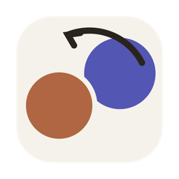
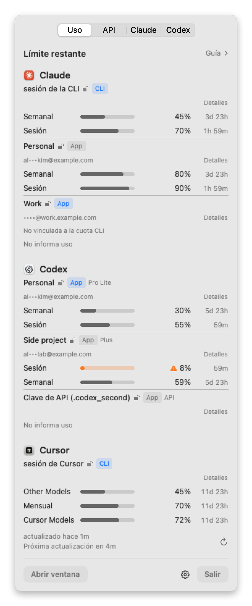
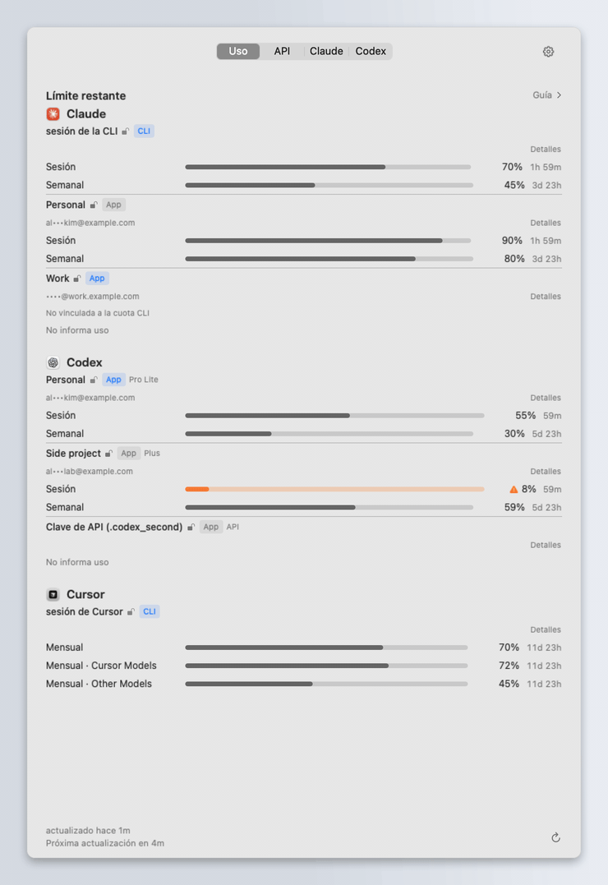
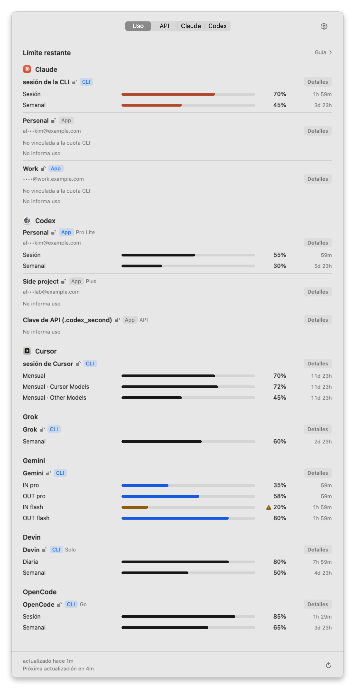
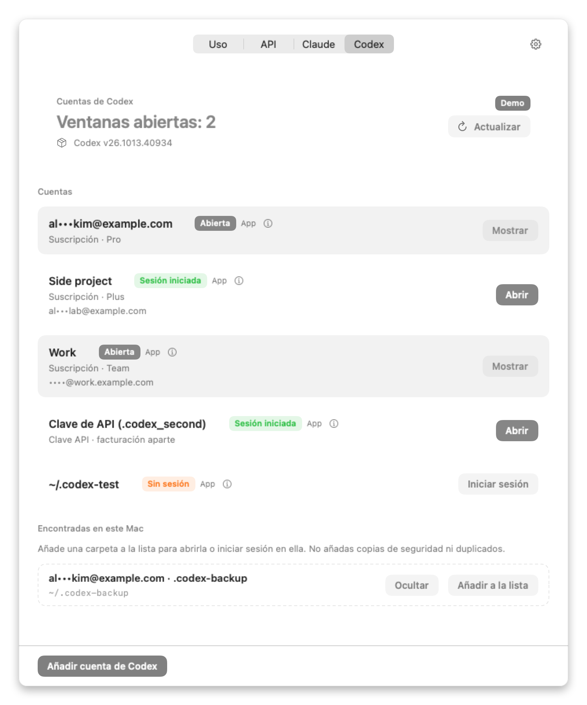
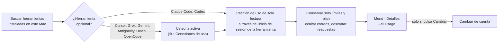

<div align="center">



# UsageSwitch

**Vea cuánto uso de IA le queda. Cambie de cuenta cuando usted decida.**

Una app nativa de macOS para la barra de menús, pensada para quienes trabajan con Claude, Codex, Cursor y otras herramientas de IA — a menudo con más de una cuenta cada una.

[](https://github.com/deximple/usageswitch/releases/latest)


[](https://github.com/deximple/usageswitch/actions/workflows/ci.yml)
[](LICENSE)

[English](README.md) · [한국어](README.ko.md) · [日本語](README.ja.md) · [简体中文](README.zh-Hans.md) · **Español**

<a href="https://github.com/deximple/usageswitch/releases/latest"></a>

<br><br>

<picture>
  <source media="(prefers-color-scheme: dark)" srcset="docs/screenshots/es/menu-dark.png">
  
</picture>

<sub>Todas las capturas y animaciones de este documento usan los datos de demostración integrados en la app. Ninguna cuenta real.</sub>

</div>

---

**Contenido** —
[Qué hace](#qué-hace) ·
[Verlo en acción](#verlo-en-acción) ·
[Instalación](#instalación) ·
[Primeros pasos](#primeros-pasos) ·
[Cómo leer la lista](#cómo-leer-la-lista-de-uso) ·
[Mensajes de estado](#cuando-una-fila-muestra-un-mensaje) ·
[Herramientas compatibles](#herramientas-compatibles) ·
[Guía](#guía) ·
[Cambiar de cuenta](#cambiar-de-cuenta) ·
[Pestaña API](#pestaña-api) ·
[Ajustes](#ajustes) ·
[Privacidad](#privacidad-y-seguridad) ·
[Línea de comandos](#línea-de-comandos) ·
[Preguntas frecuentes](#preguntas-frecuentes) ·
[Limitaciones](#limitaciones) ·
[Desinstalación](#desinstalación) ·
[Compilar](#compilar-desde-el-código-fuente)

## Qué hace

| | |
|---|---|
| 📊 **Todos los límites de un vistazo** | Límites de sesión, diarios, semanales y mensuales de cada cuenta, mostrados como la parte que **queda** y el tiempo hasta el reinicio. |
| 🧭 **Solo lo que de verdad usa** | La lista muestra las herramientas instaladas en este Mac y las cuentas que registró. Una herramienta que no tiene nunca aparece, y nada se lee de ella. |
| 💡 **Una sugerencia, nunca un piloto automático** | La **Guía** opcional sugiere qué cuenta — y qué modelo y esfuerzo — encaja con lo que queda. Nunca cambia, abre ni inicia sesión por sí misma. |
| 🔁 **Cambio con un clic** | Cambie el inicio de sesión de Claude Desktop entre cuentas guardadas (con verificación y reversión automática), y use cuentas de Codex en paralelo en ventanas independientes. |
| 🔒 **Privada por diseño** | Sin analítica, telemetría ni actualizaciones en segundo plano. Los correos se muestran ocultos. Las seis herramientas opcionales están apagadas hasta que las encienda una a una. |

## Verlo en acción

<p align="center">
  
</p>

1. **Vea** — haga clic en el icono de la barra de menús. Cada cuenta muestra cuánto queda de cada límite y cuándo se reinicia.
2. **Obtenga una sugerencia** — abra la **Guía** para ver qué cuenta aún tiene margen para el tipo de trabajo que va a hacer.
3. **Cambie** — en la pestaña **Claude**, haga clic en **Cambiar**. UsageSwitch reinicia Claude Desktop con esa cuenta, lo confirma y revierte si algo falla.

Usted decide cada paso. Que un límite se agote nunca desencadena un cambio, una apertura ni un inicio de sesión.

## Instalación

**Requisitos:** macOS 15 Sequoia o posterior, en Apple silicon o Intel.

1. Descargue `UsageSwitch-<version>.dmg` de la [última versión](https://github.com/deximple/usageswitch/releases/latest).
2. Ábralo y arrastre **UsageSwitch** a **Aplicaciones**.
3. Abra UsageSwitch. Vive en la barra de menús y no tiene icono en el Dock. Al abrirlo desde Finder también aparece su ventana.

Las versiones están firmadas con un Developer ID y notarizadas por Apple, así que macOS solo muestra el aviso habitual de "descargado de Internet" la primera vez.
Cada versión incluye `SHA256SUMS.txt` por si quiere verificar la descarga.
Para actualizar, use **⚙︎ › Buscar actualizaciones…**. Abre la página de versiones; UsageSwitch nunca se actualiza por sí mismo en segundo plano.

## Primeros pasos

### 1. Mire la pestaña Uso

La pestaña **Uso** es lo primero que verá. Las lecturas de Claude Code y Codex empiezan solas porque provienen de los programas de línea de comandos de esas herramientas.
Si una lista está vacía, esa herramienta aún no ha iniciado sesión — vea [Mensajes de estado](#cuando-una-fila-muestra-un-mensaje).

### 2. Active las herramientas que usa (opcional)

Cursor, Grok, Gemini, Antigravity, Devin y OpenCode Go están **apagados por defecto**. Para cada uno que use:

- haga clic en **Conectar uso** en su fila, o abra **⚙︎ › Conexiones de uso**;
- lea el diálogo — indica exactamente qué se lee y a dónde van las peticiones;
- haga clic en **Activar**.

Apagar una conexión deja de leerla y elimina sus números.

### 3. Dé a las cuentas de Claude guardadas sus propios números (opcional)

Los inicios de sesión de Claude Desktop no informan de cuota, así que una cuenta de Claude guardada muestra **No vinculada a la cuota CLI** hasta que la vincule a un perfil de Claude Code con sesión en la misma cuenta:

```bash
# Cree un perfil de Claude Code independiente para su cuenta "Work" e inicie sesión
CLAUDE_CONFIG_DIR="$HOME/.claude-work" claude
```

Luego, en UsageSwitch, abra los **Detalles** de esa cuenta → **Conectar uso mediante un perfil CLI…** → elija la carpeta (pulse <kbd>⌘</kbd><kbd>⇧</kbd><kbd>.</kbd> para ver carpetas ocultas) → **Activar**.
UsageSwitch solo muestra los números cuando el perfil se confirma como la misma cuenta y organización antes y después de cada lectura.

### 4. Guarde cuentas para cambiar entre ellas

- Pestaña **Claude**: con Claude Desktop con sesión iniciada, haga clic en **Guardar sesión actual**. Haga clic en **Iniciar sesión con otra cuenta**, inicie sesión y guarde de nuevo. Repita para cada cuenta.
- Pestaña **Codex**: haga clic en **Añadir cuenta de Codex** e inicie sesión en su navegador. Las carpetas de Codex encontradas en este Mac aparecen en **Encontradas en este Mac**; haga clic en **Añadir a la lista** en las que quiera.

## Cómo leer la lista de uso

Cada cuenta es un pequeño bloque: quién es y luego una línea por límite.

| Lo que ve | Qué significa |
|---|---|
| **Personal** | El nombre visible de la cuenta. Cámbielo en **Detalles** → **Editar nombre**. |
|   | De dónde viene la lectura: un inicio de sesión de línea de comandos o una app de escritorio. **Azul** significa que es el inicio de sesión en uso ahora (la sesión de la CLI actual o la app abierta). |
| Candado abierto, en su color de acento | Inicio verificado. |
| Candado abierto, gris | Inicio guardado. |
| Candado cerrado | Se requiere inicio. Sin candado, UsageSwitch no puede saberlo, así que no afirma nada. |
| `Pro Lite`, `Plus`, `Team`… | El plan que informa el proveedor. |
| `API` · *Clave API · facturación aparte* | Un perfil de clave de API. Se factura por uso y no tiene límite de suscripción, así que nunca cuenta como cuota restante. |
| `al•••kim@example.com` | El correo oculto. Active **⚙︎ › Mostrar siempre los correos** para verlo completo. |
| `Semanal ▬▬▬▭▭ 45%  3d 23h` | Un límite: su nombre, una barra, la parte que **queda** y el tiempo hasta el reinicio. |
| `Cursor Models`, `Gemini Models`… | Un límite que aplica solo a algunos modelos, con el nombre que le da el proveedor. |
| *podría agotarse en 5h* | Al ritmo actual, este límite se vacía antes de reiniciarse. |
| **2 límites más** | El menú compacto muestra hasta tres límites por cuenta. El resto está en **Detalles**. |
| **Detalles** | Abre una ventana con todos los límites, horas de reinicio, el origen de la lectura y la versión de la herramienta. |

**Colores de la barra:** gris hay margen; naranja ha pasado su nivel de aviso (80% usado por defecto); rojo está agotado; una barra difuminada es una lectura antigua esperando actualización.

**Pie:** *actualizado hace 1m · Próxima actualización en 4m*. UsageSwitch se actualiza cada 5 minutos, justo después de que un límite se reinicie y al pulsar ↻.

**Fijar un límite:** haga clic con el botón derecho en un límite y elija **Fijar**. La barra de menús muestra entonces ese límite (por ejemplo *Semanal 25% restante*) en lugar del más ajustado.

<p align="center">
  
</p>

## Cuando una fila muestra un mensaje

Una fila sin números siempre dice por qué. Esto es lo que significa cada mensaje y qué hacer.

| Mensaje | Por qué | Qué hacer |
|---|---|---|
| **Conexión de uso necesaria** | Esta herramienta opcional está apagada. | Haga clic en **Conectar uso**, o use **⚙︎ › Conexiones de uso**. |
| **No se encontró sesión: inicie sesión en *X* primero** | La herramienta está instalada pero sin sesión en este Mac. | Inicie sesión en esa herramienta una vez. |
| **Sesión caducada: ejecute *`command`* una vez en Terminal** | Su inicio de sesión guardado ha caducado. | Ejecute el comando mostrado: `claude`, `codex`, `cursor-agent login`, `grok`, `gemini`, `agy`, `devin` u `opencode`. |
| **No vinculada a la cuota CLI** | Una cuenta de Claude Desktop guardada no tiene perfil de Claude Code vinculado. | [Vincule un perfil](#3-dé-a-las-cuentas-de-claude-guardadas-sus-propios-números-opcional) en **Detalles**. |
| **No informa uso** | Un perfil de clave de API — no tiene límite de suscripción. | Nada que arreglar. Use la [pestaña API](#pestaña-api) para estimaciones de gasto. |
| **Esta cuenta no tiene uso de *X*** | El proveedor dice que el plan de esta cuenta no tiene cuota que mostrar. | Nada que arreglar. |
| **Google ya no ofrece cuota de Gemini CLI para cuentas individuales (ahora en Antigravity)** | Google movió las cuentas individuales a Antigravity. | Active **Antigravity**; su límite *Gemini Models* muestra la misma cuota. |
| **La lectura del uso fue rechazada** | El proveedor rechazó el inicio de sesión. | Vuelva a iniciar sesión en esa herramienta. |
| **El uso llegó de otra cuenta, así que no se muestra** | El inicio de sesión cambió durante una lectura. UsageSwitch nunca muestra números de otra cuenta. | Espere a la próxima actualización. |
| **No se pudo leer el uso — esta versión de *X* puede necesitar una actualización de UsageSwitch** | El formato de respuesta de la herramienta cambió. | Busque un UsageSwitch más nuevo, o [abra un issue](https://github.com/deximple/usageswitch/issues). |
| **Tiempo de espera agotado al leer el uso** · **No se pudo contactar con el servicio** · **Límite de ritmo — inténtalo más tarde** | Un problema temporal de red o de servicio. | Reintenta en la próxima actualización. |
| **No se encontró la herramienta de línea de comandos** | El programa de línea de comandos de la herramienta no está instalado o no está en su `PATH`. | Instálelo, o revise su `PATH`. |
| **Ajustes gestionados — no se puede leer el uso** | Su organización gestiona los ajustes de Claude Code en este Mac. | Es de esperar. UsageSwitch no lee el uso ahí. |
| **Reinicio pasado — se necesita actualizar** | El límite se ha reiniciado desde la última lectura. | Pulse ↻ o espere un momento. |

## Herramientas compatibles

| Herramienta | Lo que ve | De dónde vienen los números | Cómo activarla |
|---|---|---|---|
| **Claude Code** | Límites de sesión (5 h), semanales y semanales por modelo | El `/usage` del CLI `claude` | Automático |
| **Cuentas de Claude Desktop guardadas** | Igual que Claude Code | Un perfil de Claude Code que usted vincula (`claude auth status`, luego `/usage`) | Por cuenta, en **Detalles** |
| **Codex** | Límites de sesión y semanales, por cuenta de ChatGPT | `codex app-server` | Automático |
| **Cursor** | Total Mensual, más *Cursor Models* y *Other Models* | La API de uso de Cursor, con el inicio de sesión de `cursor-agent` | ⚙︎ › Conexiones de uso |
| **Grok** | Límite semanal | El endpoint de uso del CLI de Grok | ⚙︎ › Conexiones de uso |
| **Gemini** | Límites de entrada y salida por modelo | La cuota de Gemini Code Assist, con el inicio de sesión del CLI de Gemini | ⚙︎ › Conexiones de uso |
| **Antigravity** | Límites por grupo de modelos (por ejemplo *Gemini Models*) | La pantalla `/usage` de `agy`, con una API de cuota de solo lectura como respaldo | ⚙︎ › Conexiones de uso |
| **Devin** | La cuota que informa el CLI de Devin | El estado de usuario del CLI de Devin | ⚙︎ › Conexiones de uso |
| **OpenCode Go** | Límites rodantes de 5 horas, semanales y mensuales | El endpoint de uso de OpenCode Go | ⚙︎ › Conexiones de uso |

Una herramienta aparece cuando su programa de línea de comandos está en su `PATH` (o en las carpetas habituales de npm, bun y Volta), o su app está en `/Applications` o `~/Applications`. Encontrar una herramienta nunca la ejecuta.

<details>
<summary><b>Exactamente qué lee y envía cada conexión opcional</b></summary>

<br>

Cada conexión opcional lee el inicio de sesión local propio de la herramienta, lo conserva solo en memoria y envía peticiones HTTPS de solo lectura a un único host fijo. Las redirecciones se rechazan y las respuestas se limitan a 1 MiB. Nada se registra ni se guarda.

| Herramienta | Inicio de sesión local que lee | Host que contacta | Notas |
|---|---|---|---|
| Cursor | La entrada de Cursor en el llavero, luego `~/.cursor/auth.json` | `api2.cursor.sh` | Una petición por actualización. Un token caducado no envía petición. Un `cursor-agent login` de navegador dura unos 60 días; un inicio de sesión con clave de API, una hora. Grok Bot y el gasto bajo demanda no se leen. |
| Grok | El archivo de inicio de sesión del CLI de Grok | `cli-chat-proxy.grok.com` | Experimental. |
| Gemini | El ítem del llavero del CLI de Gemini, luego `~/.gemini/oauth_creds.json` | `cloudcode-pa.googleapis.com`, `oauth2.googleapis.com` | Si el token de acceso caducó, UsageSwitch usa el token de actualización guardado con el propio cliente de inicio de sesión del CLI de Gemini instalado para obtener un token temporal solo en memoria. Nunca escribe nada. Hasta tres peticiones por actualización. |
| Antigravity | El propio `agy`, ejecutado en un terminal oculto desde su carpeta personal (como máximo cada 9 minutos); respaldo: el ítem de agy en el llavero | `oauth2.googleapis.com`, `cloudcode-pa.googleapis.com` | `agy` arranca con sus ajustes normales, incluidos los servidores MCP que configure. UsageSwitch nunca responde a los avisos de agy. macOS puede pedir una vez permiso de acceso al llavero. |
| Devin | Las credenciales y la versión del CLI de Devin | `server.codeium.com` | Requiere una versión compatible del CLI de Devin. |
| OpenCode Go | La entrada `opencode-go` en el `auth.json` de OpenCode | `opencode.ai` | Solo el plan Go, no otro uso de OpenCode. |

Son endpoints privados, no APIs públicas estables. Una actualización del proveedor puede romper una lectura hasta que se actualice UsageSwitch — la fila entonces lo dice en lugar de mostrar números incorrectos.
La lista completa de archivos leídos y escritos está en [PRIVACY.md](PRIVACY.md) (en inglés).

</details>

## Guía

Haga clic en **Guía** encima de la lista para abrirla. Un pequeño punto junto a ella significa que hay una sugerencia lista (apague el punto con **⚙︎ › Mostrar el indicador de Guía**).

- **Modo** — limita qué modelo y qué esfuerzo puede elegir una sugerencia:

  | Modo | Sugiere como máximo |
  |---|---|
  | *Ahorro* | modelos de gama media, esfuerzo medio |
  | *Equilibrado* | modelos de frontera a esfuerzo medio, o de gama media a esfuerzo alto |
  | *Enfoque* | modelos de frontera, esfuerzo alto |
  | *Urgente* | modelos de frontera, esfuerzo Máximo — pregunta antes, y vuelve a *Equilibrado* en el próximo reinicio de 5 horas de Claude (o tras cinco horas) |

- **Tarea** — deslice de *Programación sencilla* a *Máximo razonamiento* para decir qué va a hacer.
- **Sugerencia** — una línea que nombra la cuenta, el modelo y el esfuerzo que encajan con lo que queda ahora. Cuando ninguna sugerencia de modelo encaja, la Guía muestra la cuenta con más margen entre las cuentas de suscripción comparables. Los perfiles de clave de API nunca se sugieren.

La Guía solo sugiere. Para actuar, cambia usted mismo.

<details>
<summary><b>Qué lee y guarda la Guía</b></summary>

<br>

- **Lee:** sus lecturas de uso, más los campos de modelo, esfuerzo, marca de tiempo y recuento de tokens de los registros de sesión locales de Claude Code y Codex. El contenido de las conversaciones nunca se lee.
- **Datos de modelos:** un catálogo fijo de modelos que viene dentro de la app. Nada se descarga en ejecución.
- **Guarda:** pequeños archivos locales de aprendizaje indexados por hashes de cuenta con sal — sin nombres, correos ni contenido. Los archivos en crudo se archivan a los 14 días y se eliminan a los 180.
- **Borrar:** **⚙︎ › Borrar datos de aprendizaje** los elimina ahora. Sus ajustes de modo y tarea se conservan.

</details>

## Cambiar de cuenta

### Claude Desktop (pestaña Claude)

Guarde el inicio de sesión de Claude Desktop de cada cuenta una vez y luego haga clic en **Cambiar** en cualquiera de ellas. Un cambio:

1. pregunta primero si hay sesiones de Claude Code en marcha (su historial se conserva);
2. pausa todo lo que relanzaría Claude durante el cambio, y luego cierra Claude con normalidad — nunca un cierre forzado;
3. intercambia el inicio de sesión local, arranca Claude y confirma la cuenta desde su registro;
4. revierte a la cuenta anterior si algún paso falla.

Su primer cambio crea una copia de seguridad única del inicio de sesión original. Nada se cierra sesión en el servidor.
**Iniciar sesión con otra cuenta** borra el inicio de sesión solo en este Mac, y solo después de guardar el actual.

### Codex (pestaña Codex)

En **Cuentas de Codex**, cada cuenta tiene su propia carpeta de Codex y se abre en su propia ventana, así que varias cuentas pueden funcionar en paralelo.
El inicio de sesión siempre pasa por el propio `codex login` de Codex en su navegador, y los archivos de sesión nunca se copian entre carpetas.
**Eliminar** cierra la sesión de esa cuenta en este Mac y mueve su carpeta a la Papelera. **Quitar de la lista** solo oculta una carpeta encontrada en este Mac. El `~/.codex` estándar no se puede eliminar.

<p align="center">
  
</p>

## Pestaña API

Para cuentas que usan una clave de API en lugar de una suscripción:

- **Presupuestos** — establezca un saldo prepagado o una cuota mensual (con su día de reinicio) para Anthropic, OpenAI, Google o xAI.
- **Estimaciones** — gasto de los últimos 7 días, la tasa diaria media y aproximadamente cuántos días dura su presupuesto. Se estiman solo a partir de los registros CLI locales de cuentas con clave de API, nunca del proveedor.
- **Almacén de claves API** — guarde claves en el llavero de macOS, protegidas por Touch ID o su contraseña. *Estándar* pide al cambiar una clave; *Fuerte* pide cada vez que se lee una clave. Las claves nunca se envían a ningún sitio.

## Ajustes

Todo está en el menú **⚙︎**.

| Ajuste | Qué hace |
|---|---|
| Idioma | English, 한국어, 日本語, 简体中文 o Español. Sigue al sistema por defecto. |
| Apariencia | Seguir el sistema, Claro u Oscuro. |
| Abrir al iniciar sesión | Arranca UsageSwitch al iniciar sesión. |
| Mostrar el nombre de la cuenta en la barra de menús | Muestra el nombre de la cuenta de Claude actual junto al icono (los correos siguen ocultos). |
| Mostrar siempre los correos | Muestra los correos completos en lugar de ocultos. |
| Mostrar uso en la barra de menús | Muestra el límite más ajustado (o fijado) junto al icono, por ejemplo *Semanal 25% restante*. Activado por defecto. |
| Alertas de uso · Avisar al porcentaje usado | Envía una notificación de macOS cuando un límite supera el 70%, 80% (por defecto) o 90% usado. |
| Mostrar el indicador de Guía | El punto junto a **Guía** cuando hay una sugerencia lista. |
| Conexiones de uso | Enciende o apaga cada herramienta opcional. Solo lista herramientas encontradas en este Mac. |
| Borrar datos de aprendizaje | Elimina los archivos locales de aprendizaje de la Guía. |
| Mostrar la carpeta de datos en el Finder | Abre `~/Library/Application Support/com.jaysong.usageswitch/`. |
| Buscar actualizaciones… | Abre la página de versiones en su navegador. |

## Privacidad y seguridad



**UsageSwitch nunca:**

- cambia de cuenta, abre apps ni inicia sesión porque un límite esté bajo;
- envía peticiones a modelos ni ejecuta tareas — leer el uso no cuesta nada;
- cierra sesión en el servidor ni descifra las cookies de Claude;
- guarda ni registra los tokens que lee para el uso, ni los envía a ningún sitio que no sea el host de esa herramienta;
- envía analítica, telemetría ni informes de fallos, ni se actualiza en segundo plano.

**Qué almacena** — todo en `~/Library/Application Support/com.jaysong.usageswitch/`, legible solo por usted:
inicios de sesión de Claude Desktop guardados (aún cifrados exactamente como los guarda Claude), carpetas de Codex que añadió, ajustes, la última lectura de uso con correos ocultos y los archivos de aprendizaje de la Guía.

La lista completa de cada archivo leído, escrito y cada host contactado está en **[PRIVACY.md](PRIVACY.md)** (en inglés). Para informar de un problema de seguridad en privado, vea [SECURITY.md](SECURITY.md).

## Línea de comandos

El binario de la app también funciona como herramienta de línea de comandos con salida JSON.

```bash
APP=/Applications/UsageSwitch.app/Contents/MacOS/UsageSwitch

"$APP" --cli usage            # la última lectura de uso (JSON)
"$APP" --cli status           # cuentas de Claude guardadas y el estado de Claude
"$APP" --cli codex status     # cuentas de Codex
"$APP" --cli switch Work      # cambia Claude Desktop a la cuenta llamada "Work"
"$APP" --cli                  # lista todos los comandos
```

`--cli usage` imprime lo que la app leyó y guardó por última vez. No contacta con ninguna herramienta ni con la red, así que abra UsageSwitch una vez primero. Los correos siempre van ocultos.

<details>
<summary><b>Ejemplo de salida y un resumen de una línea con <code>jq</code></b></summary>

<br>

```json
{
  "ok" : true,
  "result" : {
    "accounts" : [
      {
        "accountRef" : "codex#1",
        "authentication" : "subscription",
        "id" : "codex#1",
        "label" : "al•••kim@example.com",
        "plan" : "prolite",
        "provider" : "codex",
        "readAt" : "2026-11-09T05:10:00Z",
        "state" : "ok",
        "toolVersion" : "0.166.0",
        "windows" : [
          {
            "durationMinutes" : 10080,
            "kind" : "weekly",
            "leftPercent" : 69,
            "resetsAt" : "2026-11-13T14:00:00Z",
            "usedPercent" : 31
          }
        ]
      },
      {
        "accountRef" : "current",
        "authentication" : "unknown",
        "id" : "gemini:current",
        "label" : "Gemini",
        "problem" : "notEligible",
        "provider" : "gemini",
        "readAt" : "2026-11-09T05:10:00Z",
        "state" : "unavailable",
        "windows" : []
      }
    ],
    "generatedAt" : "2026-11-09T05:10:00Z"
  }
}
```

`state` es `ok`, `notReporting`, `unavailable` o `failed`; `problem` indica la razón. Los IDs de cuenta son opacos y cambian de orden con la lista.

```bash
"$APP" --cli usage | jq -r '.result.accounts[]
  | "\(.provider)\t\(.label)\t\([.windows[] | "\(.scope // .kind) \(.leftPercent | floor)% left"] | join(", "))"'
```

Los comandos que cambian algo (`switch`, `capture`, `enroll`, `remove`, `codex add`, …) imprimen el progreso en stderr y devuelven códigos de salida distintos de cero en caso de fallo. `switch` pide `--yes` cuando hay sesiones de Claude Code en marcha.
Un enlace `usageswitch://switch?id=<account-id>` inicia el mismo cambio que el botón, tras confirmarlo en la app.

</details>

## Preguntas frecuentes

<details>
<summary><b>¿Cambiará de cuenta por mí cuando me quede poco?</b></summary>

No. Las lecturas y sugerencias son solo para mostrar. Solo su clic (o un comando que ejecute) cambia, abre o inicia sesión.

</details>

<details>
<summary><b>¿Leer el uso cuesta algo o gasta mi cuota?</b></summary>

No. UsageSwitch no envía peticiones a modelos. Pide a cada herramienta su uso mediante comandos y endpoints de solo lectura.

</details>

<details>
<summary><b>Una herramienta que uso no está en la lista.</b></summary>

UsageSwitch solo lista una herramienta cuando encuentra su programa de línea de comandos en su `PATH` (o en las carpetas habituales de npm, bun y Volta), o su app en `/Applications` o `~/Applications`. Cursor, Grok, Gemini, Antigravity, Devin y OpenCode además necesitan **⚙︎ › Conexiones de uso**.

</details>

<details>
<summary><b>¿Por qué una cuenta de Claude guardada dice "No vinculada a la cuota CLI"?</b></summary>

Los inicios de sesión de Claude Desktop no exponen el uso. Vincule un perfil de Claude Code con sesión en la misma cuenta — vea el [paso 3](#3-dé-a-las-cuentas-de-claude-guardadas-sus-propios-números-opcional). UsageSwitch nunca deduce el vínculo a partir de una dirección de correo.

</details>

<details>
<summary><b>Cursor sigue diciendo que la sesión caducó.</b></summary>

UsageSwitch usa el inicio de sesión que `cursor-agent` guarda y nunca lo renueva por sí mismo. Un `cursor-agent login` de navegador dura unos 60 días; un inicio de sesión con clave de API, una hora. Ejecute `cursor-agent login` y elija el inicio de sesión del navegador.

</details>

<details>
<summary><b>Gemini muestra un mensaje en lugar de números.</b></summary>

Google ya no ofrece cuota de Gemini CLI para cuentas individuales y las movió a Antigravity. Active **Antigravity**: su límite *Gemini Models* es la misma cuota.

</details>

<details>
<summary><b>¿Es seguro usarla mientras comparto pantalla?</b></summary>

Los correos están ocultos en todas partes por defecto, incluida la barra de menús. El archivo de uso guardado y la salida de `--cli usage` siempre van ocultos, aunque elija **Mostrar siempre los correos**.

</details>

<details>
<summary><b>¿UsageSwitch es de Anthropic, OpenAI u otro proveedor?</b></summary>

No. Es un proyecto independiente de código abierto y no está afiliado ni avalado por ninguno de ellos.

</details>

## Limitaciones

- El cambio de Claude Desktop depende de los archivos internos de Claude. Si una actualización de Claude los cambia, el cambio falla de forma segura y revierte hasta que se actualice UsageSwitch.
- Un inicio de sesión de Claude guardado puede caducar o ser revocado. Su fila le pedirá **Caducada**.
- Las carpetas de Codex que guardan su sesión en el llavero (`cli_auth_credentials_store = "keyring"`) pueden aparecer como sin sesión.
- Las conexiones opcionales usan endpoints privados que pueden cambiar sin aviso.
- UsageSwitch muestra los límites que informa cada proveedor. No muestra saldos ni facturas del proveedor; la pestaña API muestra solo estimaciones locales.

## Desinstalación

1. Opcional: para cerrar sesión de las cuentas de Codex que añadió, elimínelas primero en la pestaña **Codex**.
2. Apague **⚙︎ › Abrir al iniciar sesión**, salga de UsageSwitch y muévalo a la Papelera.
3. Opcional: elimine `~/Library/Application Support/com.jaysong.usageswitch/`. Contiene sus inicios de sesión guardados, ajustes y las carpetas de Codex añadidas en UsageSwitch, así que conserve lo que aún necesite.

## Compilar desde el código fuente

Requiere Xcode 26 o posterior (el SDK de macOS 26) en macOS 15 o posterior.

```bash
swift build                    # compilación de depuración
./scripts/test.sh              # tests y un informe de cobertura
python3 scripts/check-l10n.py  # comprueba que los cinco idiomas tienen cada cadena
./scripts/bundle.sh            # build/UsageSwitch.app universal (Developer ID si está disponible, ad-hoc si no)
```

Para probar la interfaz sin ninguna cuenta, ejecute el paquete con datos de demostración — nunca toca sus datos reales:

```bash
build/UsageSwitch.app/Contents/MacOS/UsageSwitch --ui-fixture usage-seven
```

`./scripts/readme-screenshots.sh` regenera todas las imágenes de este README, en los cinco idiomas, a partir de los mismos datos de demostración.

Las versiones se notarizan con `scripts/notarize.sh`, que necesita un perfil de llavero `NOTARY_PROFILE` existente. Una versión no puede usar el respaldo ad-hoc.
Los issues y pull requests son bienvenidos. Los cambios están en [CHANGELOG.md](CHANGELOG.md), y las notas de diseño en [DESIGN.md](DESIGN.md).

## Agradecimientos

Proyecto independiente de código abierto — no afiliado ni avalado por Anthropic, OpenAI, Anysphere (Cursor), xAI, Google, Cognition o Sourcegraph. Los nombres de productos pertenecen a sus propietarios.
Proyectos comunitarios relacionados: [CodexBar](https://github.com/steipete/CodexBar), [claudepot-app](https://github.com/xiaolai/claudepot-app), [claude-desktop-accounts](https://github.com/5eanxlee/claude-desktop-accounts), [Swivel](https://github.com/jspanji/Swivel), [claude-graft](https://github.com/aaditya-v-more/claude-graft).

## Licencia

[MIT](LICENSE) © 2026 Jay Song
