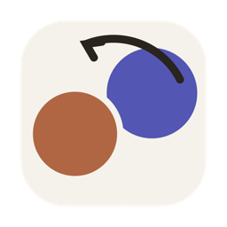
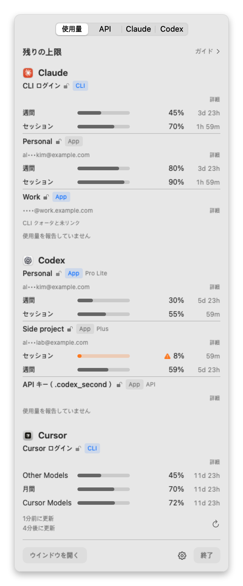
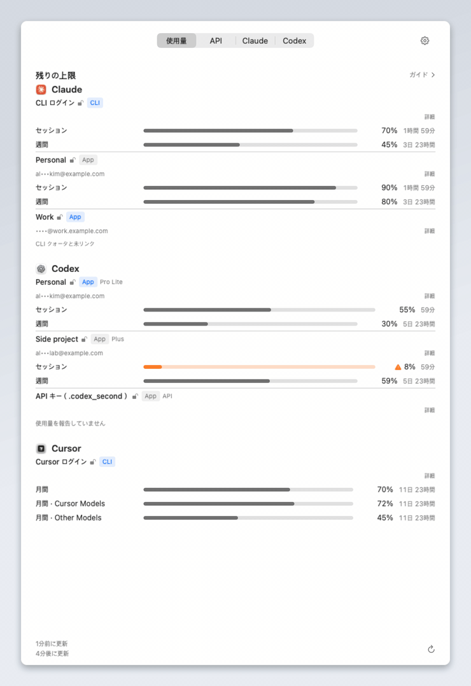
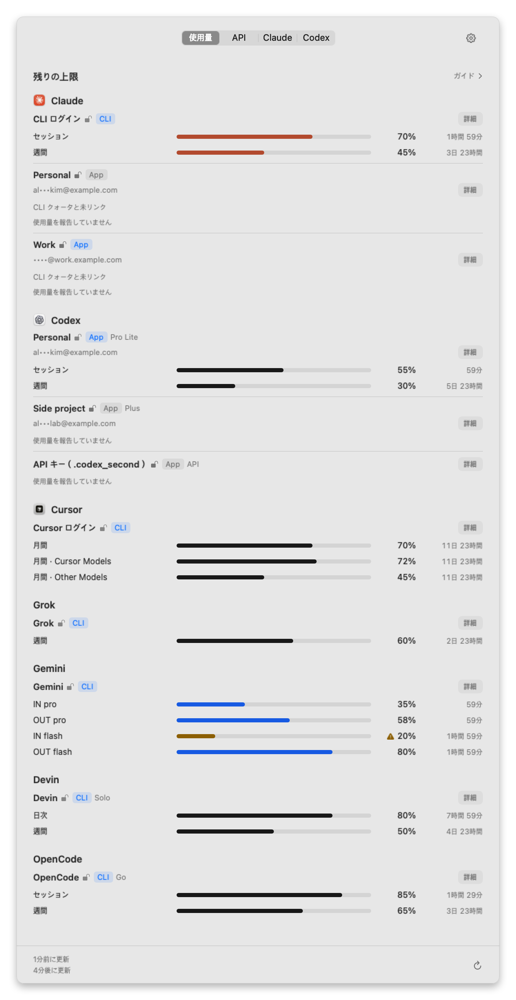
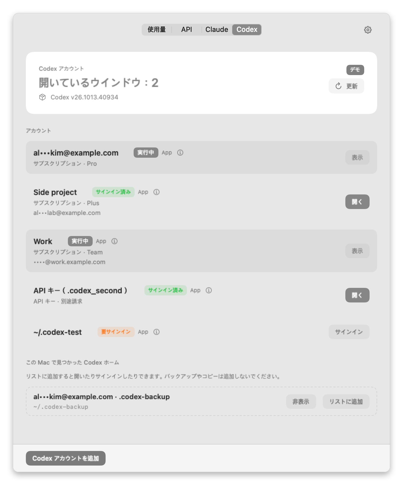
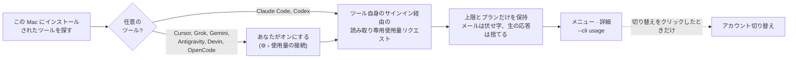

<div align="center">



# UsageSwitch

**AI の残りの使用量が一目でわかる。アカウントの切り替えはあなたの判断で。**

Claude、Codex、Cursor などの AI コーディングツールを — しばしば複数のアカウントで — 使う人のための、ネイティブ macOS メニューバーアプリです。

[](https://github.com/deximple/usageswitch/releases/latest)


[](https://github.com/deximple/usageswitch/actions/workflows/ci.yml)
[](LICENSE)

[English](README.md) · [한국어](README.ko.md) · **日本語** · [简体中文](README.zh-Hans.md) · [Español](README.es.md)

<a href="https://github.com/deximple/usageswitch/releases/latest"></a>

<br><br>

<picture>
  <source media="(prefers-color-scheme: dark)" srcset="docs/screenshots/ja/menu-dark.png">
  
</picture>

<sub>ここに掲載しているスクリーンショットとアニメーションはすべて、アプリ内蔵のデモデータを使っています。実際のアカウントは使っていません。</sub>

</div>

---

**目次** —
[機能](#機能) ·
[動作を見る](#動作を見る) ·
[インストール](#インストール) ·
[使い始める](#使い始める) ·
[リストの読み方](#使用量リストの読み方) ·
[ステータスメッセージ](#行にメッセージが表示されるとき) ·
[対応ツール](#対応ツール) ·
[ガイド](#ガイド) ·
[アカウントの切り替え](#アカウントの切り替え) ·
[API タブ](#api-タブ) ·
[設定](#設定) ·
[プライバシー](#プライバシーと安全性) ·
[コマンドライン](#コマンドライン) ·
[FAQ](#faq) ·
[制限事項](#制限事項) ·
[アンインストール](#アンインストール) ·
[ビルド](#ソースからビルド)

## 機能

| | |
|---|---|
| 📊 **すべての上限を一目で** | セッション（5 時間）、週間、月間の上限をアカウントごとに、残りの**割合**とリセットまでの時間で表示します。 |
| 🧭 **実際に使っているものだけ** | リストにはこの Mac にインストールされているツールと登録済みアカウントだけが表示されます。持っていないツールは表示されず、何も読み取られません。Claude と Codex のローカル使用ログはガイドと API タブのために常に読み取られます — オフにはできません。 |
| 💡 **ヒントだけ、自動操縦はなし** | **ガイド**は、常に読み取られるローカルログをもとに、残りの量に合うアカウント・モデル・作業量を提案します。勝手に切り替えたり、起動したり、サインインしたりはしません。 |
| 🔁 **ワンクリックで切り替え** | Claude Desktop のサインインを保存済みアカウント間で切り替えます（検証と自動ロールバック付き）。Codex アカウントは別ウィンドウで並行して使えます。 |
| 🔒 **プライバシー第一の設計** | 分析・テレメトリ・バックグラウンドアップデートはありません。メールアドレスは伏せ字表示。6 つの任意ツールは、それぞれオンにするまでオフのままです。 |

## 動作を見る

<p align="center">
  
</p>

1. **見る** — メニューバーのアイコンをクリック。各アカウントに、すべての上限の残りとリセット時刻が表示されます。
2. **ヒントを得る** — **ガイド**を開くと、これからやる作業に余裕のあるアカウントがわかります。
3. **切り替える** — **Claude** タブで**切り替え**をクリック。UsageSwitch がそのアカウントで Claude Desktop を再起動し、確認して、失敗時にはロールバックします。

すべての判断はあなたが行います。上限が少なくなっても、切り替え・起動・サインインが自動で起きることはありません。

## インストール

**必要環境：** macOS 15 Sequoia 以降、Apple silicon または Intel。

1. [最新リリース](https://github.com/deximple/usageswitch/releases/latest)から `UsageSwitch-<version>.dmg` をダウンロード。
2. 開いて **UsageSwitch** を **アプリケーション** にドラッグ。
3. UsageSwitch を開く。メニューバーに常駐し、Dock アイコンはありません。Finder から開くとウィンドウも表示されます。

リリースは Developer ID で署名され Apple が公証しているため、macOS は初回だけ通常の「インターネットからダウンロード」警告を表示します。
各リリースには `SHA256SUMS.txt` が付いているので、ダウンロードを検証できます。
アップデートは **⚙︎ › アップデートを確認…** で。リリースページが開くだけで、UsageSwitch がバックグラウンドで自動更新することはありません。

## 使い始める

### 1. 使用量タブを見る

最初に表示されるのは**使用量**タブです。Claude Code と Codex の読み取りは、それぞれのツールのコマンドラインプログラムから取るため、自動で始まります。
リストが空なら、そのツールにまだサインインしていません — [ステータスメッセージ](#行にメッセージが表示されるとき)を参照してください。

### 2. 使うツールをオンにする（任意）

Cursor、Grok、Gemini、Antigravity、Devin、OpenCode Go は**デフォルトでオフ**です。使うものごとに：

- その行の**使用状況に接続**をクリック、または **⚙︎ › 使用量の接続** を開きます、
- ダイアログを読みます — 何を読み取り、どこへリクエストを送るかが正確に書かれています。
- **有効にする**をクリック。

**⚙︎ › 使用量の接続** で接続をオフにすると読み取りが止まり、そのツールの行も一覧から消えます。オンに戻すと再び表示されます。使わないツールは行の**非表示**でも同じように外せます。

### 3. 保存済み Claude アカウントに自分の数字を持たせる（任意）

Claude Desktop のサインインはクォータを報告しないため、保存済み Claude アカウントは、同じアカウントでサインインした Claude Code プロファイルをリンクするまで **CLI クォータと未リンク** と表示されます：

```bash
# 「Work」アカウント用の独立した Claude Code プロファイルを作ってサインインする
CLAUDE_CONFIG_DIR="$HOME/.claude-work" claude
```

次に UsageSwitch で、そのアカウントの**詳細** → **CLI プロファイルで使用量を接続…** → フォルダを選択（隠しフォルダは <kbd>⌘</kbd><kbd>⇧</kbd><kbd>.</kbd>）→ **有効にする**。
UsageSwitch は、プロファイルのアカウント・組織 ID と CLI が報告する組織・設定フォルダ・メールアドレスが保存済みアカウントと一致することを毎回の読み取りの前後で確認した場合にだけ数字を表示します。

### 4. 切り替え用にアカウントを保存する

- **Claude** タブ：Claude Desktop がサインインしている間に**現在のサインインを保存**。**別のアカウントでサインイン**をクリックしてサインインし、また保存します。アカウントごとに繰り返します。
- **Codex** タブ：**Codex アカウントを追加**をクリックしてブラウザでサインイン。この Mac で見つかった既存の Codex フォルダは **この Mac で見つかった Codex ホーム** 以下に表示されます。使いたいものは **リストに追加** をクリック。

## 使用量リストの読み方

各アカウントは小さなブロックです：誰のアカウントか、続いて上限ごとの行。

| 表示 | 意味 |
|---|---|
| **Personal** | アカウントの表示名。**詳細** → **名前を編集** で変更できます。 |
|   | 読み取りの出どころ：コマンドラインのサインインか、デスクトップアプリか。**青**は現在使用中のサインイン（現在の CLI ログイン、または開いているアプリ）です。 |
| 開いた鍵、アクセントカラー | 確認済みサインイン。 |
| 開いた鍵、グレー | 保存済みサインイン。 |
| 閉じた鍵 | サインインが必要。鍵がない場合は UsageSwitch が判断できないので、何も主張しません。 |
| `Pro Lite`, `Plus`, `Team`… | プロバイダが報告するプラン。 |
| `API` · *API キー · 別途請求* | API キープロファイル。従量課金でサブスクリプションの上限がないため、残りクォータとしては数えません。 |
| `al•••kim@example.com` | 伏せ字のメールアドレス。**⚙︎ › メールアドレスを常に表示** で全文を表示できます。 |
| `週間 ▬▬▬▭▭ 45%  3日 23時間` | 上限：名前、バー、残りの**割合**、リセットまでの時間。 |
| `Cursor Models`, `Gemini Models`… | 一部のモデルにだけ適用される上限。プロバイダの呼び名で表示します。 |
| *このペースなら5時間で枯渇* | 現在のペースだと、リセット前にこの上限が尽きます。 |
| **さらに 2 件の上限** | コンパクトなメニューではアカウントごとに最大 3 件の上限を表示します。残りは**詳細**で。 |
| **詳細** | すべての上限、リセット時刻、読み取り元、ツールのバージョンを表示するウィンドウを開きます。 |

**バーの色：** グレーは余裕あり。オレンジは警告レベル（デフォルト 80% 使用）超過。赤は使い切り。薄いバーは更新待ちの古い読み取り、または現在読み取れない保存済み Claude アカウント・Codex サインインの最後の成功値(確認時刻付き)です。リセットが過ぎたウィンドウは数字を表示しません。

**フッター：** *1分前に更新 · 4分後に更新*。UsageSwitch は 5 分ごと、上限のリセット直後、そして ↻ をクリックしたときに更新します。

**上限をピン留め：** 上限を右クリックして**ピン留め**を選択。メニューバーには、最も厳しい上限ではなく、その上限（例：*週間 残り 25%*）が表示されます。

<p align="center">
  
</p>

## 行にメッセージが表示されるとき

数字のない行には必ず理由が書かれています。各メッセージの意味と対処法です。

| メッセージ | 理由 | 対処 |
|---|---|---|
| **使用量の接続が必要です** | この任意ツールはまだオンにしていません。 | **使用状況に接続**をクリック、または **⚙︎ › 使用量の接続** へ。使わない場合は**非表示**をクリック。 |
| **サインインが見つかりません · 先に *X* にサインインしてください** | ツールはインストールされていますが、この Mac でサインインしていません。 | そのツールに一度サインイン。 |
| **このアカウントの CLI プロファイルはサインインしていません — 「詳細」で手順を確認** | 保存した Claude アカウントに連結した CLI プロファイルがサインアウトしているため、最後の読み取りが薄く残っています。 | **詳細**でコマンドをコピーしてターミナルで実行し、同じアカウントでサインインします。 |
| **サインインの期限切れ · ターミナルで *`command`* を一度実行してください** | 保存されたサインインが期限切れです。 | 表示されたコマンドを実行：`claude auth login`, `codex login`, `cursor-agent login`, `grok login`, `gemini`, `agy`, `devin auth login`, `opencode auth login`。 |
| **サインインが拒否されました · ターミナルで *`command`* を一度実行してください** | プロバイダが保存されたサインインを拒否しました — 取り消されたか、別のアプリのサインインに置き換えられたか、このツールが対応しないアカウントです。 | 表示されたコマンドを実行し、表示したいアカウントでサインインしてください。 |
| **CLI クォータと未リンク** | 保存済み Claude Desktop アカウントにリンクされた Claude Code プロファイルがありません。 | **詳細**で[プロファイルをリンク](#3-保存済み-claude-アカウントに自分の数字を持たせる任意)します。 |
| **使用量を報告していません** | ツールが使用量の数字なしに応答しました: API キープロファイル（サブスクリプション上限なし）、サインアウトした Codex ホーム、サブスクリプション上限のないアカウントです。 | 対処不要。使用料の見積もりは [API タブ](#api-タブ)を使います（Codex API キーアカウントのみ）。 |
| **このアカウントは *X* の使用量の対象外です** | プロバイダがこのアカウントのプランに表示できるクォータがないと言っています。 | 対処不要。 |
| **Google は個人アカウント向けの Gemini CLI クォータを終了しました（Antigravity に移行）** | Google が個人アカウントを Antigravity に移しました。 | **Antigravity** をオンに。その *Gemini Models* 上限が同じクォータを表示します。 |
| **使用量の読み取りが拒否されました** | ツールのコマンドラインプログラムが使用量を返さずに終了しました。 | 次の更新で再試行します。続く場合はターミナルでツールを一度実行し、サインインと動作を確認してください。 |
| **別のアカウントの使用量が返されたため表示しません** | 読み取り中にサインインが変わりました。UsageSwitch は別アカウントの数字を表示しません。 | 次の更新を待ちます。 |
| **使用量を読み取れません — この *X* バージョンには UsageSwitch の更新が必要かもしれません** | ツールの応答形式が変わりました。 | 新しい UsageSwitch を確認、または[イシューを開く](https://github.com/deximple/usageswitch/issues)。 |
| **使用量の読み取りがタイムアウトしました** · **サービスに接続できません** · **レート制限中 — 後でもう一度お試しください** | 一時的なネットワークまたはサービスの問題。 | 次の更新で再試行します。 |
| **コマンドラインツールが見つかりません** | ツールのコマンドラインプログラムがインストールされていないか `PATH` にありません。 | インストールするか、`PATH` を確認。 |
| **管理設定があるため使用量を読み取れません** | この Mac の Claude Code 設定が組織によって管理されています。 | 想定内。UsageSwitch はそこでは使用量を読み取りません。 |
| **リセット済み — 更新が必要** | 前回の読み取り以降に上限がリセットされました。 | ↻ をクリックするか少し待ちます。 |

## 対応ツール

| ツール | 見えるもの | 数字の出どころ | 有効化 |
|---|---|---|---|
| **Claude Code** | セッション（5 時間）、週間、モデル別週間の上限 | `claude` CLI の `/usage` | 自動 |
| **保存済み Claude Desktop アカウント** | Claude Code と同じ | リンクした Claude Code プロファイル（`claude auth status`、続いて `/usage`） | アカウントごとに**詳細**で |
| **Codex** | セッションと週間の上限、ChatGPT アカウント別 | `codex app-server` | 自動 |
| **Cursor** | 月次合計に加え *Cursor Models* と *Other Models* | Cursor の使用量 API、`cursor-agent` のサインインを使用 | ⚙︎ › 使用量の接続 |
| **Grok** | 週間の上限 | Grok CLI の使用量エンドポイント | ⚙︎ › 使用量の接続 |
| **Gemini** | モデル別の入出力上限 | Gemini Code Assist クォータ、Gemini CLI のサインインを使用 | ⚙︎ › 使用量の接続 |
| **Antigravity** | モデルグループの上限（例：*Gemini Models*） | `agy` の `/usage` 画面と、更新のたびに呼び出す読み取り専用クォータ API（画面を読み取れない場合はこの値を表示） | ⚙︎ › 使用量の接続 |
| **Devin** | Devin CLI が報告するクォータ | Devin CLI のユーザーステータス | ⚙︎ › 使用量の接続 |
| **OpenCode Go** | ローリング 5 時間・週間・月間の上限 | OpenCode の Go 使用量エンドポイント | ⚙︎ › 使用量の接続 |

ツールは、そのコマンドラインプログラムが `PATH` 上（または `~/.local/bin`、一般的な npm・bun・Volta のフォルダ、`/opt/homebrew/bin`、`/usr/local/bin` 内）にあるか、そのアプリが `/Applications` または `~/Applications` にある場合に表示されます。ツールを見つけても実行されることはありません。

<details>
<summary><b>各任意接続が実際に読み取り・送信するもの</b></summary>

<br>

どの任意接続も、ツール自身のローカルサインインを読み取り、メモリ内にだけ保持し、固定の許可リスト — ツールごとに 1 ホスト（Gemini と Antigravity はクォータ取得先に加えトークン更新の `oauth2.googleapis.com` の 2 つ）— へ読み取り専用の HTTPS リクエストを送ります。リダイレクトは拒否し、応答は 1 MiB に制限されます。ログや保存は一切ありません。

| ツール | 読み取るローカルサインイン | 接続するホスト | 補足 |
|---|---|---|---|
| Cursor | Cursor のキーチェーン項目、続いて `~/.cursor/auth.json` | `api2.cursor.sh` | 更新ごとに 1 リクエスト。期限切れトークンではリクエストを送りません。ブラウザの `cursor-agent login` は約 60 日、API キーサインインは約 1 時間持ちます。Grok Bot とオンデマンド料金は読み取りません。 |
| Grok | Grok CLI のサインインファイル | `cli-chat-proxy.grok.com` | 実験的。 |
| Gemini | Gemini CLI のキーチェーン項目、続いて `~/.gemini/oauth_creds.json` | `cloudcode-pa.googleapis.com`, `oauth2.googleapis.com` | アクセストークンが期限切れの場合、UsageSwitch は保存済み更新トークンとインストール済み Gemini CLI 自身のサインインクライアントで、メモリにだけ保持する一時トークンを取得します。何も書き戻しません。更新ごとに最大 3 リクエスト。 |
| Antigravity | ホームフォルダから隠しターミナルで実行される `agy` 自体（最大 9 分ごと）。agy のキーチェーン項目（キーチェーンにない場合は `~/.gemini/jetski-standalone-oauth-token`）を更新のたびに読み取ります | `oauth2.googleapis.com`, `cloudcode-pa.googleapis.com` | `agy` は通常の設定で起動し、設定済みの MCP サーバーも含みます。UsageSwitch は agy のプロンプトに答えません。macOS がキーチェーンアクセスを一度尋ねることがあります。 |
| Devin | Devin CLI の認証情報とバージョン | `server.codeium.com` | 対応する Devin CLI バージョンが必要。 |
| OpenCode Go | OpenCode の `auth.json` 内の `opencode-go` エントリ | `opencode.ai` | Go プランのみ。他の OpenCode 使用量は対象外。 |

これらは安定した公開 API ではなく、プライベートなエンドポイントです。プロバイダの更新で読み取りが壊れることがあり、その場合は間違った数字を出す代わりに行がその旨を伝えます。
読み書きするファイルの全一覧は [PRIVACY.md](PRIVACY.md)（英語）にあります。

</details>

## ガイド

リストの上の**ガイド**をクリックして開きます。横の小さな点は提案の準備ができている印です（**⚙︎ › ガイドのインジケーターを表示**でオフにできます）。

- **モード** — 提案できるモデルの強さと作業量の上限を決めます：

  | モード | 最大で提案するもの |
  |---|---|
  | *節約* | ミッドティアのモデル、中程度の作業量 |
  | *バランス* | フロンティアモデルの中作業量、またはミッドティアの高作業量 |
  | *集中* | フロンティアモデル、高作業量 |
  | *緊急* | フロンティアモデル、最大作業量 — 実行前に確認し、次の 5 時間の Claude リセット（または 5 時間後）に *バランス* に戻ります |

- **タスク** — *シンプルなコーディング*から*推論を最大限に*までスライドして、これからする作業を伝えます。
- **提案** — いま残りに合うアカウント・モデル・作業量を 1 行で示します。合うモデル提案がない場合、比較対象のサブスクリプションアカウントの中で最も余裕のあるものを表示します。API キープロファイルは提案されません。

ガイドは提案するだけです。実行はあなた自身が切り替えます。

<details>
<summary><b>ガイドが読み取り・保持するもの</b></summary>

<br>

- **読み取るもの：** 使用量の読み取り結果に加え、ローカルの Claude Code と Codex のセッションログからモデル・作業量・タイムスタンプ・トークン数のフィールド。会話内容は一切読み取りません。
- **モデルデータ：** アプリに同梱される固定のモデルカタログ。実行時にダウンロードされるものはありません。
- **保持するもの：** ソルト付きアカウントハッシュをキーにした小さなローカル学習ファイル — 名前・メール・内容は含みません。生ファイルは 14 日後にアーカイブ、180 日後に削除されます。
- **削除：** **⚙︎ › 学習データを消去** で今すぐ消せます。モードとタスクの設定は残ります。

</details>

## アカウントの切り替え

### Claude Desktop（Claude タブ）

各アカウントの Claude Desktop サインインを一度ずつ保存し、いずれかで**切り替え**をクリックします。切り替えは：

1. Claude Code セッションが動いていれば先に尋ねます（履歴は保持されます）、
2. 切り替え中に Claude を再起動させるものを一時停止し、Claude を正常終了します — 強制終了はしません、
3. ローカルのサインインを交換し、Claude を起動して、そのログからアカウントを確認します、
4. どこかのステップが失敗したら前のアカウントにロールバックします。

最初の切り替えで元のサインインのワンタイムバックアップを作ります。サーバー側では何もサインアウトされません。
**別のアカウントにサインイン**はこの Mac のサインインだけを、現在のものを保存した後に消去します。

### Codex（Codex タブ）

各 Codex アカウントは専用の Codex フォルダを持ち、専用ウィンドウで開くため、複数アカウントを並行して使えます。
サインインは常に Codex 自身の `codex login`（ブラウザ）を通り、サインインファイルがフォルダ間でコピーされることはありません。
**削除**はこの Mac でそのアカウントをサインアウトし、フォルダをゴミ箱に移します。**リストから削除**はこの Mac で見つかったフォルダを非表示にするだけです。標準の `~/.codex` は削除できません。

<p align="center">
  
</p>

## API タブ

サブスクリプションではなく API キーを使うアカウント向け：

- **予算** — Anthropic、OpenAI、Google、xAI に対し、プリペイド残高または月次クォータ（リセット日付き）を設定。
- **見積もり** — 過去 7 日間の消費、平均日次レート、予算がだいたい何日持つか。API キーアカウントのローカル CLI ログからの推定のみで、プロバイダから取得しません。
- **API キー保管庫** — アプリでキーの追加・表示・削除を行うときに Touch ID またはパスワードを求めます。キーはログインキーチェーンに保存され、キーチェーン自体のアクセスルールに従います。キーがどこかへ送られることはありません。

## 設定

すべては **⚙︎** メニューにあります。

| 設定 | 動作 |
|---|---|
| 言語 | English、한국어、日本語、简体中文、Español。デフォルトはシステムに従う。 |
| 外観 | システムに合わせる、ライト、ダーク。 |
| ログイン時に開く | ログイン時に UsageSwitch を起動。 |
| メニューバーにアカウント名を表示 | アイコンの横に現在の Claude アカウント名を表示（メールは伏せ字のまま）。 |
| メールアドレスを常に表示 | 伏せ字の代わりに完全なメールアドレスを表示。 |
| メニューバーに使用量を表示 | 最も厳しい（またはピン留めした）上限をアイコンの横に表示（例：*週間 残り 25%*）。デフォルトでオン。 |
| 使用量アラート · 使用率の警告基準 | 上限が 70%、80%（デフォルト）、90% 使用を超えたときに macOS 通知を送信。 |
| ガイドインジケータを表示 | 提案の準備ができると**ガイド**の横に出る点。 |
| 使用量の接続 | 各任意ツールのオン・オフ。オフにしたツールは使用量の一覧から消えます。この Mac で見つかったツールだけを表示。 |
| 学習データを消去 | ガイドのローカル学習ファイルを削除。 |
| データフォルダを Finder で表示 | `~/Library/Application Support/com.jaysong.usageswitch/` を開く。 |
| アップデートを確認… | ブラウザでリリースページを開く。 |

## プライバシーと安全性



**UsageSwitch が絶対にしないこと：**

- 上限が少ないという理由でアカウント切り替え・アプリ起動・サインイン、
- モデルリクエストの送信やタスクの実行 — 使用量の読み取りに費用はかかりません、
- サーバーでのサインアウトや Claude のクッキーの復号、
- 使用量のために読み取ったトークンの保存・ログ記録、そのツールのホスト以外への送信、
- 分析・テレメトリ・クラッシュレポートの送信、バックグラウンドでの自己更新。

**保存するもの** — すべて `~/Library/Application Support/com.jaysong.usageswitch/` 内で、あなただけが読めます：
保存済み Claude Desktop サインイン（Claude が保存するのと同じ形で暗号化されたまま）、追加した Codex フォルダ、設定、メールを伏せ字にした最新の使用量読み取り、ガイドの学習ファイル。

読み書きするすべてのファイルと接続するすべてのホストの完全な一覧は **[PRIVACY.md](PRIVACY.md)**（英語）にあります。セキュリティ上の問題を非公開で報告するには [SECURITY.md](SECURITY.md) を参照してください。

## コマンドライン

アプリのバイナリは JSON のコマンドラインツールを兼ねます。

```bash
APP=/Applications/UsageSwitch.app/Contents/MacOS/UsageSwitch

"$APP" --cli usage            # 最新の使用量読み取り(JSON)
"$APP" --cli status           # 保存済み Claude アカウントと Claude の状態
"$APP" --cli codex status     # Codex アカウント
"$APP" --cli switch Work      # Claude Desktop を「Work」という名前のアカウントに切り替える
"$APP" --cli                  # すべてのコマンドを表示
```

**2.2.0 の変更:** `remove` と `codex remove` は確認用の `--yes` が必要です — ない場合は `needs_confirmation`（コード 3）で終了し、何も変更されません。

`--cli usage` はアプリが最後に読み取って保存した内容を出力します。ツールやネットワークには一切接続しないので、先に UsageSwitch を一度開いてください。メールアドレスは常に伏せ字です。

<details>
<summary><b>出力例と <code>jq</code> による一行サマリー</b></summary>

<br>

```json
{
  "ok" : true,
  "result" : {
    "accounts" : [
      {
        "accountRef" : "codex#1",
        "authentication" : "subscription",
        "id" : "codex#1",
        "label" : "al•••kim@example.com",
        "plan" : "prolite",
        "provider" : "codex",
        "readAt" : "2026-11-09T05:10:00Z",
        "state" : "ok",
        "toolVersion" : "0.166.0",
        "windows" : [
          {
            "durationMinutes" : 10080,
            "kind" : "weekly",
            "leftPercent" : 69,
            "resetsAt" : "2026-11-13T14:00:00Z",
            "usedPercent" : 31
          }
        ]
      },
      {
        "accountRef" : "current",
        "authentication" : "unknown",
        "id" : "gemini:current",
        "label" : "Gemini",
        "problem" : "notEligible",
        "provider" : "gemini",
        "readAt" : "2026-11-09T05:10:00Z",
        "state" : "unavailable",
        "windows" : []
      }
    ],
    "generatedAt" : "2026-11-09T05:10:00Z"
  }
}
```

`state` は `ok`、`notReporting`、`unavailable`、`failed` のいずれかで、`problem` が理由を示します。アカウント ID は不透明で、リストの並び順で変わります。

```bash
"$APP" --cli usage | jq -r '.result.accounts[]
  | "\(.provider)\t\(.label)\t\([.windows[] | "\(.scope // .kind) \(.leftPercent | floor)% left"] | join(", "))"'
```

変更を伴うコマンド（`switch`、`capture`、`enroll`、`remove`、`codex add` など）は進行を stderr に出し、失敗時は非ゼロの終了コードを返します。`switch` は Claude Code セッションが動いているときに `--yes` を求めます。
`usageswitch://switch?id=<account-id>` リンクは、アプリで確認したあと、ボタンと同じ切り替えを開始します。

</details>

## FAQ

<details>
<summary><b>残りが少なくなると自動で切り替えてくれますか？</b></summary>

いいえ。読み取りと提案は表示専用です。切り替え・起動・サインインはあなたのクリック（または実行したコマンド）だけが行います。

</details>

<details>
<summary><b>使用量の読み取りに費用はかかりますか？クォータを使いますか？</b></summary>

いいえ。UsageSwitch はモデルリクエストを送りません。読み取り専用のコマンドとエンドポイントで各ツールに使用量を尋ねるだけです。

</details>

<details>
<summary><b>使っているツールがリストにありません。</b></summary>

UsageSwitch は、そのツールのコマンドラインプログラムを `PATH`（または `~/.local/bin`、一般的な npm・bun・Volta のフォルダ、`/opt/homebrew/bin`、`/usr/local/bin`）で見つけたとき、またはそのアプリが `/Applications` / `~/Applications` にあるときだけ表示します。Cursor、Grok、Gemini、Antigravity、Devin、OpenCode はさらに **⚙︎ › 使用量の接続** が必要です。

</details>

<details>
<summary><b>保存済み Claude アカウントに「CLI クォータと未リンク」と出るのはなぜ？</b></summary>

Claude Desktop のサインインは使用量を公開しません。同じアカウントでサインインした Claude Code プロファイルをリンクしてください — [手順 3](#3-保存済み-claude-アカウントに自分の数字を持たせる任意)を参照。UsageSwitch はメールアドレスからリンクを推測しません。

</details>

<details>
<summary><b>Cursor がサインイン期限切れと言い続けます。</b></summary>

UsageSwitch は `cursor-agent` が保存するサインインを使い、自分では更新しません。ブラウザの `cursor-agent login` は約 60 日持ち、API キーサインインは約 1 時間です。`cursor-agent login` を実行してブラウザサインインを選んでください。

</details>

<details>
<summary><b>Gemini が数字の代わりにメッセージを出します。</b></summary>

Google は個人アカウント向けの Gemini CLI クォータを終了し、Antigravity に移しました。**Antigravity** をオンにしてください。その *Gemini Models* 上限は同じクォータです。

</details>

<details>
<summary><b>画面共有中でも安全ですか？</b></summary>

メールアドレスはメニューバー含めすべての場所でデフォルト伏せ字です。保存される使用量ファイルと `--cli usage` の出力は、**メールアドレスを常に表示**を選んでも常に伏せ字です。ほかの CLI 出力（`--cli status`、`--cli codex status`、`--cli switch`、`--cli capture`）はアカウントの元のメールアドレスをそのまま表示します。

</details>

<details>
<summary><b>UsageSwitch は Anthropic、OpenAI、他のプロバイダ製ですか？</b></summary>

いいえ。独立したオープンソースプロジェクトで、どの企業とも提携・承認関係はありません。

</details>

## 制限事項

- Claude Desktop の切り替えは Claude の内部ファイルに依存します。Claude の更新がそれを変えた場合、切り替えは安全に失敗し、UsageSwitch が更新されるまでロールバックします。
- 保存済み Claude サインインは期限切れや取り消しがありえます。その行は**要再サインイン**を促します。
- サインインをキーチェーンに保持する Codex フォルダ（`cli_auth_credentials_store = "keyring"`）はサインアウト状態に見えることがあります。
- 任意接続は予告なく変わりうるプライベートエンドポイントを使います。
- UsageSwitch は各プロバイダが報告する上限を表示します。プロバイダの残高や請求は表示しません。API タブはローカル推定のみです。

## アンインストール

1. 任意：まず **API** タブで API キーを削除します。キーはアンインストール後もキーチェーンに残ります。
2. 任意：追加した Codex アカウントをサインアウトするには、先に **Codex** タブで削除します。
3. **⚙︎ › ログイン時に開く** をオフにし、UsageSwitch を終了してゴミ箱へ。
4. 任意：`~/Library/Application Support/com.jaysong.usageswitch/` を削除。保存済みサインイン・設定・UsageSwitch で追加した Codex フォルダが入っているので、必要なものは残してください。

## ソースからビルド

macOS 15 以降で Xcode 26 以降（macOS 26 SDK）が必要です。

```bash
swift build                    # デバッグビルド
./scripts/test.sh              # テストとカバレッジレポート
python3 scripts/check-l10n.py  # 5 言語すべてに全文字列があるか確認
./scripts/bundle.sh            # ユニバーサル build/UsageSwitch.app(Developer ID があればそれ、なければアドホック)
```

アカウントなしでインターフェースを試すには、バンドルをデモデータで起動してください — 実データには一切触れません：

```bash
build/UsageSwitch.app/Contents/MacOS/UsageSwitch --ui-fixture usage-seven
```

`./scripts/readme-screenshots.sh` は同じデモデータから、この README のすべての画像を 5 言語で再生成します。

リリースは `scripts/notarize.sh` で公証します。既存の `NOTARY_PROFILE` キーチェーンプロファイルが必要で、アドホックフォールバックではリリースを作れません。
イシューとプルリクエストを歓迎します。変更一覧は [CHANGELOG.md](CHANGELOG.md)に、設計メモは [DESIGN.md](DESIGN.md)にあります。

## 謝辞

独立したオープンソースプロジェクト — Anthropic、OpenAI、Anysphere（Cursor）、xAI、Google、Cognition（Devin）、SST（OpenCode）とは提携・承認関係はありません。製品名はそれぞれの所有者に帰属します。
関連するコミュニティプロジェクト：[CodexBar](https://github.com/steipete/CodexBar)、[claudepot-app](https://github.com/xiaolai/claudepot-app)、[claude-desktop-accounts](https://github.com/5eanxlee/claude-desktop-accounts)、[Swivel](https://github.com/jspanji/Swivel)、[claude-graft](https://github.com/aaditya-v-more/claude-graft)。

## ライセンス

[MIT](LICENSE) © 2026 Jay Song
