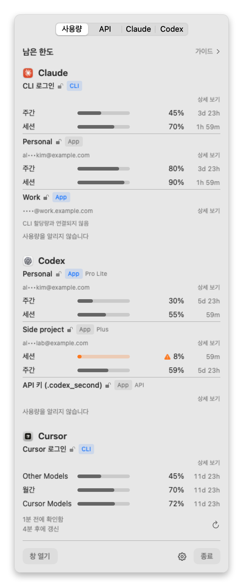
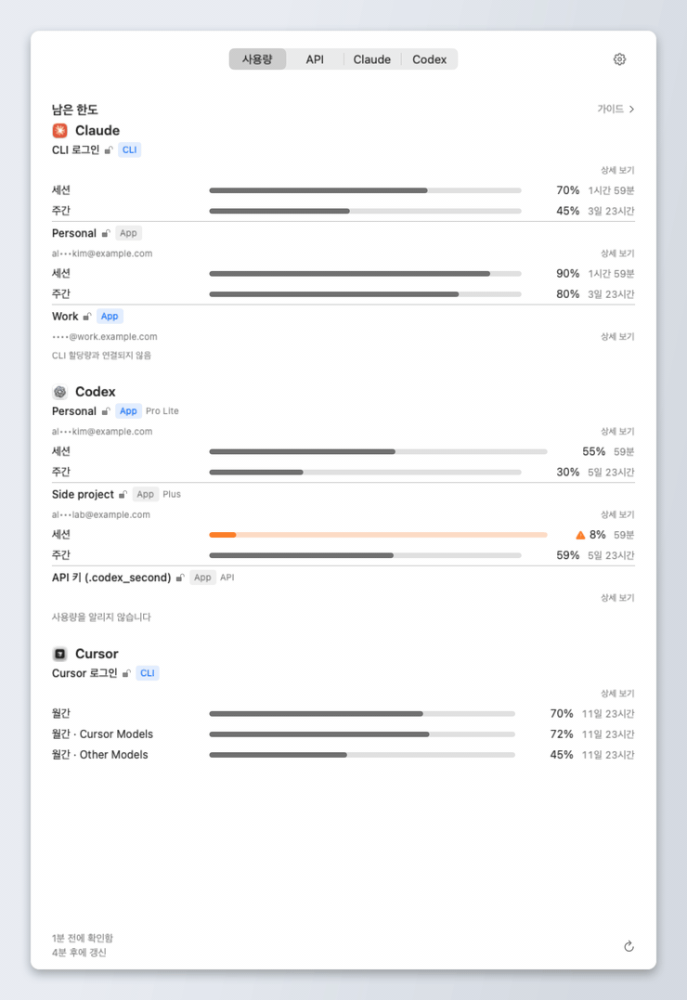
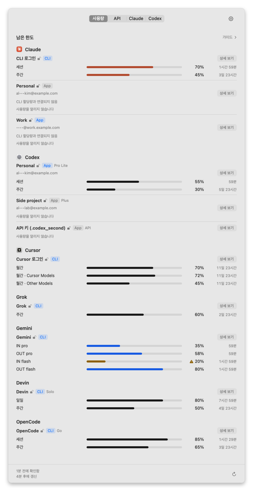
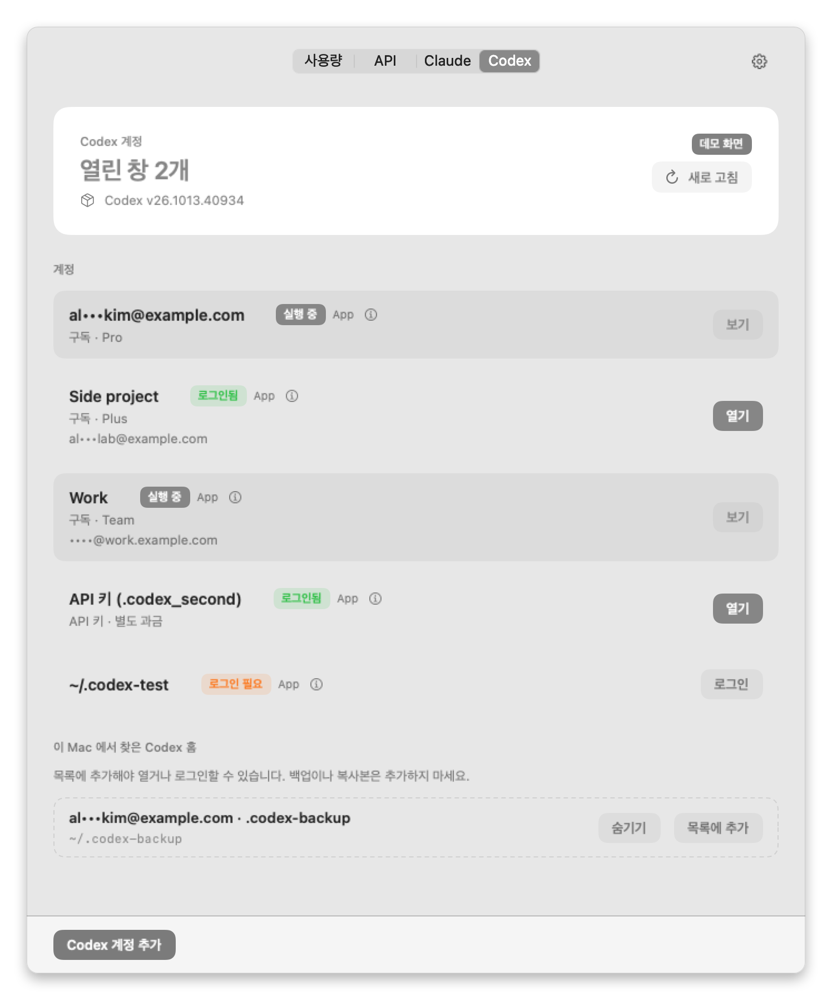
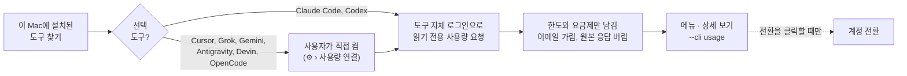

<div align="center">


# UsageSwitch

**AI 사용량이 얼마나 남았는지 확인하고, 원할 때 계정을 바꾸세요.**

Claude, Codex, Cursor 같은 AI 코딩 도구를 여러 계정으로 함께 쓰는 사람을 위한
macOS 네이티브 메뉴 막대 앱입니다.

[](https://github.com/deximple/usageswitch/releases/latest)


[](https://github.com/deximple/usageswitch/actions/workflows/ci.yml)
[](LICENSE)

[English](README.md) · **한국어** · [日本語](README.ja.md) · [简体中文](README.zh-Hans.md) · [Español](README.es.md)

<a href="https://github.com/deximple/usageswitch/releases/latest"></a>

<br><br>

<picture>
  <source media="(prefers-color-scheme: dark)" srcset="docs/screenshots/ko/menu-dark.png">
  
</picture>

<sub>이 문서의 스크린샷과 애니메이션은 모두 앱에 내장된 데모 데이터입니다. 실제 계정은 나오지 않습니다.</sub>

</div>

---

**목차** —
[하는 일](#하는-일) ·
[동작 모습](#동작-모습) ·
[설치](#설치) ·
[시작하기](#시작하기) ·
[목록 읽는 법](#사용량-목록-읽는-법) ·
[상태 메시지](#행에-메시지가-보일-때) ·
[지원 도구](#지원-도구) ·
[가이드](#가이드) ·
[계정 전환](#계정-전환) ·
[API 탭](#api-탭) ·
[설정](#설정) ·
[개인정보](#개인정보와-안전) ·
[명령줄](#명령줄) ·
[FAQ](#자주-묻는-질문) ·
[제한](#제한) ·
[제거](#제거) ·
[빌드](#소스에서-빌드)

## 하는 일

| | |
|---|---|
| 📊 **모든 한도를 한눈에** | 계정마다 세션·일일·주간·월간 한도를 **남은** 비율과 초기화까지 남은 시간으로 보여 줍니다. |
| 🧭 **실제로 쓰는 것만** | 이 Mac에 설치된 도구와 등록한 계정만 목록에 나옵니다. 없는 도구는 나타나지 않고, 그 도구의 정보를 읽지도 않습니다. 끄거나 숨긴 도구도 목록에서 빠집니다. Claude와 Codex의 로컬 사용 로그는 가이드와 API 탭을 위해 항상 읽습니다 — 끌 수는 없습니다. |
| 💡 **추천만 할 뿐, 자동으로 움직이지 않음** | **가이드**는 항상 읽는 로컬 로그로 남은 한도에 맞는 계정과 모델, 노력 수준을 추천하고, 그 근거를 보여 주며, 초기화 전에 바닥날 것 같은 한도를 알려 줍니다. 스스로 계정을 전환하거나 앱을 열거나 로그인하지 않습니다. |
| 🔁 **클릭 한 번으로 전환** | 저장한 계정 사이에서 Claude Desktop 로그인을 바꿉니다. 전환 결과를 확인하고, 실패하면 자동으로 되돌립니다. Codex 계정은 각각 다른 창에서 나란히 엽니다. |
| 🔒 **개인정보 우선 설계** | 분석·원격 측정이 없습니다. 업데이트는 직접 확인할 때만, 또는 허용한 뒤에만 하루 한 번 확인합니다. 이메일은 가려서 보여 줍니다. 선택 도구 일곱 개는 직접 켜기 전까지 꺼져 있습니다. |

## 동작 모습

<p align="center">
  
</p>

1. **보기** — 메뉴 막대 아이콘을 클릭합니다. 계정마다 각 한도가 얼마나 남았고 언제 초기화되는지 보입니다.
2. **추천받기** — **가이드**를 열면 지금 하려는 작업에 여유가 있는 계정을 알려 줍니다.
3. **전환하기** — **Claude** 탭에서 **전환**을 클릭합니다. UsageSwitch가 Claude Desktop을 그 계정으로 다시 시작하고, 계정이 맞는지 확인합니다. 문제가 생기면 이전 상태로 되돌립니다.

모든 단계는 사용자가 결정합니다. 한도가 줄어든다는 이유로 계정을 전환하거나 앱을 열거나 로그인하지 않습니다.

## 설치

**요구 사항:** Apple silicon 또는 Intel Mac, macOS 15 Sequoia 이상.

1. [최신 릴리스](https://github.com/deximple/usageswitch/releases/latest)에서 `UsageSwitch-<버전>.dmg`를 내려받습니다.
2. 파일을 열고 **UsageSwitch**를 **응용 프로그램** 폴더로 끌어 옮깁니다.
3. UsageSwitch를 엽니다. 메뉴 막대에 상주하며 Dock 아이콘은 없습니다. Finder에서 열면 창도 함께 나타납니다.

릴리스는 Developer ID로 서명하고 Apple 공증을 받았습니다. 그래서 처음 열 때 macOS의 일반적인 "인터넷에서 다운로드한 앱" 확인 창만 나옵니다.
내려받은 파일을 검증하려면 릴리스에 함께 올린 `SHA256SUMS.txt`를 사용하세요.
업데이트는 **⚙︎ › 업데이트 확인…**에서 합니다. 업데이트 피드가 켜진 빌드에서는 앱 안에서 바로 확인하고, 설치 전에는 항상 묻습니다. 백그라운드에서 하루 한 번 다시 확인할지는 Sparkle이 처음 한 번 묻는 창에서 정합니다. 피드가 없는 빌드에서는 릴리스 페이지를 엽니다.

## 시작하기

### 1. 사용량 탭 확인

처음 열면 **사용량** 탭이 보입니다. Claude Code와 Codex는 각 도구의 명령줄 프로그램으로 읽기 때문에 따로 설정하지 않아도 바로 숫자가 나옵니다.
목록이 비어 있다면 그 도구에 아직 로그인하지 않은 것입니다. [상태 메시지](#행에-메시지가-보일-때)를 참고하세요.

### 2. 사용하는 도구 켜기 (선택)

Cursor, Grok, Gemini, Antigravity, Devin, OpenCode Go, GitHub Copilot은 **기본으로 꺼져 있습니다**. 사용하는 도구마다 다음 순서로 켭니다.

- 그 도구 행의 **사용량 연결**을 클릭하거나 **⚙︎ › 사용량 연결**을 엽니다.
- 확인 창을 읽습니다. 무엇을 읽고 요청을 어디로 보내는지 정확히 적혀 있습니다.
- **활성화**를 클릭합니다.

**⚙︎ › 사용량 연결**에서 연결을 끄면 더 이상 읽지 않고, 그 도구의 행도 목록에서 빠집니다. 다시 켜면 돌아옵니다. 쓰지 않는 도구는 행의 **숨기기**로도 같은 방식으로 뺄 수 있습니다.

### 3. 저장된 Claude 계정에 숫자 표시 (선택)

Claude Desktop 로그인은 할당량을 알려 주지 않습니다. 그래서 저장된 Claude 계정에는 같은 계정으로 로그인한 Claude Code 프로필을 연결하기 전까지 **CLI 할당량과 연결되지 않음**이 표시됩니다.

```bash
# "Work" 계정용 Claude Code 프로필을 따로 만들고 그 계정으로 로그인합니다
CLAUDE_CONFIG_DIR="$HOME/.claude-work" claude
```

그다음 UsageSwitch에서 그 계정의 **상세 보기** → **CLI 프로필로 사용량 연결…**을 누르고 폴더를 고른 뒤 **활성화**를 클릭합니다. 숨김 폴더는 <kbd>⌘</kbd><kbd>⇧</kbd><kbd>.</kbd>를 누르면 보입니다.
UsageSwitch는 프로필의 계정·조직 ID와 CLI가 알려 주는 조직·설정 폴더·이메일이 저장된 계정과 일치하는지 매 읽기 전후로 확인되는 경우에만 숫자를 보여 줍니다.

### 4. 전환할 계정 저장

- **Claude** 탭: Claude Desktop에 로그인한 상태에서 **현재 로그인 저장**을 클릭합니다. 이어서 **새 계정 로그인**을 클릭해 다른 계정으로 로그인하고 다시 저장합니다. 계정마다 반복합니다.
- **Codex** 탭: **Codex 계정 추가**를 클릭하고 브라우저에서 로그인합니다. 이 Mac에 이미 있는 Codex 폴더는 **이 Mac 에서 찾은 Codex 홈**에 나타납니다. 쓰려는 폴더에서 **목록에 추가**를 클릭하세요.

## 사용량 목록 읽는 법

계정 하나가 작은 묶음 하나입니다. 계정 정보가 먼저 나오고, 그 아래에 한도가 한 줄씩 나옵니다.

| 보이는 것 | 의미 |
|---|---|
| **Personal** | 계정의 표시 이름입니다. **상세 보기** → **이름 편집**에서 바꿀 수 있습니다. |
|   | 숫자를 어디서 읽었는지 알려 줍니다. 명령줄 로그인(CLI)이나 데스크톱 앱(App)입니다. **파란색**이면 지금 쓰고 있는 로그인(현재 CLI 로그인 또는 열려 있는 앱)입니다. |
| 열린 자물쇠(강조 색) | 확인된 로그인 |
| 열린 자물쇠(회색) | 저장된 로그인 |
| 닫힌 자물쇠 | 로그인 필요. 자물쇠가 없으면 UsageSwitch가 판단할 수 없다는 뜻이며, 아무것도 단정하지 않습니다. |
| `Pro Lite`, `Plus`, `Team`… | 제공자가 알려 준 요금제 |
| `API` · *API 키 · 별도 과금* | API 키 프로필입니다. 사용한 만큼 과금되고 구독 한도가 없으므로 남은 할당량으로 세지 않습니다. |
| `al•••kim@example.com` | 가린 이메일입니다. **⚙︎ › 이메일 항상 보이기**를 켜면 전체가 보입니다. |
| `주간 ▬▬▬▭▭ 45%  3일 23시간` | 한도 하나입니다. 이름, 막대, **남은** 비율, 초기화까지 남은 시간 순서입니다. |
| `Cursor Models`, `Gemini Models`… | 일부 모델에만 적용되는 한도입니다. 이름은 제공자가 부르는 그대로입니다. 메뉴에서는 한도가 둘 이상인 모델 그룹(Antigravity)에 제목 줄이 생기고, 그 아래 행에는 *주간*, *세션*… 만 보입니다. |
| *이 속도면 5시간 후 소진* | 지금 속도라면 초기화 전에 이 한도를 다 씁니다. |
| *리셋 티켓 2장 · 18일 5시간 후 첫 만료* | OpenAI가 이 Codex 계정에 준 무료 한도 리셋입니다. 몇 장인지와 첫 장이 언제 만료되는지 보여 줍니다. UsageSwitch는 읽기만 하니, 리셋은 Codex에서 직접 쓰세요. |
| **한도 2개 더** | 메뉴에는 계정당 한도를 최대 3개까지 보여 줍니다. 나머지는 **상세 보기**에 있습니다. |
| **상세 보기** | 모든 한도, 초기화 시각, 수집 경로, 도구 버전을 보여 주는 창을 엽니다. |

**막대 색:** 여유가 있는 막대는 그 도구의 로고 색으로 채웁니다. Claude는 테라코타, Gemini와 Antigravity는 파랑, 나머지는 검정(다크 모드에서는 흰색)입니다. 경고 아이콘과 호박색은 경고 기준(기본 80% 사용)을 넘었다는 뜻이고, 빨간 아이콘과 빈 막대는 다 썼다는 뜻입니다. 흐린 회색 막대는 새로 고침을 기다리는 오래된 값이거나, 지금 읽을 수 없는 저장 Claude 계정·Codex 로그인의 마지막 성공 값(확인 시각 표시)입니다. 리셋이 지난 창은 숫자를 보이지 않습니다.

**하단:** *1분 전에 확인함 · 4분 후에 갱신*. 5분마다, 한도가 초기화된 직후, 그리고 ↻를 클릭할 때 새로 읽습니다.

**메뉴바 한도 고르기:** **⚙︎ › 메뉴바 사용량**에서 한도를 하나 고르거나, 한도를 오른쪽 클릭하고 **고정**을 고릅니다. 그러면 메뉴바에 가장 빠듯한 한도 대신 그 한도(예: *주간 25% 남음*)가 표시됩니다. **메뉴바 사용량**에서 고른 것이 고정보다 우선하고, **자동 (가장 적게 남은 한도)**으로 돌리면 고정한 한도, 없으면 가장 빠듯한 한도로 돌아갑니다.

<p align="center">
  
</p>

## 행에 메시지가 보일 때

숫자가 없는 행에는 항상 그 이유가 적혀 있습니다. 메시지별 의미와 해결 방법은 다음과 같습니다.

| 메시지 | 이유 | 해결 방법 |
|---|---|---|
| **사용량 연결 필요** | 이 선택 도구를 아직 켜지 않았습니다. | **사용량 연결**을 클릭하거나 **⚙︎ › 사용량 연결**에서 켭니다. 쓰지 않으면 **숨기기**를 누릅니다. |
| **로그인 정보 없음 · *X*에 먼저 로그인하세요** | 도구는 설치됐지만 이 Mac에서 로그인하지 않았습니다. | 그 도구에 한 번 로그인합니다. |
| **이 계정의 CLI 프로필이 로그인되어 있지 않음 · 상세 보기에서 방법 확인** | 저장된 Claude 계정에 연결한 CLI 프로필이 로그아웃된 상태라 마지막 읽기가 흐리게 남아 있습니다. | **상세 보기**에서 명령을 복사해 터미널에서 실행하고 같은 계정으로 로그인합니다. |
| **로그인 만료 · 터미널에서 *`명령`* 실행 후 다시 확인하세요** | 저장된 로그인이 만료됐습니다. | 표시된 명령을 실행합니다: `claude auth login`, `codex login`, `cursor-agent login`, `grok login`, `gemini`, `agy`, `devin auth login`, `opencode auth login`. |
| **로그인 거부 · 터미널에서 *`명령`* 실행 후 다시 확인하세요** | 제공자가 저장된 로그인을 거부했습니다 — 취소되었거나, 다른 앱의 로그인으로 대체됐거나, 이 도구가 지원하지 않는 계정입니다. | 표시된 명령을 실행하고 보고 싶은 계정으로 로그인하세요. |
| **CLI 할당량과 연결되지 않음** | 저장된 Claude Desktop 계정에 연결한 Claude Code 프로필이 없습니다. | **상세 보기**에서 [프로필을 연결](#3-저장된-claude-계정에-숫자-표시-선택)합니다. |
| **사용량을 알리지 않습니다** | 도구가 사용량 숫자 없이 응답했습니다: API 키 프로필(구독 한도 없음), 로그아웃된 Codex 홈, 구독 한도가 없는 계정입니다. | 고칠 것이 없습니다. 예상 지출은 [API 탭](#api-탭)에서 봅니다. (Codex API 키 계정만) |
| **이 계정은 *X* 사용량 대상이 아닙니다** | 제공자가 이 요금제에는 보여 줄 할당량이 없다고 응답했습니다. | 고칠 것이 없습니다. |
| **Google이 개인 계정용 Gemini CLI 할당량을 종료함 (Antigravity로 이전)** | Google이 개인 계정을 Antigravity로 옮겼습니다. | **Antigravity**를 켭니다. 그 행의 *Gemini Models* 한도가 같은 할당량입니다. |
| **사용량 읽기가 거부되었습니다** | 도구의 명령줄 프로그램이 사용량 보고 없이 중단됐습니다. | 다음 새로 고침 때 다시 시도합니다. 계속되면 터미널에서 도구를 한 번 실행해 로그인과 작동을 확인하세요. |
| **다른 계정의 사용량이 돌아와 표시하지 않습니다** | 읽는 도중 로그인이 바뀌었습니다. 다른 계정의 숫자는 절대 보여 주지 않습니다. | 다음 새로 고침을 기다립니다. |
| **사용량을 읽지 못했습니다 — 이 *X* 버전은 UsageSwitch 업데이트가 필요할 수 있습니다** | 도구의 응답 형식이 바뀌었습니다. | 새 UsageSwitch가 있는지 확인하거나 [이슈를 남겨 주세요](https://github.com/deximple/usageswitch/issues). |
| **사용량 읽기 시간이 초과되었습니다** · **서비스에 연결할 수 없습니다** · **요청 한도에 걸렸습니다 — 나중에 다시 시도하세요** | 일시적인 네트워크·서비스 문제입니다. | 다음 새로 고침 때 다시 시도합니다. |
| **명령행 도구를 찾을 수 없습니다** | 도구의 명령줄 프로그램이 없거나 `PATH`에 없습니다. | 설치하거나 `PATH`를 확인합니다. |
| **관리 설정이 있어 사용량을 읽을 수 없습니다** | 조직이 이 Mac의 Claude Code 설정을 관리합니다. | 정상 동작입니다. 이 경우 사용량을 읽지 않습니다. |
| **리셋 시점 경과 — 새로 고침 필요** | 마지막으로 읽은 뒤 한도가 초기화됐습니다. | ↻를 클릭하거나 잠시 기다립니다. |

## 지원 도구

| 도구 | 보이는 것 | 숫자를 가져오는 곳 | 켜는 방법 |
|---|---|---|---|
| **Claude Code** | 세션(5시간), 주간, 모델별 주간 한도 | `claude` CLI의 `/usage` | 자동 |
| **저장된 Claude Desktop 계정** | Claude Code와 같음 | 연결한 Claude Code 프로필 (`claude auth status` 후 `/usage`) | 계정마다 **상세 보기**에서 |
| **Codex** | ChatGPT 계정별 세션·주간 한도, 계정이 가진 한도 리셋 티켓 | `codex app-server` | 자동 |
| **Cursor** | 월간 합계, *Cursor Models*, *Other Models* | `cursor-agent` 로그인을 사용하는 Cursor 사용량 API | ⚙︎ › 사용량 연결 |
| **Grok** | 주간 한도 | Grok CLI 사용량 엔드포인트 | ⚙︎ › 사용량 연결 |
| **Gemini** | 모델별 입력·출력 한도 | Gemini CLI 로그인을 사용하는 Gemini Code Assist 할당량 | ⚙︎ › 사용량 연결 |
| **Antigravity** | 모델 그룹별 한도 (예: *Gemini Models*) | `agy`의 `/usage` 화면과, 갱신할 때마다 호출하는 읽기 전용 할당량 API (화면을 읽지 못하면 이 값을 표시) | ⚙︎ › 사용량 연결 |
| **Devin** | Devin CLI가 알려 주는 할당량 | Devin CLI 사용자 상태 | ⚙︎ › 사용량 연결 |
| **OpenCode Go** | 5시간 롤링·주간·월간 한도 | OpenCode Go 사용량 엔드포인트 | ⚙︎ › 사용량 연결 |

도구는 명령줄 프로그램이 `PATH`(또는 `~/.local/bin`, npm·bun·Volta의 기본 폴더, `/opt/homebrew/bin`, `/usr/local/bin`)에 있거나, 앱이 `/Applications` 또는 `~/Applications`에 있을 때 목록에 나옵니다. 도구를 찾는 과정에서 그 도구를 실행하지는 않습니다.

<details>
<summary><b>선택 연결별로 정확히 무엇을 읽고 보내는지</b></summary>

<br>

선택 연결은 모두 그 도구의 로컬 로그인 정보를 읽어 메모리에만 두고, 정해진 호스트 — 도구당 하나(Gemini와 Antigravity는 토큰 갱신을 위해 `oauth2.googleapis.com`까지 둘) — 에 읽기 전용 HTTPS 요청을 보냅니다. 리다이렉트는 거부하고 응답은 1 MiB까지만 받습니다. 기록하거나 저장하는 것은 없습니다.

| 도구 | 읽는 로컬 로그인 | 연결하는 호스트 | 참고 |
|---|---|---|---|
| Cursor | Cursor의 키체인 항목, 없으면 `~/.cursor/auth.json` | `api2.cursor.sh` | 새로 고침마다 요청 1회. 토큰이 만료됐으면 요청을 보내지 않습니다. 브라우저 `cursor-agent login`은 약 60일, API 키 로그인은 약 1시간 유지됩니다. Grok Bot과 온디맨드 요금은 읽지 않습니다. |
| Grok | Grok CLI 로그인 파일 | `cli-chat-proxy.grok.com` | 실험 기능 |
| Gemini | Gemini CLI 키체인 항목, 없으면 `~/.gemini/oauth_creds.json` | `cloudcode-pa.googleapis.com`, `oauth2.googleapis.com` | 액세스 토큰이 만료됐으면 저장된 갱신 토큰과 설치된 Gemini CLI 자체의 로그인 클라이언트로 임시 토큰을 받아 메모리에만 둡니다. 아무것도 다시 쓰지 않습니다. 새로 고침마다 요청은 최대 3회입니다. |
| Antigravity | 홈 폴더에서 숨겨진 터미널로 실행한 `agy` (최대 9분에 한 번). agy의 키체인 항목(키체인에 없으면 `~/.gemini/jetski-standalone-oauth-token`)을 갱신할 때마다 읽음 | `oauth2.googleapis.com`, `cloudcode-pa.googleapis.com` | `agy`는 사용자가 설정한 MCP 서버를 포함해 평소 설정으로 시작합니다. UsageSwitch는 agy의 프롬프트에 응답하지 않습니다. macOS가 키체인 접근 허용을 한 번 물을 수 있습니다. |
| Devin | Devin CLI 인증 정보와 버전 | `server.codeium.com` | 지원되는 Devin CLI 버전이 필요합니다. |
| OpenCode Go | OpenCode `auth.json`의 `opencode-go` 항목 | `opencode.ai` | Go 요금제만 읽습니다. 다른 OpenCode 사용량은 포함하지 않습니다. |

이 엔드포인트들은 안정된 공개 API가 아니라 비공개 경로입니다. 제공자가 바꾸면 UsageSwitch가 업데이트될 때까지 값을 읽지 못할 수 있습니다. 그때는 잘못된 숫자 대신 그 사실을 행에 표시합니다.
읽고 쓰는 파일 전체 목록은 [PRIVACY.md](PRIVACY.md)에 있습니다(영문).

</details>

## 가이드

목록 위의 **가이드**를 클릭하면 열립니다. 옆에 작은 점이 보이면 추천이 준비됐다는 뜻입니다. 점은 **⚙︎ › 가이드 표시기 표시**에서 끌 수 있습니다.

- **모드** — 추천이 고를 수 있는 모델의 수준과 노력 수준의 상한을 정합니다.

  | 모드 | 추천 상한 |
  |---|---|
  | *절전* | 중간 등급 모델, 중간 노력 |
  | *균형* | 최상위 모델의 중간 노력, 또는 중간 등급 모델의 높은 노력 |
  | *집중* | 최상위 모델, 높은 노력 |
  | *긴급* | 최상위 모델, 최대 노력. 켜기 전에 확인하고, 다음 Claude 5시간 초기화 때(모르면 5시간 뒤) *균형*으로 돌아갑니다. |

- **작업 선호** — 지금 할 일에 맞춰 *단순 코딩*에서 *추론 극대화* 사이로 슬라이더를 옮깁니다.
- **추천** — 지금 남은 한도에 맞는 제공자와 계정, 모델, 노력 수준을 한 줄로 보여 줍니다(*제안: …*, 비교할 계정이 하나뿐이면 *사용 가능: …*). 맞는 모델이 없으면 비교 가능한 구독 계정 중 여유가 가장 큰 계정을 보여 줍니다. API 키 프로필은 추천하지 않습니다.
- **제안 근거** — 펼치면 추천과 비교한 계정을 최대 4개까지(발목을 잡는 한도, 남은 비율, 초기화 시각) 보여 주고, **제외됨**에는 경고 기준에 걸렸거나 초기화 전에 바닥날 것 같거나 새 값을 기다리는 계정이 나옵니다.
- **앞으로의 전망** — 각 한도의 속도(두 번의 읽기가 맞으면 최근 속도, 아니면 지금까지의 평균)로 초기화 전에 바닥날 수 있는 계정을 빠른 순서로 최대 3개 보여 줍니다. 한도 기간의 15%가 지나기 전에는 예측하지 않습니다. 곧 초기화되는 한도는 쓰지 않으면 사라질 몫을 더해서 셈하므로, 주간 초기화 3시간 전에 60% 남은 계정이 6일 더 남은 70% 계정보다 앞섭니다. 추천한 계정에는 *고르게 쓰면 하루 약 15%씩 리셋까지 갑니다* 같은 줄이 붙습니다.
- **더 가벼운 조합** — 바닥날 것 같은 계정의 로그에 최근 하루 동안 주로 쓴 모델이 있으면, 같은 회사의 더 가벼운 모델이나 노력 수준을 알려 줍니다(*더 가벼운 조합: …*). 방향을 알려 줄 뿐 절약량을 약속하지 않습니다.
- **여유 있는 계정이 없을 때** — *지금 여유 있는 계정이 없습니다.*와 가장 먼저 풀리는 한도를 보여 줍니다. 순위를 매길 수 없는 도구(Cursor, Devin, Copilot, Antigravity) 중 여유가 있는 것은 *순위는 매기지 못하지만 여유 있음*으로 최대 2개 보여 줍니다.
- **리셋 티켓** — 한도를 다 쓴 Codex 계정이 리셋 티켓을 가지고 있으면 알려 주고(*직접 쓸 수 있습니다*), 2일 안에 만료되는 티켓도 알려 줍니다.

전망은 이미 보이는 값으로 낸 추정입니다. 가이드는 추천만 합니다. 계정을 전환하거나 로그인하거나 리셋 티켓을 쓰지 않습니다. 전환은 사용자가 직접 합니다.

<details>
<summary><b>가이드가 읽고 보관하는 것</b></summary>

<br>

- **읽는 것:** 사용량 값, 그리고 로컬 Claude Code·Codex 세션 로그의 모델·노력 수준·시각·토큰 수 필드. 대화 내용은 읽지 않습니다.
- **모델 데이터:** 앱에 들어 있는 고정 모델 카탈로그. 실행 중에 내려받지 않습니다.
- **보관하는 것:** 솔트를 넣은 계정 해시로만 구분한 작은 로컬 학습 파일. 이름, 이메일, 대화 내용은 없습니다. 원본 파일은 14일 뒤 보관 처리되고 180일 뒤 삭제됩니다.
- **삭제:** **⚙︎ › 학습 데이터 삭제**로 바로 지울 수 있습니다. 모드와 작업 선호 설정은 남습니다.

</details>

## 계정 전환

### Claude Desktop (Claude 탭)

계정마다 Claude Desktop 로그인을 한 번 저장한 뒤, 원하는 계정에서 **전환**을 클릭합니다. 전환은 다음 순서로 진행됩니다.

1. Claude Code 세션이 돌고 있으면 먼저 묻습니다(세션 기록은 남습니다).
2. 전환 도중 Claude를 다시 띄우는 항목을 잠시 멈추고, Claude를 정상 종료합니다. 강제 종료는 하지 않습니다.
3. 로컬 로그인을 바꾸고 Claude를 시작한 뒤, Claude 로그로 계정을 확인합니다.
4. 어느 단계든 실패하면 이전 계정으로 되돌립니다.

처음 전환할 때 원래 로그인을 한 번 백업합니다. 서버에서 로그아웃하는 일은 없습니다.
**새 계정 로그인**은 현재 로그인을 저장한 뒤에만, 이 Mac에서만 로그인 정보를 비웁니다.

### Codex (Codex 탭)

Codex 계정마다 전용 Codex 폴더를 만들고 각자의 창에서 엽니다. 그래서 여러 계정을 나란히 실행할 수 있습니다.
로그인은 언제나 브라우저에서 Codex 자체의 `codex login`으로 진행하며, 로그인 파일을 폴더끼리 복사하지 않습니다.
**제거**는 그 계정을 이 Mac에서 로그아웃하고 폴더를 휴지통으로 옮깁니다. **목록에서 제거**는 이 Mac에서 찾은 폴더를 목록에서만 숨깁니다. 기본 `~/.codex`는 제거할 수 없습니다.

<p align="center">
  
</p>

## API 탭

구독 대신 API 키를 쓰는 계정을 위한 탭입니다.

- **예산** — Anthropic, OpenAI, Google, xAI별로 선불 잔액이나 월간 한도(재설정일 포함)를 정합니다.
- **예상 지출** — 최근 7일 지출, 일평균 사용률, 지금 속도로 예산이 며칠 남는지 보여 줍니다. API 키 계정의 로컬 CLI 로그만으로 추정한 값이며, 제공자에게서 가져온 값이 아닙니다.
- **API 키 보관함** — 앱에서 키를 추가·표시·삭제할 때 Touch ID나 암호를 묻습니다. 키는 로그인 키체인에 저장되며 키체인 자체의 접근 규칙을 따릅니다. 키는 어디에도 전송하지 않습니다.

## 설정

모든 설정은 **⚙︎** 메뉴에 있습니다.

| 설정 | 하는 일 |
|---|---|
| 언어 | English, 한국어, 日本語, 简体中文, Español. 기본값은 시스템 언어입니다. |
| 외관 | 시스템 설정 따르기, 라이트, 다크 |
| 로그인 시 자동 실행 | 로그인할 때 UsageSwitch를 시작합니다. |
| 메뉴바에 계정 이름 표시 | 현재 Claude 계정 이름을 아이콘 옆에 표시합니다(이메일은 가린 상태 유지). |
| 이메일 항상 보이기 | 가린 이메일 대신 전체 이메일을 보여 줍니다. |
| 메뉴바에 사용량 표시 | 한도 하나를 아이콘 옆에 표시합니다. 예: *주간 25% 남음*. 기본으로 켜져 있습니다. |
| 메뉴바 사용량 | 그 한도를 고릅니다. **자동 (가장 적게 남은 한도)**은 고정한 한도, 없으면 다 쓰지 않은 한도 중 가장 적게 남은 것을 씁니다. 목록에서 한도 하나를 고를 수도 있습니다. |
| 사용량 알림 · 사용률 경고 기준 | 한도 사용률이 70%, 80%(기본), 90%를 넘으면 macOS 알림을 보냅니다. |
| 가이드 표시기 표시 | 추천이 준비되면 **가이드** 옆에 점을 표시합니다. |
| 사용량 연결 | 선택 도구를 하나씩 켜고 끕니다. 끈 도구는 사용량 목록에서 빠집니다. 이 Mac에서 찾은 도구만 나옵니다. |
| 학습 데이터 삭제 | 가이드의 로컬 학습 파일을 지웁니다. |
| 데이터 폴더 보기 | `~/Library/Application Support/com.jaysong.usageswitch/`를 엽니다. |
| 업데이트 확인… | 업데이트 기능이 켜져 있으면 업데이트 피드를 확인하고, 아니면 브라우저에서 릴리스 페이지를 엽니다. |

## 개인정보와 안전



**UsageSwitch가 절대 하지 않는 일:**

- 한도가 부족하다는 이유로 계정을 전환하거나 앱을 열거나 로그인하기
- 모델 요청을 보내거나 작업을 실행하기 (사용량을 읽는 데 비용이 들지 않습니다)
- 서버에서 로그아웃시키거나 Claude 쿠키를 복호화하기
- 사용량을 읽으려고 가져온 토큰을 저장·기록하거나, 그 도구의 호스트가 아닌 곳으로 보내기
- 분석·원격 측정·충돌 보고를 보내거나 백그라운드에서 스스로 업데이트하기

**저장하는 것** — 모두 `~/Library/Application Support/com.jaysong.usageswitch/`에 있고 본인만 읽을 수 있습니다.
저장한 Claude Desktop 로그인(Claude가 저장한 그대로 암호화된 상태), 추가한 Codex 폴더, 설정, 이메일을 가린 마지막 사용량, 가이드 학습 파일이 들어 있습니다.

읽고 쓰는 모든 파일과 연결하는 모든 호스트는 **[PRIVACY.md](PRIVACY.md)**(영문)에 있습니다. 보안 문제는 [SECURITY.md](SECURITY.md)의 방법으로 비공개 제보해 주세요.

## 명령줄

앱 실행 파일은 JSON을 출력하는 명령줄 도구로도 쓸 수 있습니다.

```bash
APP=/Applications/UsageSwitch.app/Contents/MacOS/UsageSwitch

"$APP" --cli usage            # 마지막 사용량 (JSON)
"$APP" --cli status           # 저장된 Claude 계정과 Claude 상태
"$APP" --cli codex status     # Codex 계정
"$APP" --cli switch Work      # Claude Desktop을 "Work" 계정으로 전환
"$APP" --cli                  # 전체 명령 목록
```

**2.2.0 변경:** `remove`와 `codex remove`는 확인용 `--yes`가 필요합니다 — 없으면 `needs_confirmation`(코드 3)으로 끝나고 아무것도 바뀌지 않습니다.

`--cli usage`는 앱이 마지막으로 읽어 저장한 값을 출력합니다. 도구나 네트워크에 연결하지 않으므로 먼저 UsageSwitch를 한 번 열어 두세요. 이메일은 언제나 가려서 출력합니다.

<details>
<summary><b>출력 예시와 <code>jq</code>로 한 줄 요약하기</b></summary>

<br>

```json
{
  "ok" : true,
  "result" : {
    "accounts" : [
      {
        "accountRef" : "codex#1",
        "authentication" : "subscription",
        "id" : "codex#1",
        "label" : "al•••kim@example.com",
        "plan" : "prolite",
        "provider" : "codex",
        "readAt" : "2026-11-09T05:10:00Z",
        "state" : "ok",
        "toolVersion" : "0.166.0",
        "windows" : [
          {
            "durationMinutes" : 10080,
            "kind" : "weekly",
            "leftPercent" : 69,
            "resetsAt" : "2026-11-13T14:00:00Z",
            "usedPercent" : 31
          }
        ]
      },
      {
        "accountRef" : "current",
        "authentication" : "unknown",
        "id" : "gemini:current",
        "label" : "Gemini",
        "problem" : "notEligible",
        "provider" : "gemini",
        "readAt" : "2026-11-09T05:10:00Z",
        "state" : "unavailable",
        "windows" : []
      }
    ],
    "generatedAt" : "2026-11-09T05:10:00Z"
  }
}
```

`state`는 `ok`, `notReporting`, `unavailable`, `failed` 중 하나이고, `problem`에 이유가 들어갑니다. 계정 ID는 의미 없는 값이며 목록 순서에 따라 바뀝니다.

```bash
"$APP" --cli usage | jq -r '.result.accounts[]
  | "\(.provider)\t\(.label)\t\([.windows[] | "\(.scope // .kind) \(.leftPercent | floor)% left"] | join(", "))"'
```

무언가를 바꾸는 명령(`switch`, `capture`, `enroll`, `remove`, `codex add` 등)은 진행 상황을 stderr로 출력하고, 실패하면 0이 아닌 종료 코드를 돌려줍니다. Claude Code 세션이 돌고 있으면 `switch`는 `--yes`를 요구합니다.
`usageswitch://switch?id=<계정-ID>` 링크도 버튼과 같은 전환을 시작하지만, 앱에서 사용자가 확인해야 진행됩니다.

</details>

## 자주 묻는 질문

<details>
<summary><b>한도가 부족하면 알아서 계정을 바꿔 주나요?</b></summary>

아니요. 사용량과 추천은 보여 주기만 합니다. 전환·실행·로그인은 사용자가 클릭하거나 명령을 실행할 때만 일어납니다.

</details>

<details>
<summary><b>사용량을 읽는 데 비용이 들거나 할당량을 쓰나요?</b></summary>

아니요. 모델 요청을 보내지 않습니다. 각 도구에 읽기 전용 명령과 엔드포인트로 사용량만 묻습니다.

</details>

<details>
<summary><b>쓰고 있는 도구가 목록에 없어요.</b></summary>

UsageSwitch는 도구의 명령줄 프로그램이 `PATH`(또는 npm, bun, Volta의 기본 폴더)에 있거나, 앱이 `/Applications` 또는 `~/Applications`에 있을 때만 목록에 올립니다. Cursor, Grok, Gemini, Antigravity, Devin, OpenCode는 여기에 더해 **⚙︎ › 사용량 연결**에서 켜야 합니다.

</details>

<details>
<summary><b>저장된 Claude 계정에 "CLI 할당량과 연결되지 않음"이 떠요.</b></summary>

Claude Desktop 로그인은 사용량을 알려 주지 않습니다. 같은 계정으로 로그인한 Claude Code 프로필을 연결하세요. 방법은 [시작하기 3단계](#3-저장된-claude-계정에-숫자-표시-선택)에 있습니다. UsageSwitch는 이메일 주소만 보고 짐작해서 연결하지 않습니다.

</details>

<details>
<summary><b>Cursor가 계속 로그인 만료라고 해요.</b></summary>

UsageSwitch는 `cursor-agent`가 저장한 로그인을 사용하고, 직접 갱신하지 않습니다. 브라우저로 한 `cursor-agent login`은 약 60일, API 키 로그인은 약 1시간 유지됩니다. `cursor-agent login`을 실행하고 브라우저 로그인을 선택하세요.

</details>

<details>
<summary><b>Gemini에 숫자 대신 메시지가 나와요.</b></summary>

Google이 개인 계정용 Gemini CLI 할당량을 종료하고 Antigravity로 옮겼습니다. **Antigravity**를 켜세요. 그 행의 *Gemini Models* 한도가 같은 할당량입니다.

</details>

<details>
<summary><b>화면을 공유하는 중에 써도 안전한가요?</b></summary>

기본 설정에서는 메뉴 막대를 포함해 모든 곳의 이메일을 가립니다. 저장된 사용량 파일과 `--cli usage` 출력은 **이메일 항상 보이기**를 켜도 언제나 가립니다. 다른 CLI 출력(`--cli status`, `--cli codex status`, `--cli switch`, `--cli capture`)은 계정의 원래 이메일을 그대로 인쇄합니다.

</details>

<details>
<summary><b>Anthropic, OpenAI 같은 제공자가 만든 앱인가요?</b></summary>

아니요. 독립 오픈소스 프로젝트이며, 어떤 제공자와도 제휴하거나 보증받지 않았습니다.

</details>

## 제한

- Claude Desktop 전환은 Claude 내부 파일에 의존합니다. Claude 업데이트로 그 파일이 바뀌면 UsageSwitch가 업데이트될 때까지 전환이 안전하게 실패하고 되돌아갑니다.
- 저장된 Claude 로그인은 만료되거나 취소될 수 있습니다. 그러면 그 행에서 **재로그인 필요**를 요청합니다.
- 로그인을 키체인에 보관하는 Codex 폴더(`cli_auth_credentials_store = "keyring"`)는 로그아웃 상태로 보일 수 있습니다.
- 선택 연결은 예고 없이 바뀔 수 있는 비공개 엔드포인트를 사용합니다.
- UsageSwitch는 각 제공자가 알려 주는 한도만 보여 줍니다. 제공자의 잔액이나 청구 금액은 보여 주지 않으며, API 탭의 값은 로컬 추정치입니다.

## 제거

1. 선택 사항: 먼저 **API** 탭에서 API 키를 삭제합니다. 키는 앱을 지워도 키체인에 남습니다.
2. 선택 사항: 추가한 Codex 계정을 로그아웃하려면 먼저 **Codex** 탭에서 제거합니다.
3. **⚙︎ › 로그인 시 자동 실행**을 끄고, UsageSwitch를 종료한 뒤 휴지통으로 옮깁니다.
4. 선택 사항: `~/Library/Application Support/com.jaysong.usageswitch/`를 지웁니다. 저장한 로그인, 설정, UsageSwitch에서 추가한 Codex 폴더가 들어 있으니 필요한 것은 먼저 보관하세요.

## 소스에서 빌드

macOS 15 이상에서 Xcode 26 이상(macOS 26 SDK)이 필요합니다.

```bash
swift build                    # 디버그 빌드
./scripts/test.sh              # 테스트와 커버리지 보고서
python3 scripts/check-l10n.py  # 다섯 언어 문자열이 모두 있는지 확인
./scripts/bundle.sh            # 유니버설 build/UsageSwitch.app (Developer ID가 있으면 사용, 없으면 ad-hoc 서명)
./scripts/vendor-drift.sh      # 설치된 벤더 CLI의 출력이 앱이 읽는 형태와 맞는지 점검 (docs/vendor-drift.md)
```

계정 없이 화면만 보려면 데모 데이터로 실행하세요. 실제 데이터에는 손대지 않습니다.

```bash
build/UsageSwitch.app/Contents/MacOS/UsageSwitch --ui-fixture usage-seven
```

`./scripts/readme-screenshots.sh`는 이 문서의 모든 이미지를 같은 데모 데이터로 다섯 언어 모두 다시 만듭니다.

릴리스는 `scripts/notarize.sh`로 공증하며, 미리 만든 `NOTARY_PROFILE` 키체인 프로필이 필요합니다. 릴리스에는 ad-hoc 서명을 쓸 수 없습니다.
이슈와 풀 리퀘스트를 환영합니다. 변경 내역은 [CHANGELOG.md](CHANGELOG.md), 설계 메모는 [DESIGN.md](DESIGN.md)에 있습니다.

## 감사의 말

독립 오픈소스 프로젝트입니다. Anthropic, OpenAI, Anysphere(Cursor), xAI, Google, Cognition(Devin), SST(OpenCode)와 제휴하거나 보증받지 않았으며, 제품 이름은 각 소유자의 것입니다.
관련 커뮤니티 프로젝트: [CodexBar](https://github.com/steipete/CodexBar), [claudepot-app](https://github.com/xiaolai/claudepot-app), [claude-desktop-accounts](https://github.com/5eanxlee/claude-desktop-accounts), [Swivel](https://github.com/jspanji/Swivel), [claude-graft](https://github.com/aaditya-v-more/claude-graft).

## 라이선스

[MIT](LICENSE) © 2026 Jay Song
