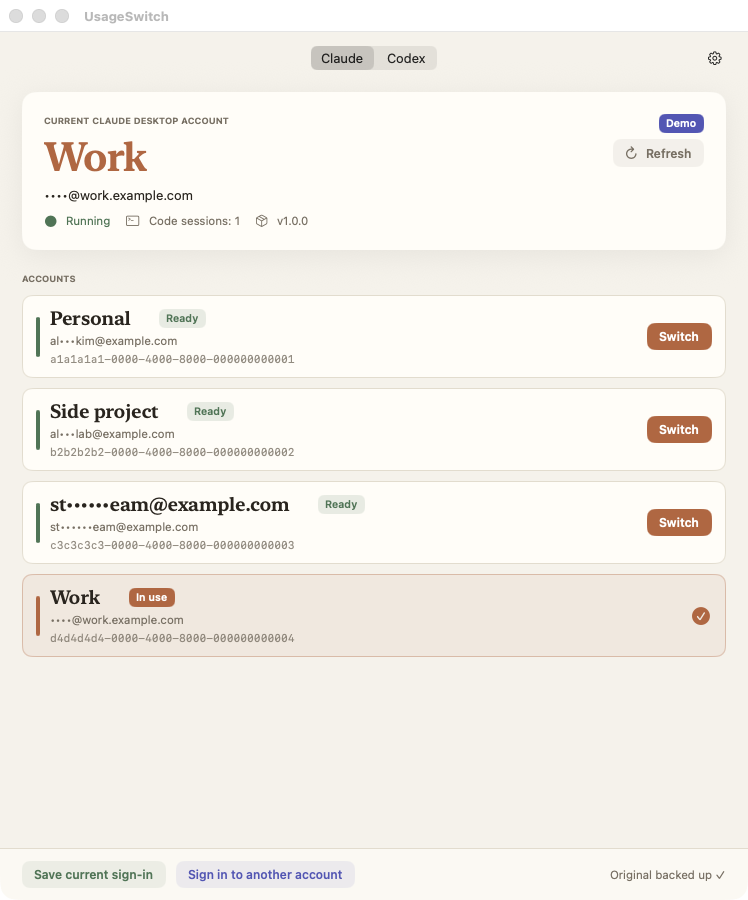
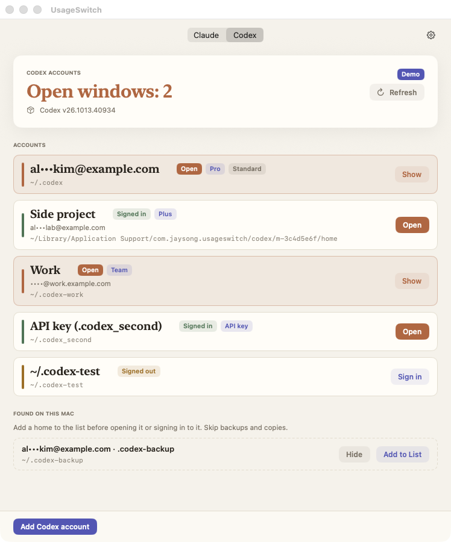

# UsageSwitch

Claude 나 Codex 계정을 여러 개 쓰는 사람을 위한 macOS 메뉴바 앱입니다.

- **Claude 탭**: 계정마다 Claude Desktop 로그인을 한 번 저장해 두면, 클릭 한 번으로 Claude Desktop(Code 탭 포함)을 그 계정으로 전환합니다. 로그아웃했다가 다시 로그인할 필요가 없습니다.
- **Codex 탭**: Codex 계정마다 자기 Codex 홈을 두고, 각각 별도 창으로 나란히 엽니다.

[English](README.md) · 내려받기: [최신 릴리스](https://github.com/deximple/usageswitch/releases/latest) · [개인정보](PRIVACY.md) · [변경 내역](CHANGELOG.md)

<p>
  
  
</p>

<sub>스크린샷은 데모 데이터입니다.</sub>

화면 언어는 한국어 · 简体中文 · 日本語 · English · Español 입니다. 기본값은 시스템 언어이고 ⚙︎ › 언어에서 바꿉니다.

## 설치

1. [최신 릴리스](https://github.com/deximple/usageswitch/releases/latest)에서 `UsageSwitch-<버전>.dmg` 를 내려받습니다.
2. 열어서 **UsageSwitch** 를 **응용 프로그램(Applications)** 으로 끌어 놓습니다.
3. UsageSwitch 를 엽니다. 메뉴바에 상주하며, Finder 에서 열면 창도 함께 뜹니다.

Developer ID 로 서명했고 Apple 공증(notarization)을 받았습니다.

**요구 사항:**
- macOS 15 이상, Apple 실리콘 또는 Intel.
- [Claude Desktop](https://claude.ai/download)이나 Codex 데스크톱 앱(또는 둘 다)이 `/Applications` 또는 `~/Applications` 에 설치되어 있어야 합니다.

## Claude 탭

### 계정 추가(계정마다 한 번)

1. Claude Desktop 이 원하는 계정으로 로그인되어 있으면 **현재 로그인 저장**을 누릅니다.
2. 다른 계정을 추가하려면 **새 계정 로그인**을 누릅니다. 현재 로그인을 저장한 뒤 Claude 가 로그인 화면으로 다시 열립니다.
   - 이 Mac 의 로그인만 지웁니다. 서버에서 로그아웃하는 것이 아닙니다.
3. Claude 에서 다른 계정으로 로그인한 뒤 **현재 로그인 저장**을 누릅니다.

계정은 이메일 이름으로 목록에 보입니다. 연필 버튼이나 우클릭 › **이름 바꾸기…** 로 "회사" 같은 이름을 붙일 수 있습니다.

이메일은 클릭하기 전까지 가려집니다. 항상 보려면 ⚙︎ › **이메일 항상 보이기**를 켭니다.

### 전환

창이나 메뉴바에서 계정 옆의 **전환**을 누릅니다. Claude 가 종료되었다가 그 계정으로 다시 열리고, 진행 단계가 그대로 보입니다.

- 실행 중인 Code 세션은 Claude 가 종료될 때 멈추므로, 전환 전에 먼저 묻습니다. 세션 기록은 계정별로 남아 있어 그 계정으로 돌아오면 다시 보입니다.
- Claude 가 "Claude is still working" 대화상자를 띄우면 기다립니다. 그래도 종료되지 않으면 아무것도 바꾸지 않고 멈춥니다.

계정을 우클릭하면 다음 메뉴가 있습니다.

- **이름 바꾸기…**
- **재로그인…**: 저장된 로그인을 새로 고칩니다. 예를 들어 만료됐을 때 씁니다.
- **저장된 로그인 삭제**: 이 Mac 의 저장본만 지우며, 계정 자체나 다른 기기에는 영향이 없습니다. 사용 중인 계정에는 없습니다.

## Codex 탭

Codex 는 로그인을 Codex 홈(기본 `~/.codex`)에 저장합니다. UsageSwitch 는 계정마다 홈을 하나씩 두고 각각 별도 Codex 창으로 열기 때문에, 여러 계정을 동시에 열 수 있습니다.

여는 방식은 Codex 가 자기 두 번째 창을 여는 방식과 같습니다. `CODEX_HOME` 과 별도 앱 데이터 폴더를 씁니다.

- **Codex 계정 추가**: 새 Codex 홈을 만들고 Codex 자신의 `codex login` 을 실행합니다. 브라우저에서 로그인하면 그 계정으로 Codex 가 열립니다.
- **열기 / 보기**: 그 계정의 Codex 창을 엽니다. 이미 열려 있으면 앞으로 가져옵니다.
- **로그인**: 로그아웃된 계정을 다시 인증합니다. 다른 계정은 우클릭 › **재인증…** 으로 같은 일을 합니다.
- **제거…**
  - UsageSwitch 에서 추가한 계정: 그 계정의 Codex 창을 닫고 `codex logout` 으로 로그아웃한 뒤, 홈 폴더를 휴지통으로 옮깁니다.
  - **이 Mac 에서 찾은 Codex 홈**에서 추가한 홈: 목록에서만 뺍니다(**목록에서 제거…**).
  - 기본 `~/.codex` 는 제거할 수 없습니다.
- **이 Mac 에서 찾은 Codex 홈**: `~/.codex-work` 같은 기존 홈을 제안만 하고 쓰지는 않습니다.
  - 실제 계정인 것만 **목록에 추가**하고, 백업이나 복사본은 건너뜁니다.
  - 같은 로그인을 가진 홈 두 개는 서로를 로그아웃시킵니다.
- 우클릭 메뉴에는 **이름 바꾸기…**, **터미널 명령 복사**(`CODEX_HOME=… codex`), **Finder에서 보기**도 있습니다.

로그인 정보는 홈 사이에서 복사하거나 바꿔 끼우지 않습니다. Codex 의 갱신 토큰은 한 번만 쓸 수 있어서, `auth.json` 을 바꿔 끼우면 로그인이 풀릴 수 있기 때문입니다.

로그인과 로그아웃은 Codex 자신의 CLI 가 합니다. 예외는 **제거…** 하나입니다. `codex logout` 이 끝나지 않으면 UsageSwitch 가 그 홈의 `auth.json` 을 직접 지워, 살아 있는 로그인이 휴지통으로 가지 않게 합니다.

## 설정(⚙︎)

| 설정 | 하는 일 |
|---|---|
| 언어 | 시스템 언어, 또는 앱의 5개 언어 중 하나 |
| 로그인 시 자동 실행 | 로그인 때 실행되면 창 없이 메뉴바에만 뜹니다 |
| 메뉴바에 계정 이름 표시 | 끄면 아이콘만 보입니다 |
| 이메일 항상 보이기 | 클릭하지 않아도 이메일을 보여 줍니다 |
| 숨긴 Codex 홈 다시 보기 | 찾은 홈을 숨긴 적이 있을 때만 보입니다 |
| 데이터 폴더 보기 | 아래 "개인정보와 안전"에 나오는 폴더를 엽니다 |
| 업데이트 확인… | 브라우저에서 릴리스 페이지를 엽니다 |
| UsageSwitch 정보 | 버전 |

## 명령줄

앱 실행 파일에 JSON 을 출력하는 명령줄 인터페이스가 들어 있습니다.

```bash
APP=/Applications/UsageSwitch.app/Contents/MacOS/UsageSwitch
"$APP" --cli status                  # 계정 목록, 사용 중인 계정, Code 세션
"$APP" --cli switch <계정> --yes      # <계정>: status 의 id, 이름 또는 이메일
"$APP" --cli capture --yes           # 지금 Claude 로그인 저장
"$APP" --cli enroll --yes            # 새 계정 로그인 준비(로그인 화면으로 Claude 재실행)
"$APP" --cli rename <계정> "회사"      # --reset: 기본 이름으로
"$APP" --cli remove <계정>            # 저장된 로그인 삭제(사용 중인 계정은 불가)
"$APP" --cli codex status            # Codex 계정 목록
"$APP" --cli codex open <계정>
"$APP" --cli codex add               # 브라우저 로그인, Ctrl-C 로 취소
"$APP" --cli --lang ko status        # 이번 실행만 다른 언어로
```

명령 없이 `"$APP" --cli` 만 실행하면 전체 명령 목록이 나옵니다.

**종료 코드:**

| 코드 | 뜻 |
|---|---|
| 0 | 성공 |
| 1 | 실패. 바뀐 것이 없거나, 이전 계정으로 되돌리고 확인까지 마침 |
| 2 | 되돌렸지만 Claude 로그에서 확인하지 못함 |
| 3 | Code 세션이 실행 중. `--yes` 를 붙여야 함 |
| 4 | 복구 필요. `recover` 실행 |
| 64 | 알 수 없는 명령이나 빠진 인자. 사용법을 출력함 |

`usageswitch://switch?id=<account-id>` 링크로 다른 도구에서도 같은 전환을 할 수 있습니다. 링크로 시작한 전환은 항상 확인을 묻고, 기본 버튼은 취소입니다.

## 전환 동작

1. **사전 점검**
   - 저장본이 온전한지(SHA-256)
   - 쿠키 DB 형식이 호환되는지
   - 디스크 여유가 8GB 이상인지
   - Claude 업데이트가 설치 중이 아닌지
2. Claude 를 자동으로 다시 띄우는 사용자 LaunchAgent(keep-alive 에이전트 등)를 잠시 멈춥니다. 끝나면 되돌리며, plist 는 고치지 않습니다.
3. Claude 를 정상 종료합니다. 강제 종료는 하지 않습니다.
4. 나가는 계정의 쿠키를 다시 저장해, 갱신된 로그인을 잃지 않게 합니다. 첫 전환 때는 원래 파일의 백업도 만듭니다.
5. Claude 의 `Cookies` DB 를 대상 계정의 사본으로 원자적으로 교체합니다.
6. `config.json` 의 `lastKnownAccountUuid` 를 맞추고 캐시된 토큰을 지워, Claude 가 새로 발급받게 합니다.
7. 깨끗한 환경으로 Claude 를 다시 실행합니다. Claude 로그에 대상 계정이 찍히는지 확인하고, 이후 20초 동안 지켜봅니다.
8. 어느 단계든 실패하면 이전 파일을 그대로 되돌리고 다시 실행해, 이전 계정까지 확인합니다.

모든 단계는 실행 전에 기록(journal)됩니다. 전환 도중 UsageSwitch 나 Mac 이 멈춰도 다음 실행 때 복구합니다. 명령줄의 `recover` 로도 복구할 수 있습니다.

## 개인정보와 안전

UsageSwitch 는 스스로 네트워크에 연결하지 않으며, 분석이나 원격 측정도 없습니다.

인터넷 연결은 두 경우뿐이고, 둘 다 브라우저에서 일어납니다.
- **업데이트 확인…** 은 브라우저에서 웹 페이지를 엽니다.
- Codex 로그인은 Codex CLI 가 브라우저에서 진행합니다.

자세한 내용은 [PRIVACY.md](PRIVACY.md)(영문)에 있습니다.

- **서버 로그아웃 없음**: 서버 세션이 폐기되므로 로그아웃으로 전환하지 않습니다.
- **로그인 정보를 복호하거나 출력하지 않음**
  - 저장본은 Claude 가 저장한 그대로 암호화된 쿠키 DB 입니다.
  - 키체인은 읽지 않습니다.
- **쓰는 곳**
  - 데이터 폴더 `~/Library/Application Support/com.jaysong.usageswitch/` (본인만 읽을 수 있음)
  - 전환할 때 Claude 의 `Cookies` 파일과 `config.json`
- **쓰지 않는 곳**: `~/.claude`(Claude Code CLI 로그인), 다른 앱의 데이터, 키체인

## 한계

- Claude Desktop 의 내부 파일(쿠키 DB, config 키, 로그 문구)에 의존합니다. Claude 업데이트로 형식이 바뀌면, UsageSwitch 가 업데이트될 때까지 전환이 안전하게 실패하고 롤백됩니다.
- 저장된 로그인은 claude.ai 세션이 만료되기 전(약 4주)에 한 번 이상 써야 합니다. 그러지 않으면 **재로그인 필요**로 표시됩니다.
- Claude Desktop 인스턴스 하나만 전환합니다. 여러 Claude 를 동시에 띄우지는 않습니다.
- 키체인에 로그인을 저장하는 Codex 홈(`cli_auth_credentials_store = "keyring"`)은 로그아웃으로 보일 수 있습니다.

## 제거

1. 원하면 Codex 탭에서 추가한 Codex 계정을 제거합니다(로그아웃됨).
2. ⚙︎ › **로그인 시 자동 실행**을 끄고, UsageSwitch 를 종료한 뒤 휴지통으로 옮깁니다.
3. `~/Library/Application Support/com.jaysong.usageswitch/` 를 지웁니다.
   - 저장된 로그인, 이름, 설정이 들어 있습니다.
   - UsageSwitch 에서 추가한 Codex 홈도 여기 있습니다.
4. 원하면 `defaults delete com.jaysong.usageswitch` 로 창 위치 같은 환경설정도 지웁니다.

## 소스에서 빌드

macOS 15 이상에서 Xcode 16 이상(Swift 6)이 필요합니다.

```bash
swift build
./scripts/test.sh              # 테스트와 커버리지
./scripts/bundle.sh            # build/UsageSwitch.app (유니버설)
python3 scripts/check-l10n.py  # 모든 언어에 모든 문자열이 있는지 검사
```

- `bundle.sh` 는 `SIGN_IDENTITY`(Developer ID Application 인증서)로 서명하고, 없으면 ad-hoc 서명으로 대신합니다.
- `scripts/notarize.sh` 는 `notarytool` 키체인 프로필로 공증합니다.

## 관련 프로젝트

다음 오픈소스 프로젝트에서 아이디어를 참고했습니다. 코드는 복사하지 않았습니다.

- [claudepot-app](https://github.com/xiaolai/claudepot-app)
- [claude-desktop-accounts](https://github.com/5eanxlee/claude-desktop-accounts)
- [Swivel](https://github.com/jspanji/Swivel)
- [claude-graft](https://github.com/aaditya-v-more/claude-graft)

## 고지

UsageSwitch 는 독립 프로젝트입니다. Anthropic 이나 OpenAI 와 제휴하지 않았고, 그 보증이나 지원을 받지 않습니다. Claude 는 Anthropic 의, Codex 는 OpenAI 의 제품입니다. 각 계정은 해당 서비스 약관에 맞게 사용하세요.

## 라이선스

[MIT](LICENSE) © 2026 Jay Song
