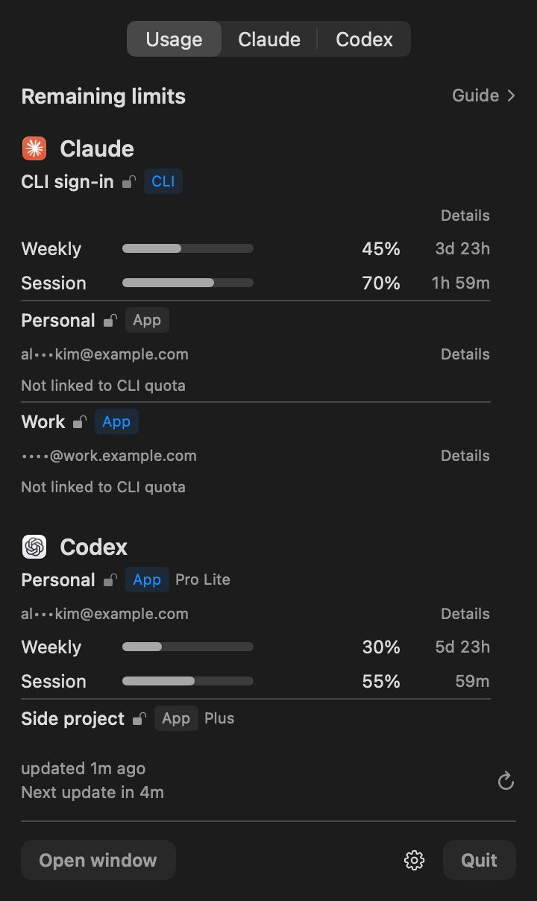

# UsageSwitch

See remaining AI usage. Switch Claude/Codex accounts when you choose.

A local-first macOS menu-bar app: a compact usage list for your detected tools and
registered accounts, plus the existing Claude sign-in switcher and per-account Codex homes.

[한국어](README.ko.md) · Download: [latest release](https://github.com/deximple/usageswitch/releases/latest) · [Privacy](PRIVACY.md) · [Changelog](CHANGELOG.md)

<p></p>
<sub>Screenshot: development preview, synthetic demo data — no real accounts or quotas shown.</sub>

The app is in English, 한국어, 简体中文, 日本語 and Español (follows the system language;
change it in ⚙︎ › Language). Version 2.1.2.

## Requirements

- macOS 15 or later — Apple silicon and Intel.
- Published releases are signed with a Developer ID and notarized by Apple.
  Development previews are ad-hoc signed and not notarized.
- For account switching: Claude Desktop and/or the Codex desktop app. Usage-only
  environments can use the supported local CLIs without those apps.

## Install

1. Download `UsageSwitch-<version>.dmg` (or `.zip`) from the [latest release](https://github.com/deximple/usageswitch/releases/latest).
2. Open it and drag **UsageSwitch** to **Applications**.
3. Open UsageSwitch — it lives in the menu bar; opening it from Finder also shows its window.

## How it works

The usage list is **environment-first**: it shows only providers that are installed or
have registered accounts — detected CLI executables and `.app` directories, never a fixed
seven-provider catalog. Filesystem-only discovery never runs candidates; the caller's
PATH order wins. With Claude, Codex and Cursor present you see exactly three; a Claude-only
setup shows Claude and its saved accounts. Absent providers run no credential reads or
collection jobs.

The compact 360-pt menu shows the **percent remaining** (not used) of each limit window
with a short reset like `2d 3h`. Up to three trustworthy fresh windows per account;
"More limits" opens the detail window with all of them. The optional **Guide** offers at
most one conservative next-account candidate from comparable subscription windows — it
never switches or launches anything.

**Details** opens a window per account to inspect full limits, reset times and source.
Saved Claude accounts can explicitly connect or disconnect a user-selected CLI profile
there; this runs only the official CLI auth-status and `/usage` reads after consent.
No other provider or account auth actions happen there. Saved Claude/Codex
**display names** can be edited using the existing account registry; renaming updates
the list and Guide immediately without recollecting usage. A name edit never changes
sign-in, email, or plan, and the CLI snapshot keeps the last collected reading until
the next normal refresh.

Claude CLI quota is never attributed to a saved Claude App account automatically. A saved
account can opt in separately by choosing a Claude CLI profile the user has signed in to and
confirming **Enable**. UsageSwitch runs the official CLI's `claude auth status --json` and
`/usage` with that profile, and shows quota only when the same account and organization are
confirmed before and after the read. The CLI reads its own saved sign-in (which may involve
the macOS Keychain) and may refresh its own token or update its own config files; UsageSwitch
reads only the account and organization IDs in `.claude.json`. It never runs a task or model
request, signs in or out, or switches accounts. Disconnect removes the binding and displayed
reading without changing or deleting the profile. API profiles stay marked `API` — never
treated as subscription balances.

## Providers

| Provider | Read path | Availability |
|---|---|---|
| Claude Code | CLI `/usage` | Current CLI sign-in; refused when managed Claude settings apply |
| Saved Claude account | Opt-in official CLI profile (`auth status --json`, then `/usage`) | Explicit per-account binding; profile identity/auth checked before and after each read |
| Codex | `app-server` → `account/rateLimits/read` | Listed ChatGPT homes; API-key profiles don't report subscription quota |
| Cursor | Current-period usage endpoint; may run `cursor-agent status` so cursor-agent renews an expired sign-in | Opt-in; windows are the monthly included total plus the dashboard pools “Cursor Models” and “Other Models”; Grok Bot and on-demand spending are not read |
| Grok | CLI usage endpoint | Opt-in; **experimental** |
| Gemini | Code Assist project/quota — may exchange the stored refresh token for a memory-only access token | Opt-in; Keychain then legacy auth file (encrypted-file storage unsupported); model/input/output limits kept separate; individual accounts Google moved to Antigravity show that state |
| Antigravity | Hidden `agy` `/usage` screen; read-only Code Assist quota API as fallback/enrichment | Opt-in; may use agy's Keychain login for a temporary in-memory API token |
| Devin | CLI-compatible user status | Opt-in; requires a supported CLI version |
| OpenCode Go | Go usage endpoint | Opt-in; only the Go plan, not an OpenCode total |

Suggestion model data is bundled as a frozen snapshot; the app does not fetch it at runtime.

The six optional providers are all **off by default**. Enabling one explains that
UsageSwitch reads that provider's local sign-in and sends read-only usage requests to a
fixed allowlist over HTTPS — no redirects, bounded responses. Gemini may make two API
requests; Antigravity may make a token exchange and two quota API requests. Gemini supports
its CLI Keychain item and legacy `~/.gemini/oauth_creds.json`, using only its access token
and expiry; forced encrypted-file storage is unsupported and shows no sign-in. Antigravity
runs `agy` from your home folder in a hidden terminal to read `/usage`, at most once every
9 minutes. `agy` starts with its normal configuration, which may include MCP servers you
configured. UsageSwitch never answers agy's prompts, including the folder-trust prompt; if
agy asks, the app sends no response and falls back to the read-only quota API. That fallback
may use the Keychain generic-password item with service `gemini` and account
`antigravity-acp` to mint a temporary access token held only in memory; macOS may ask to
allow access to that item. The token is not saved and UsageSwitch does not write to agy's
configuration. Those optional-provider tokens are never saved or logged by the usage collectors.
The newer connectors are **experimental** — private
endpoints may change and live-account compatibility is not yet verified. UsageSwitch
never signs in or out, switches accounts, or runs model tasks. Antigravity's refresh-token
grant is used only to obtain a temporary in-memory access token for the read-only quota call;
no model requests are sent.
For an explicitly
connected Claude profile, the official CLI may refresh its own token or update its
own config files as described above. Usage collection makes no model requests. There
is no analytics, telemetry, or background auto-updater.

## Account actions

- **Claude tab** — save each account's Claude Desktop sign-in once, then switch in one
  click. A switch quits Claude normally (never force-quits), asks first if Code sessions
  are running, then replaces the local sign-in, verifies it in Claude's log, and rolls
  back on any failure. Nothing signs out on the server.
- **Codex tab** — one Codex home per account, each opened in its own window. Sign-in
  always goes through Codex's own CLI; `auth.json` is never copied or swapped between
  homes (Codex refresh tokens are single-use). Removing an added home signs it out, so
  removal is a deliberate action — the standard `~/.codex` can't be removed.
- Both are **user-triggered** actions — UsageSwitch quits/opens apps only when you ask,
  never because of a quota reading.

## Command line (read-only examples)

```bash
APP=/Applications/UsageSwitch.app/Contents/MacOS/UsageSwitch
"$APP" --cli status        # Claude accounts + active account + Code sessions
"$APP" --cli codex status  # Codex homes
"$APP" --cli usage         # last usage read as JSON — reads only the persisted
                           # masked snapshot; no live collection, may lag a
                           # name edit until the next normal refresh
```

Run `"$APP" --cli` with no command for the full list.

## Privacy and safety

Display-only usage: no switches, launches, or sign-ins happen because of a limit.
Optional-provider reads happen only after explicit opt-in and their tokens are never
persisted or logged by the collectors; Claude sign-in snapshots are deliberately stored
encrypted for switching. No raw HTTP or credential values appear in the UI. Full
sources, destinations and write boundaries: [PRIVACY.md](PRIVACY.md).

The API tab estimates spend only from local logs belonging to accounts marked as API-key
accounts; a Codex session whose log shows a ChatGPT plan is left out even when the account now uses an API key. All figures are estimates, not provider balances. Budgets are stored locally.
API keys entered in the optional vault are stored in macOS Keychain and are never sent
anywhere because no verified read-only balance endpoint is available.

## Build and contribute

Requires Xcode 16+ (Swift 6) on macOS 15+.

```bash
swift build
./scripts/test.sh              # tests + coverage report
./scripts/bundle.sh            # universal bundle; Developer ID when available,
                                # ad-hoc fallback for local builds
python3 scripts/check-l10n.py  # localization key check
```

`scripts/notarize.sh` submits to Apple's notary service using an existing
`NOTARY_PROFILE` keychain profile — a release cannot use the ad-hoc fallback.

## Limitations

- Switching depends on Claude Desktop's internal files; a Claude update that changes
  them fails safely and rolls back until UsageSwitch is updated.
- A saved Claude sign-in can expire or be revoked and require a fresh sign-in.
- Codex homes that keep sign-in in the Keychain (`cli_auth_credentials_store = "keyring"`)
  may show as signed out.
- Optional provider connectors are experimental; live-account compatibility is unverified.
- No costs, balances, or per-model spending — quota is what each provider reports.

## Uninstall

1. Optional: to sign out of Codex accounts you added, remove them in the Codex tab before quitting.
2. Turn off ⚙︎ › **Open at Login**, quit UsageSwitch and move it to the Trash.
3. Optional: delete its data folder (`~/Library/Application Support/com.jaysong.usageswitch/`)
   — it holds saved sign-ins, settings and the Codex homes added in UsageSwitch, so keep
   anything you need first.

## Acknowledgments

An independent open-source project — not affiliated with or endorsed by Anthropic,
OpenAI, Cursor, xAI, Google, Cognition or Sourcegraph; product names belong to their
owners. Related community switchers: [claudepot-app](https://github.com/xiaolai/claudepot-app),
[claude-desktop-accounts](https://github.com/5eanxlee/claude-desktop-accounts),
[Swivel](https://github.com/jspanji/Swivel), [claude-graft](https://github.com/aaditya-v-more/claude-graft).

## License

MIT — see [LICENSE](LICENSE).
