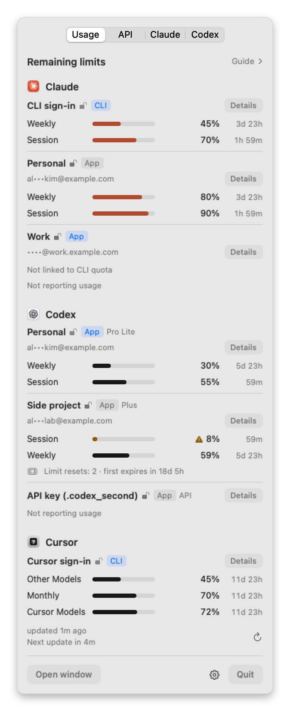
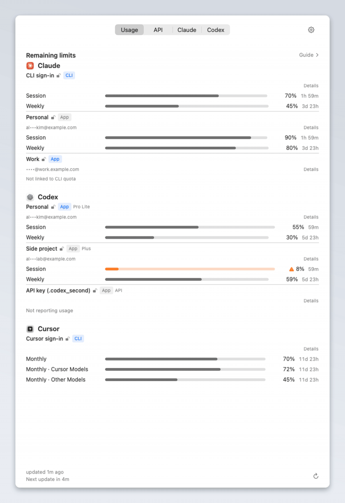
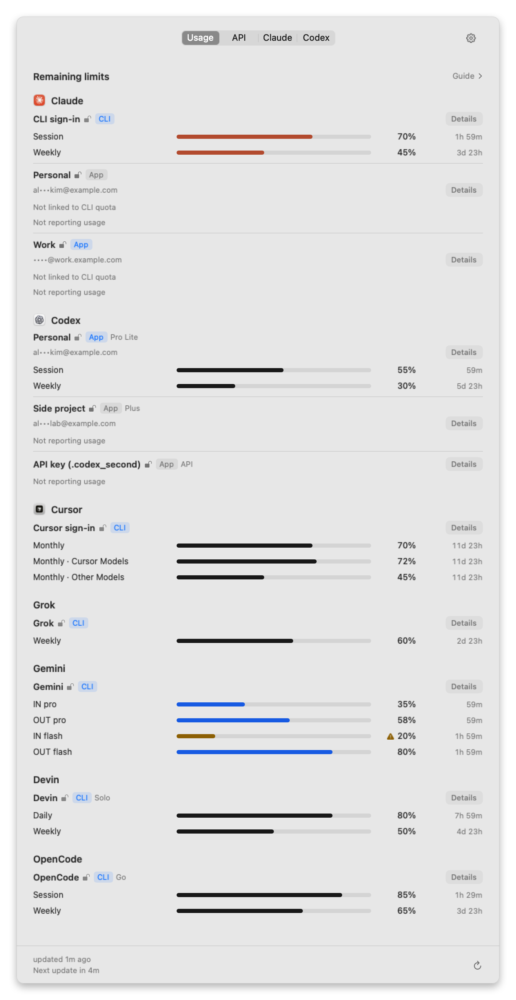
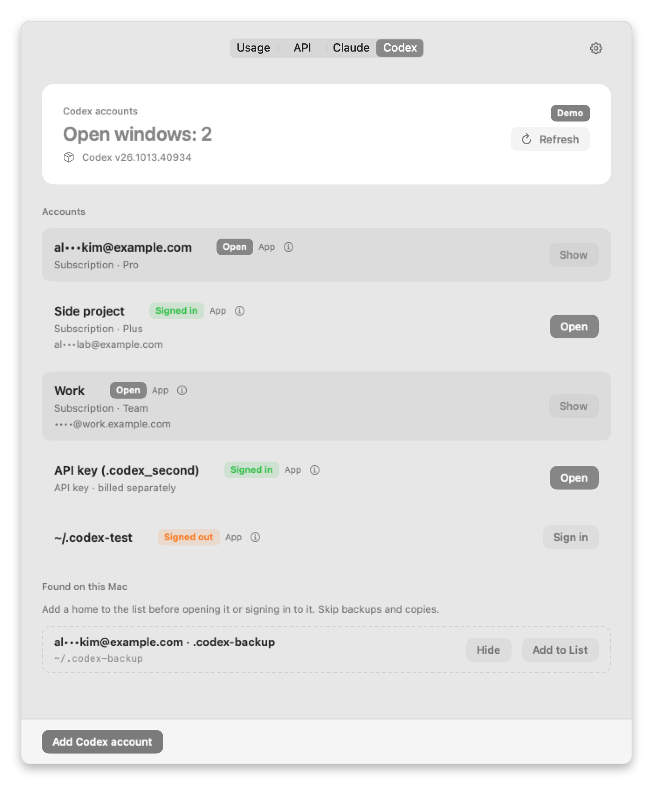
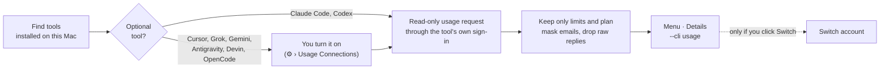

<div align="center">


# UsageSwitch

**See how much AI usage you have left. Switch accounts when you choose.**

A native macOS menu-bar app for people who work across Claude, Codex, Cursor and other AI coding tools —
often with more than one account each.

[](https://github.com/deximple/usageswitch/releases/latest)


[](https://github.com/deximple/usageswitch/actions/workflows/ci.yml)
[](LICENSE)

**English** · [한국어](README.ko.md) · [日本語](README.ja.md) · [简体中文](README.zh-Hans.md) · [Español](README.es.md)

<a href="https://github.com/deximple/usageswitch/releases/latest"></a>

<br><br>

<picture>
  <source media="(prefers-color-scheme: dark)" srcset="docs/screenshots/en/menu-dark.png">
  
</picture>

<sub>Every screenshot and animation here uses the app's built-in demo data. No real accounts.</sub>

</div>

---

**Contents** —
[What it does](#what-it-does) ·
[See it in action](#see-it-in-action) ·
[Install](#install) ·
[Get started](#get-started) ·
[Reading the list](#reading-the-usage-list) ·
[Status messages](#when-a-row-shows-a-message) ·
[Supported tools](#supported-tools) ·
[Guide](#guide) ·
[Switching accounts](#switching-accounts) ·
[API tab](#api-tab) ·
[Settings](#settings) ·
[Privacy](#privacy-and-safety) ·
[Command line](#command-line) ·
[FAQ](#faq) ·
[Limitations](#limitations) ·
[Uninstall](#uninstall) ·
[Build](#build-from-source)

## What it does

| | |
|---|---|
| 📊 **Every limit at a glance** | Session, daily, weekly and monthly limits for each account, shown as the share you have **left** and the time until it resets. |
| 🧭 **Only what you actually use** | The list shows the tools installed on this Mac and the accounts you registered. A tool you don't have never appears, and nothing is read for it. For Claude and Codex, the local usage logs behind the Guide and the API tab are always read — that part can't be turned off. |
| 💡 **A hint, never an autopilot** | The **Guide** suggests which account, model and effort fit what's left, using those local log reads. It never switches, launches or signs in on its own. |
| 🔁 **Switch in one click** | Swap the Claude Desktop sign-in between saved accounts (verified, with automatic rollback), and run Codex accounts side by side in separate windows. |
| 🔒 **Private by design** | No analytics, telemetry or background updater. Emails are masked. The six optional tools stay off until you turn each one on. |

## See it in action

<p align="center">
  
</p>

1. **See** — click the menu-bar icon. Each account shows how much of every limit is left and when it resets.
2. **Get a hint** — open **Guide** to see which account still has room for the kind of work you're about to do.
3. **Switch** — in the **Claude** tab, click **Switch**. UsageSwitch restarts Claude Desktop signed in to that account, confirms it, and rolls back if anything goes wrong.

You decide every step. A limit running low never triggers a switch, a launch or a sign-in.

## Install

**Requirements:** macOS 15 Sequoia or later, on Apple silicon or Intel.

1. Download `UsageSwitch-<version>.dmg` from the [latest release](https://github.com/deximple/usageswitch/releases/latest).
2. Open it and drag **UsageSwitch** into **Applications**.
3. Open UsageSwitch. It lives in the menu bar and has no Dock icon. Opening it from Finder also shows its window.

Releases are signed with a Developer ID and notarized by Apple, so macOS only shows its usual "downloaded from the Internet" prompt the first time.
Each release includes `SHA256SUMS.txt` if you want to verify the download.
To update, use **⚙︎ › Check for Updates…**. It opens the releases page; UsageSwitch never updates itself in the background.

## Get started

### 1. Look at the Usage tab

The **Usage** tab is the first thing you see. Claude Code and Codex readings start on their own because they come from those tools' own command-line programs.
If a list is empty, that tool isn't signed in yet — see [Status messages](#when-a-row-shows-a-message).

### 2. Turn on the tools you use (optional)

Cursor, Grok, Gemini, Antigravity, Devin and OpenCode Go are **off by default**. For each one you use:

- click **Connect usage** on its row, or open **⚙︎ › Usage Connections**;
- read the dialog — it says exactly what is read and where requests go;
- click **Enable**.

Turning a connection off stops reading it and removes its numbers.

### 3. Give saved Claude accounts their own numbers (optional)

Claude Desktop sign-ins don't report quota, so a saved Claude account shows **Not linked to CLI quota** until you link it to a Claude Code profile signed in to the same account:

```bash
# Create a separate Claude Code profile for your "Work" account and sign in to it
CLAUDE_CONFIG_DIR="$HOME/.claude-work" claude
```

Then, in UsageSwitch, open that account's **Details** → **Connect usage via CLI profile…** → pick the folder (press <kbd>⌘</kbd><kbd>⇧</kbd><kbd>.</kbd> to show hidden folders) → **Enable**.
UsageSwitch shows the numbers only when the profile's account/org IDs and the CLI-reported org, config folder and email match the saved account, before and after every read.

### 4. Save accounts for switching

- **Claude** tab: while Claude Desktop is signed in, click **Save current sign-in**. Click **Sign in to another account**, sign in, and save again. Repeat for each account.
- **Codex** tab: click **Add Codex account** and sign in in your browser. Existing Codex folders found on this Mac appear under **Found on this Mac**; click **Add to List** for the ones you want.

## Reading the usage list

Each account is a small block: who it is, then one line per limit.

| What you see | What it means |
|---|---|
| **Personal** | The account's display name. Change it in **Details** → **Edit name**. |
|   | Where the reading comes from: a command-line sign-in or a desktop app. **Blue** means it's the sign-in in use right now (the current CLI sign-in, or the app that is open). |
| Open lock, in your accent color | Verified sign-in. |
| Open lock, grey | Saved sign-in. |
| Closed lock | Sign-in required. No lock means UsageSwitch can't tell, so it makes no claim. |
| `Pro Lite`, `Plus`, `Team`… | The plan the provider reports. |
| `API` · *API key · billed separately* | An API-key profile. It's billed per use and has no subscription limit, so it never counts as remaining quota. |
| `al•••kim@example.com` | The masked email. Turn on **⚙︎ › Always Show Emails** to show it in full. |
| `Weekly ▬▬▬▭▭ 45%  3d 23h` | A limit: its name, a bar, the share **left**, and the time until it resets. |
| `Cursor Models`, `Gemini Models`… | A limit that applies only to some models, named as the provider names it. |
| *may run out in 5h* | At the current pace, this limit empties before it resets. |
| **More limits (2)** | The compact menu shows up to three limits per account. The rest are in **Details**. |
| **Details** | Opens a window with every limit, reset times, where the reading came from and the tool version. |

**Bar colors:** grey has room; orange has passed your warning level (80 % used by default); red is used up; a faded bar is an old reading waiting for a refresh.

**Footer:** *updated 1m ago · Next update in 4m*. UsageSwitch refreshes every 5 minutes, right after a limit resets, and when you click ↻.

**Pin a limit:** right-click a limit and choose **Pin**. The menu bar then shows that limit (for example *Weekly 25% left*) instead of whichever limit is tightest.

<p align="center">
  
</p>

## When a row shows a message

A row without numbers always says why. Here is what each message means and what to do.

| Message | Why | What to do |
|---|---|---|
| **Usage connection required** | This optional tool is turned off. | Click **Connect usage**, or use **⚙︎ › Usage Connections**. |
| **No sign-in found — sign in to *X* first** | The tool is installed but not signed in on this Mac. | Sign in with that tool once. |
| **Sign-in expired — run *`command`* once in Terminal** | Its stored sign-in has expired. | Run the command shown: `claude auth login`, `codex login`, `cursor-agent login`, `grok login`, `gemini`, `agy`, `devin auth login` or `opencode auth login`. |
| **Sign-in not accepted — run *`command`* once in Terminal** | The provider rejected the stored sign-in — it was revoked, replaced by another app's sign-in, or belongs to an account this tool won't serve. | Run the command shown and sign in with the account you want to see. |
| **Not linked to CLI quota** | A saved Claude Desktop account has no linked Claude Code profile. | [Link a profile](#3-give-saved-claude-accounts-their-own-numbers-optional) in **Details**. |
| **Not reporting usage** | The tool answered without a usage number: an API-key profile (no subscription limit), a signed-out Codex home, or an account with no subscription limit. | Nothing to fix. Use the [API tab](#api-tab) for spend estimates (Codex API-key accounts only). |
| **This account isn't eligible for *X* usage** | The provider says this account's plan has no quota to show. | Nothing to fix. |
| **Google no longer offers Gemini CLI quota for individual accounts (moved to Antigravity)** | Google moved individual accounts to Antigravity. | Turn on **Antigravity**; its *Gemini Models* limit shows the same quota. |
| **Usage read was refused** | The tool's command-line program stopped without returning a usage report. | It retries at the next refresh. If it keeps happening, open the tool once in Terminal to check it's signed in and working. |
| **Usage came back for a different account, so none is shown** | The sign-in changed during a read. UsageSwitch never shows another account's numbers. | Wait for the next refresh. |
| **Couldn't read usage — this *X* version may need a UsageSwitch update** | The tool's response format changed. | Check for a newer UsageSwitch, or [open an issue](https://github.com/deximple/usageswitch/issues). |
| **Timed out reading usage** · **Couldn't reach the service** · **Rate limited — try again later** | A temporary network or service problem. | It retries at the next refresh. |
| **Command-line tool not found** | The tool's command-line program isn't installed or isn't on your `PATH`. | Install it, or check your `PATH`. |
| **Managed settings — usage can't be read** | Your organization manages Claude Code's settings on this Mac. | Expected. UsageSwitch doesn't read usage there. |
| **Reset passed — refresh needed** | The limit has reset since the last reading. | Click ↻ or wait a moment. |

## Supported tools

| Tool | What you see | Where the numbers come from | How to turn it on |
|---|---|---|---|
| **Claude Code** | Session (5 h), weekly, and per-model weekly limits | The `claude` CLI's `/usage` | Automatic |
| **Saved Claude Desktop accounts** | Same as Claude Code | A Claude Code profile you link (`claude auth status`, then `/usage`) | Per account, in **Details** |
| **Codex** | Session and weekly limits, per ChatGPT account | `codex app-server` | Automatic |
| **Cursor** | Monthly total, plus *Cursor Models* and *Other Models* | Cursor's usage API, using the `cursor-agent` sign-in | ⚙︎ › Usage Connections |
| **Grok** | Weekly limit | The Grok CLI's usage endpoint | ⚙︎ › Usage Connections |
| **Gemini** | Per-model input and output limits | Gemini Code Assist quota, using the Gemini CLI sign-in | ⚙︎ › Usage Connections |
| **Antigravity** | Model-group limits (for example *Gemini Models*) | `agy`'s `/usage` screen, plus a read-only quota API on every refresh (also the fallback when the screen can't be read) | ⚙︎ › Usage Connections |
| **Devin** | The quota the Devin CLI reports | The Devin CLI's user status | ⚙︎ › Usage Connections |
| **OpenCode Go** | Rolling 5-hour, weekly and monthly limits | OpenCode's Go usage endpoint | ⚙︎ › Usage Connections |

A tool is listed when its command-line program is on your `PATH` (or in `~/.local/bin`, the usual npm, bun and Volta folders, `/opt/homebrew/bin` or `/usr/local/bin`) or its app is in `/Applications` or `~/Applications`. Finding a tool never runs it.

<details>
<summary><b>Exactly what each optional connection reads and sends</b></summary>

<br>

Every optional connection reads the tool's own local sign-in, keeps it in memory only, and sends read-only HTTPS requests to a fixed allowlist — one host per tool, two for Gemini and Antigravity (their quota endpoint plus `oauth2.googleapis.com` for a token refresh). Redirects are refused and responses are capped at 1 MiB. Nothing is logged or saved.

| Tool | Local sign-in it reads | Host it contacts | Notes |
|---|---|---|---|
| Cursor | Cursor's Keychain entry, then `~/.cursor/auth.json` | `api2.cursor.sh` | One request per refresh. An expired token sends no request. A browser `cursor-agent login` lasts about 60 days; an API-key sign-in about an hour. Grok Bot and on-demand spending are not read. |
| Grok | The Grok CLI sign-in file | `cli-chat-proxy.grok.com` | Experimental. |
| Gemini | Gemini CLI's Keychain item, then `~/.gemini/oauth_creds.json` | `cloudcode-pa.googleapis.com`, `oauth2.googleapis.com` | If the access token has expired, UsageSwitch uses the stored refresh token with the installed Gemini CLI's own sign-in client to get a temporary token held only in memory. It never writes anything back. Up to three requests per refresh. |
| Antigravity | `agy` itself, run in a hidden terminal from your home folder (at most every 9 minutes); agy's Keychain item (or `~/.gemini/jetski-standalone-oauth-token` when the Keychain has none), read on every refresh | `oauth2.googleapis.com`, `cloudcode-pa.googleapis.com` | `agy` starts with its normal settings, including any MCP servers you set up. UsageSwitch never answers agy's prompts. macOS may ask once to allow Keychain access. |
| Devin | The Devin CLI's credentials and version | `server.codeium.com` | Needs a supported Devin CLI version. |
| OpenCode Go | The `opencode-go` entry in OpenCode's `auth.json` | `opencode.ai` | Go plan only, not other OpenCode usage. |

These are private endpoints, not stable public APIs. A provider update can break a reading until UsageSwitch is updated — the row then says so instead of showing wrong numbers.
The full list of files read and written is in [PRIVACY.md](PRIVACY.md).

</details>

## Guide

Click **Guide** above the list to open it. A small dot next to it means a suggestion is ready (turn the dot off with **⚙︎ › Show the Guide indicator**).

- **Mode** — caps how strong a model and how much effort a suggestion may pick:

  | Mode | Suggests at most |
  |---|---|
  | *Saver* | mid-tier models, medium effort |
  | *Balanced* | frontier models at medium effort, or mid-tier models at high effort |
  | *Focus* | frontier models, high effort |
  | *Urgent* | frontier models, maximum effort — asks first, and returns to *Balanced* at the next 5-hour Claude reset (or after five hours) |

- **Task** — slide from *Simple coding* to *Maximum reasoning* to say what you're about to do.
- **Suggestion** — one line naming the account, the model and the effort that fit what's left right now. When no model suggestion fits, the Guide shows the account with the most room among comparable subscription accounts. API-key profiles are never suggested.

The Guide only suggests. To act on it, you switch yourself.

<details>
<summary><b>What the Guide reads and keeps</b></summary>

<br>

- **Reads:** your usage readings, plus model, effort, timestamp and token-count fields from local Claude Code and Codex session logs. Conversation content is never read.
- **Model data:** a fixed model catalog that ships inside the app. Nothing is downloaded at runtime.
- **Keeps:** small local learning files keyed by salted account hashes — no names, emails or content. Raw files are archived after 14 days and deleted after 180 days.
- **Delete:** **⚙︎ › Flush learning data** removes them now. Your mode and task settings stay.

</details>

## Switching accounts

### Claude Desktop (Claude tab)

Save each account's Claude Desktop sign-in once, then click **Switch** on any of them. A switch:

1. asks first if Claude Code sessions are running (their history is kept);
2. pauses anything that would relaunch Claude mid-switch, then quits Claude normally — never a force quit;
3. swaps the local sign-in, starts Claude, and confirms the account from Claude's log;
4. rolls back to the previous account if any step fails.

Your first switch makes a one-time backup of the original sign-in. Nothing is signed out on the server.
**Sign in to another account** clears the sign-in on this Mac only, and only after saving the current one.

### Codex (Codex tab)

Each Codex account gets its own Codex folder and opens in its own window, so several accounts can run side by side.
Sign-in always goes through Codex's own `codex login` in your browser, and sign-in files are never copied between folders.
**Remove** signs that account out on this Mac and moves its folder to the Trash. **Remove from List** only hides a folder found on this Mac. The standard `~/.codex` can't be removed.

<p align="center">
  
</p>

## API tab

For accounts that use an API key instead of a subscription:

- **Budgets** — set a prepaid balance or a monthly quota (with its reset day) for Anthropic, OpenAI, Google or xAI.
- **Estimates** — spend over the last 7 days, the average daily rate, and roughly how many days your budget lasts. These are estimated from local CLI logs of API-key accounts only, never fetched from the provider.
- **API key vault** — the app asks for Touch ID or your password when you add, show or delete a key. Keys are stored in the login Keychain and follow its access rules. Keys are never sent anywhere.

## Settings

Everything lives in the **⚙︎** menu.

| Setting | What it does |
|---|---|
| Language | English, 한국어, 日本語, 简体中文 or Español. Follows the system by default. |
| Appearance | Follow System, Light or Dark. |
| Open at Login | Starts UsageSwitch when you log in. |
| Show Account Name in Menu Bar | Shows the current Claude account's name next to the icon (emails stay masked). |
| Always Show Emails | Shows full emails instead of masked ones. |
| Show Usage in Menu Bar | Shows the tightest (or pinned) limit next to the icon, for example *Weekly 25% left*. On by default. |
| Usage Alerts · Warn at used percentage | Sends a macOS notification when a limit passes 70 %, 80 % (default) or 90 % used. |
| Show the Guide indicator | The dot next to **Guide** when a suggestion is ready. |
| Usage Connections | Turns each optional tool on or off. Lists only tools found on this Mac. |
| Flush learning data | Deletes the Guide's local learning files. |
| Show Data Folder in Finder | Opens `~/Library/Application Support/com.jaysong.usageswitch/`. |
| Check for Updates… | Opens the releases page in your browser. |

## Privacy and safety



**UsageSwitch never:**

- switches accounts, opens apps or signs in because a limit is low;
- sends model requests or runs tasks — reading usage costs nothing;
- signs you out on the server, or decrypts Claude's cookies;
- saves or logs the tokens it reads for usage, or sends them anywhere except that tool's own host;
- sends analytics, telemetry or crash reports, or updates itself in the background.

**What it stores** — all in `~/Library/Application Support/com.jaysong.usageswitch/`, readable only by you:
saved Claude Desktop sign-ins (still encrypted exactly as Claude stores them), Codex folders you added, settings, the last usage reading with emails masked, and the Guide's learning files.

The complete list of every file read, written and every host contacted is in **[PRIVACY.md](PRIVACY.md)**. To report a security problem privately, see [SECURITY.md](SECURITY.md).

## Command line

The app binary doubles as a JSON command-line tool.

```bash
APP=/Applications/UsageSwitch.app/Contents/MacOS/UsageSwitch

"$APP" --cli usage            # the last usage reading (JSON)
"$APP" --cli status           # saved Claude accounts and Claude's state
"$APP" --cli codex status     # Codex accounts
"$APP" --cli switch Work      # switch Claude Desktop to the account named "Work"
"$APP" --cli                  # list every command
```

`--cli usage` prints what the app last read and saved. It doesn't contact any tool or the network, so open UsageSwitch once first. Emails are always masked.

<details>
<summary><b>Example output and a one-line summary with <code>jq</code></b></summary>

<br>

```json
{
  "ok" : true,
  "result" : {
    "accounts" : [
      {
        "accountRef" : "codex#1",
        "authentication" : "subscription",
        "id" : "codex#1",
        "label" : "al•••kim@example.com",
        "plan" : "prolite",
        "provider" : "codex",
        "readAt" : "2026-11-09T05:10:00Z",
        "state" : "ok",
        "toolVersion" : "0.166.0",
        "windows" : [
          {
            "durationMinutes" : 10080,
            "kind" : "weekly",
            "leftPercent" : 69,
            "resetsAt" : "2026-11-13T14:00:00Z",
            "usedPercent" : 31
          }
        ]
      },
      {
        "accountRef" : "current",
        "authentication" : "unknown",
        "id" : "gemini:current",
        "label" : "Gemini",
        "problem" : "notEligible",
        "provider" : "gemini",
        "readAt" : "2026-11-09T05:10:00Z",
        "state" : "unavailable",
        "windows" : []
      }
    ],
    "generatedAt" : "2026-11-09T05:10:00Z"
  }
}
```

`state` is `ok`, `notReporting`, `unavailable` or `failed`; `problem` names the reason. Account IDs are opaque and change order with the list.

```bash
"$APP" --cli usage | jq -r '.result.accounts[]
  | "\(.provider)\t\(.label)\t\([.windows[] | "\(.scope // .kind) \(.leftPercent | floor)% left"] | join(", "))"'
```

Commands that change something (`switch`, `capture`, `enroll`, `remove`, `codex add`, …) print progress on stderr and return non-zero exit codes on failure. `switch` asks for `--yes` when Claude Code sessions are running.
A `usageswitch://switch?id=<account-id>` link starts the same switch as the button, after you confirm it in the app.

</details>

## FAQ

<details>
<summary><b>Will it switch accounts for me when I run low?</b></summary>

No. Readings and suggestions are display-only. Only your click (or a command you run) switches, opens or signs in.

</details>

<details>
<summary><b>Does reading usage cost anything or use my quota?</b></summary>

No. UsageSwitch sends no model requests. It asks each tool for its usage through read-only commands and endpoints.

</details>

<details>
<summary><b>A tool I use isn't in the list.</b></summary>

UsageSwitch lists a tool only when it finds the tool's command-line program on your `PATH` (or in the usual npm, bun and Volta folders), or its app in `/Applications` or `~/Applications`. Cursor, Grok, Gemini, Antigravity, Devin and OpenCode then also need **⚙︎ › Usage Connections**.

</details>

<details>
<summary><b>Why does a saved Claude account say "Not linked to CLI quota"?</b></summary>

Claude Desktop sign-ins don't expose usage. Link a Claude Code profile signed in to the same account — see [step 3](#3-give-saved-claude-accounts-their-own-numbers-optional). UsageSwitch never guesses the link from an email address.

</details>

<details>
<summary><b>Cursor keeps saying the sign-in expired.</b></summary>

UsageSwitch uses the sign-in that `cursor-agent` stores, and never renews it itself. A browser `cursor-agent login` lasts about 60 days, while an API-key sign-in lasts about an hour. Run `cursor-agent login` and pick the browser sign-in.

</details>

<details>
<summary><b>Gemini shows a message instead of numbers.</b></summary>

Google no longer offers Gemini CLI quota for individual accounts and moved them to Antigravity. Turn on **Antigravity**: its *Gemini Models* limit is the same quota.

</details>

<details>
<summary><b>Is it safe to use while sharing my screen?</b></summary>

Emails are masked everywhere by default, including the menu bar. The saved usage file and `--cli usage` output are always masked, even if you choose **Always Show Emails**. Other CLI output — `--cli status`, `--cli codex status`, `--cli switch` and `--cli capture` — prints the account's raw email.

</details>

<details>
<summary><b>Is UsageSwitch made by Anthropic, OpenAI or another provider?</b></summary>

No. It's an independent open-source project and isn't affiliated with or endorsed by any of them.

</details>

## Limitations

- Switching Claude Desktop depends on Claude's internal files. If a Claude update changes them, a switch fails safely and rolls back until UsageSwitch is updated.
- A saved Claude sign-in can expire or be revoked. Its row then asks you to **Sign in again**.
- Codex folders that keep their sign-in in the Keychain (`cli_auth_credentials_store = "keyring"`) may appear signed out.
- The optional connections use private endpoints that can change without notice.
- UsageSwitch shows the limits each provider reports. It doesn't show provider balances or bills; the API tab shows local estimates only.

## Uninstall

1. Optional: delete your API keys in the **API** tab first — they stay in the Keychain after uninstall.
2. Optional: to sign out of Codex accounts you added, remove them in the **Codex** tab first.
3. Turn off **⚙︎ › Open at Login**, quit UsageSwitch, and move it to the Trash.
4. Optional: delete `~/Library/Application Support/com.jaysong.usageswitch/`. It holds your saved sign-ins, settings and the Codex folders added in UsageSwitch, so keep anything you still need.

## Build from source

Requires Xcode 26 or later (the macOS 26 SDK) on macOS 15 or later.

```bash
swift build                    # debug build
./scripts/test.sh              # tests and a coverage report
python3 scripts/check-l10n.py  # checks that all five languages have every string
./scripts/bundle.sh            # universal build/UsageSwitch.app (Developer ID if available, ad-hoc otherwise)
```

To try the interface without any accounts, run the bundle with demo data — it never touches your real data:

```bash
build/UsageSwitch.app/Contents/MacOS/UsageSwitch --ui-fixture usage-seven
```

`./scripts/readme-screenshots.sh` regenerates every image in this README, in all five languages, from the same demo data.

Releases are notarized with `scripts/notarize.sh`, which needs an existing `NOTARY_PROFILE` keychain profile. A release can't use the ad-hoc fallback.
Issues and pull requests are welcome. Changes are listed in [CHANGELOG.md](CHANGELOG.md), and the design notes are in [DESIGN.md](DESIGN.md).

## Acknowledgments

An independent open-source project — not affiliated with or endorsed by Anthropic, OpenAI, Anysphere (Cursor), xAI, Google, Cognition (Devin) or SST (OpenCode). Product names belong to their owners.
Related community projects: [CodexBar](https://github.com/steipete/CodexBar), [claudepot-app](https://github.com/xiaolai/claudepot-app), [claude-desktop-accounts](https://github.com/5eanxlee/claude-desktop-accounts), [Swivel](https://github.com/jspanji/Swivel), [claude-graft](https://github.com/aaditya-v-more/claude-graft).

## License

[MIT](LICENSE) © 2026 Jay Song
