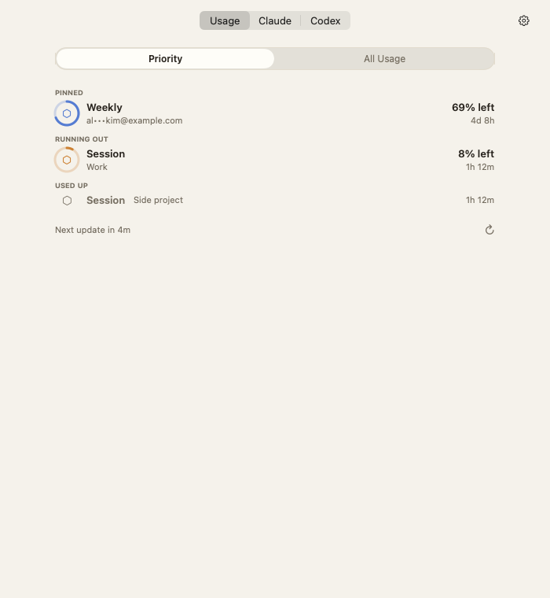
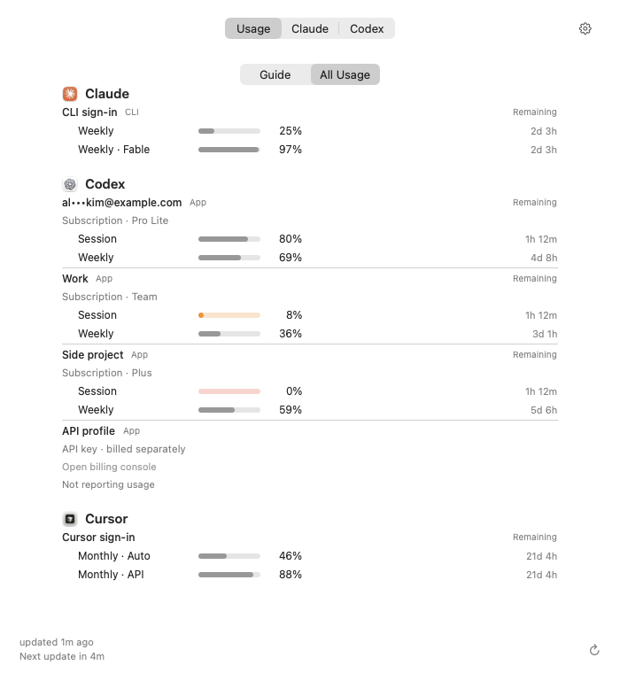
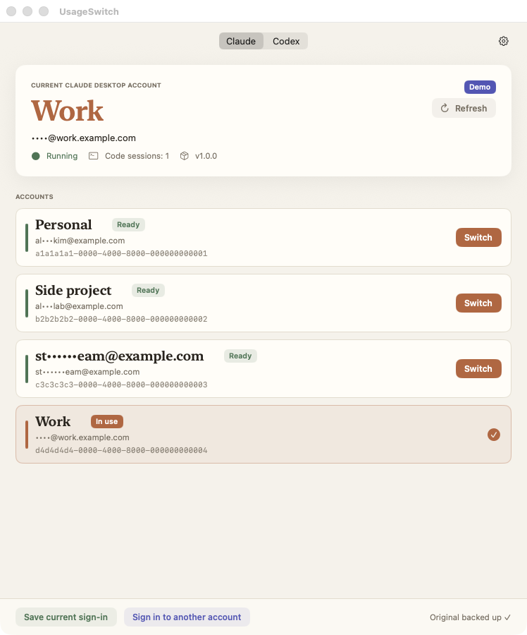
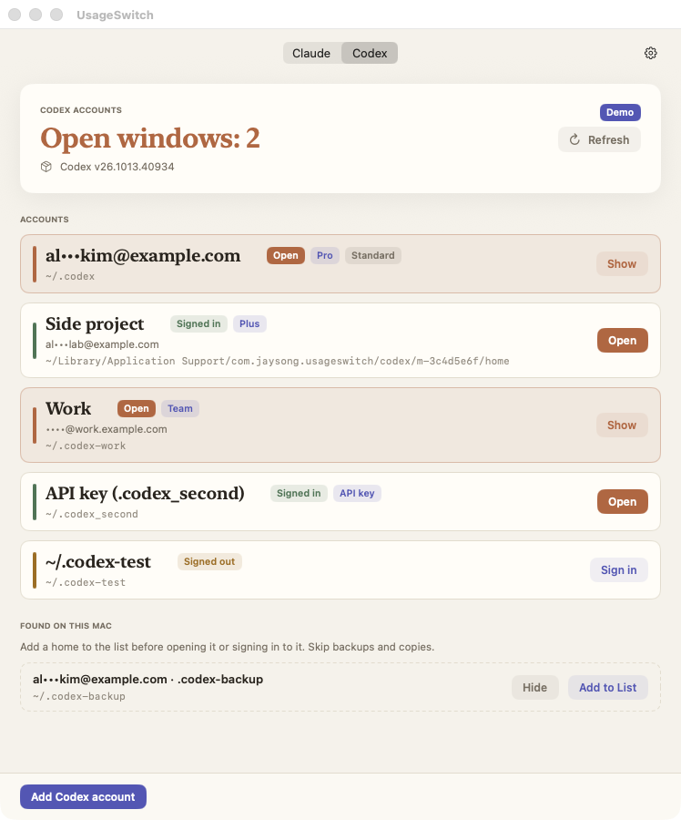
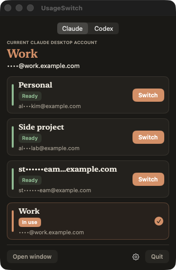
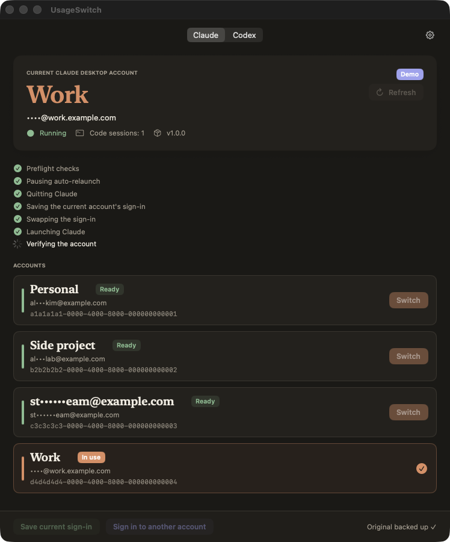

# UsageSwitch

A local-first usage dashboard and Claude/Codex account switcher for macOS.

- **Usage tab** — a compact list of your detected tools and registered accounts, remaining limits and resets. Details shows full limits and lets you edit saved account names; the optional Guide offers one conservative next-account candidate.
- **Claude tab** — save each account's Claude Desktop sign-in once, then switch Claude Desktop (including its Code tab) to any of them in one click. No signing out and back in.
- **Codex tab** — give each Codex account its own Codex home and open them side by side, each in its own window.

[한국어](README.ko.md) · Download: [latest release](https://github.com/deximple/usageswitch/releases/latest) · [Privacy](PRIVACY.md) · [Changelog](CHANGELOG.md)

<p>
  
  
</p>
<p>
  
  
</p>
<p>
  
  
</p>

<sub>Screenshots use demo data.</sub>

The app is available in English, 한국어, 简体中文, 日本語 and Español (it follows the system language; change it in ⚙︎ › Language).

## Usage

The list follows your local environment, not a fixed seven-provider catalog. With Claude, Codex and Cursor present, it shows those three; a Claude-only setup shows Claude and its saved accounts. Installation, saved sign-in and verified quota are separate signals. Claude CLI usage is not copied onto saved Claude App accounts.

| Provider | Read path | Availability |
|---|---|---|
| Claude Code | CLI `/usage`, with Claude Code's credentials | Default CLI sign-in; refused with managed Claude settings |
| Codex | `app-server` → `account/rateLimits/read` | Listed ChatGPT homes; API-key profiles do not report subscription quota |
| Cursor | Dashboard usage and plan endpoints | Explicit opt-in; Keychain or bounded auth-file fallback |
| Grok | CLI usage endpoint | Explicit opt-in; experimental |
| Gemini | Code Assist project/quota endpoints | Explicit opt-in; model/token limits kept separate |
| Devin | CLI-compatible user status endpoint | Explicit opt-in; supported CLI version required |
| OpenCode Go | Go usage endpoint | Explicit opt-in; not a total of all OpenCode providers |

The additional provider integrations in this development branch are experimental; private endpoints may change, and live-account compatibility is not yet verified. The table describes implemented read paths, not guaranteed quota availability for every plan or authentication mode.

**Settings > Usage Connections** asks before reading a provider's local sign-in or sending HTTPS usage requests. All five optional connections start off. Cursor and Gemini can each make two requests per refresh. Tokens are never saved or logged; requests reject redirects and bound response sizes. Disabled or absent providers do not run credential reads or collection jobs. See [Privacy](PRIVACY.md) for sources and destinations.

Usage never switches, launches or signs out because of a limit; it's display-only. What it adds on top:

- **Guide** — at most one next-account candidate, from accounts that report the same kinds of common windows; percentages compare the share of each limit left, never token counts. Nothing launches or switches on its own.
- **Pace** — when a window is draining fast enough to run dry before its reset, the row says so.
- **Details** — full limit names, reset information and collection method. Saved Claude/Codex display names use the existing account registry; Save propagates to the current list and Guide without recollecting usage. Blank is invalid; Default Name is an explicit restore. The CLI snapshot remains the last collected reading until the next normal refresh.
- **Alerts** — a macOS notification when a window crosses the warn level (⚙︎ › Usage Alerts, and the "Warn at used percentage" level next to it — 80% used, by default).
- **`--cli usage`** — prints the last read as JSON, for scripts and agents. It only reads the app's snapshot file — whose labels are always email-masked regardless of the show-emails setting — and never touches a vendor tool, Keychain or network.

Appearance offers **System / Light / Dark**, defaults to System and saves explicit overrides. Usage collection never initiates sign-in/out, token refresh, account switching or model-generation tasks. API profiles are marked `API`, not treated as subscription balances.

## Install

1. Download `UsageSwitch-<version>.dmg` from the [latest release](https://github.com/deximple/usageswitch/releases/latest).
2. Open it and drag **UsageSwitch** to **Applications**.
3. Open UsageSwitch. It lives in the menu bar, and opening it from Finder also shows its window.

Published releases are signed with a Developer ID and notarized by Apple. Development previews in this branch are ad-hoc signed and are not notarized.

**Requirements:**
- macOS 15 or later, Apple silicon or Intel.
- For account switching: [Claude Desktop](https://claude.ai/download), the Codex desktop app, or both, in `/Applications` or `~/Applications`. Usage-only environments can use the supported local CLIs without those desktop apps.

## Claude tab

### Add your accounts (once per account)

1. If Claude Desktop is signed in to the account you want, click **Save current sign-in**.
2. To add another account, click **Sign in to another account**. UsageSwitch saves the current sign-in and reopens Claude at its sign-in screen. This only clears the sign-in on this Mac; it doesn't sign you out on the server.
3. Sign in to the other account in Claude, then click **Save current sign-in**.

Each account appears in the list under its email. Click the pencil, or right-click › **Rename…**, to give it a name like "Work". Emails are masked until you click them; to show them always, turn on ⚙︎ › **Always Show Emails**.

### Switch

Click **Switch** next to an account, in the window or in the menu bar. Claude quits and reopens signed in to that account, and UsageSwitch shows each step as it happens.

- Running Code sessions stop when Claude quits; UsageSwitch asks first. Their history is kept with the account and shows again when you switch back.
- If Claude shows its "Claude is still working" dialog, UsageSwitch waits. If Claude still won't quit, it stops without changing anything.

Right-click an account for:
- **Rename…**
- **Sign In Again…** — refresh a saved sign-in, for example after it expired.
- **Remove Saved Sign-In** — not available for the account in use. It deletes the copy on this Mac only; the account itself and other devices are unaffected.

## Codex tab

Codex stores each sign-in in a Codex home (`~/.codex` by default). UsageSwitch keeps one home per account and opens each in its own Codex window, so several accounts can be open at once. It opens them the same way Codex opens its own second window: `CODEX_HOME`, plus a separate app-data folder.

- **Add Codex account** — UsageSwitch creates a new Codex home and starts Codex's own `codex login`. You sign in in your browser, then Codex opens for that account.
- **Open / Show** — opens that account's Codex window, or brings it to the front if it's already open.
- **Sign in** — re-authenticates an account that's signed out; right-click › **Sign In Again…** does the same for any account.
- **Remove…** — for accounts added in UsageSwitch: closes that account's Codex window, signs out with `codex logout`, then moves its home to the Trash. Homes added from **Found on this Mac** are only taken off the list (**Remove from List…**). The standard `~/.codex` can't be removed.
- **Found on this Mac** — existing homes such as `~/.codex-work` are suggested, not used. Click **Add to List** for the ones that are real accounts; skip backups and copies, since two homes with the same sign-in end up signing each other out.
- Right-click also offers **Rename…**, **Copy Terminal Command** (`CODEX_HOME=… codex`) and **Show in Finder**.

Sign-ins are never copied or swapped between homes. Codex refresh tokens are single-use, so swapping `auth.json` files can sign you out. Signing in and out goes through Codex's own CLI. The one exception is **Remove…**: if `codex logout` doesn't finish, UsageSwitch deletes that home's `auth.json` itself, so a live sign-in never goes to the Trash.

## Settings (⚙︎)

| Setting | What it does |
|---|---|
| Language | System language, or one of the five app languages |
| Appearance | Follows the system appearance by default; can be pinned to Light or Dark — the choice is remembered |
| Open at Login | When started at login, UsageSwitch stays in the menu bar without opening its window |
| Show Account Name in Menu Bar | Turn off to show only the icon |
| Always Show Emails | Show emails without clicking them |
| Show Hidden Codex Homes | Only appears after you've hidden a found home |
| Show Data Folder in Finder | Opens the folder described under Privacy below |
| Check for Updates… | Opens the releases page in your browser |
| About UsageSwitch | Version |

## Command line

The app binary has a JSON command-line interface:

```bash
APP=/Applications/UsageSwitch.app/Contents/MacOS/UsageSwitch
"$APP" --cli status                  # accounts, the active account, Code sessions
"$APP" --cli switch <account> --yes  # <account>: id from status, name, or email
"$APP" --cli capture --yes           # save Claude's current sign-in
"$APP" --cli enroll --yes            # prepare a new sign-in (reopens Claude at its sign-in screen)
"$APP" --cli rename <account> "Work" # --reset returns to the default name
"$APP" --cli remove <account>        # delete a saved sign-in (not the one in use)
"$APP" --cli codex status            # Codex accounts
"$APP" --cli usage                   # last usage read
"$APP" --cli codex open <account>
"$APP" --cli codex add               # sign in in the browser; Ctrl-C cancels
"$APP" --cli --lang ja status        # one-off language
```

Run `"$APP" --cli` with no command to print every command.

**Exit codes:**

| Code | Meaning |
|---|---|
| 0 | Success |
| 1 | Failed: nothing changed, or the previous account was restored and verified |
| 2 | Restored, but Claude's log didn't confirm it |
| 3 | Code sessions are running; add `--yes` |
| 4 | Recovery needed; run `recover` |
| 64 | Unknown command or missing argument; prints usage |

The link `usageswitch://switch?id=<account-id>` runs the same switch from other tools. A switch started from a link always asks for confirmation, and Cancel is the default.

## How a switch works

1. **Preflight checks:**
   - the saved sign-in is intact (SHA-256);
   - the cookie database schema is compatible;
   - at least 8 GB of disk is free;
   - no Claude update is being installed.
2. Pause any user LaunchAgent that would relaunch Claude, such as a keep-alive agent. UsageSwitch restores it afterwards and never edits the plist.
3. Quit Claude normally. UsageSwitch never force-quits it.
4. Re-save the outgoing account's cookies, so a refreshed sign-in isn't lost. The very first switch also keeps a backup of the original files.
5. Atomically replace Claude's `Cookies` database with the target account's copy.
6. Set `lastKnownAccountUuid` in Claude's `config.json` and clear its cached tokens, so Claude fetches fresh ones.
7. Relaunch Claude with a clean environment. UsageSwitch then waits for Claude's log to report the target account, and watches for 20 seconds.
8. If any step fails, put the previous files back exactly, relaunch, and verify the previous account.

Every step is written to a journal before it runs. If UsageSwitch or the Mac stops mid-switch, the next launch recovers it; you can also run `recover` from the command line.

## Privacy and safety

UsageSwitch makes no network connections of its own, and has no analytics or telemetry. **Check for Updates…** opens a web page in your browser; Codex sign-in happens in your browser through Codex's CLI. Details: [PRIVACY.md](PRIVACY.md).

- **No server sign-outs.** UsageSwitch never switches by signing out, because that would revoke the session on the server.
- **No decryption or printing of credentials.** Saved sign-ins are Claude's cookie database, still encrypted the way Claude stores it. UsageSwitch never reads the Keychain.
- **Writes only to:**
  - its data folder, `~/Library/Application Support/com.jaysong.usageswitch/`, readable only by you;
  - Claude's `Cookies` files and `config.json` during a switch.
- **Never writes to** `~/.claude` (your Claude Code CLI sign-in), other apps' data, or the Keychain.

## Limitations

- UsageSwitch relies on Claude Desktop's internal files (cookie database, config keys, log lines). If a Claude update changes them, switching fails safely and rolls back until UsageSwitch is updated.
- A saved sign-in must be used before its claude.ai session expires (about four weeks). Otherwise it's marked **Sign in again**.
- It switches one Claude Desktop instance; it doesn't run several Claude instances at once.
- Codex homes that keep their sign-in in the Keychain (`cli_auth_credentials_store = "keyring"`) may show as signed out.

## Uninstall

1. Optional: in the Codex tab, remove the Codex accounts you added (this signs them out).
2. Turn off ⚙︎ › **Open at Login**, then quit UsageSwitch and move it to the Trash.
3. Delete `~/Library/Application Support/com.jaysong.usageswitch/`. It holds your saved sign-ins, names, settings, and the Codex homes added in UsageSwitch.
4. Optional: remove the window position and other preferences with `defaults delete com.jaysong.usageswitch`.

## Build from source

Requires Xcode 16 or later (Swift 6) on macOS 15 or later.

```bash
swift build
./scripts/test.sh              # tests + coverage report
./scripts/bundle.sh            # build/UsageSwitch.app, universal
python3 scripts/check-l10n.py  # every language has every string
```

**Signing:** `bundle.sh` signs with `SIGN_IDENTITY` (a Developer ID Application identity). If that identity isn't available, it falls back to an ad-hoc signature. `scripts/notarize.sh` notarizes with a `notarytool` keychain profile.

**Code layout:**
- `Sources/SwitcherCore/` holds the switching engine and all strings; translations are in `Sources/SwitcherCore/Localization/`.
- `Sources/ClaudeSwitcher/` holds the SwiftUI app and the CLI.

**Demo screens** use example data only: run `UsageSwitch --ui-fixture list|switching|success|relogin|error|codex --lang <code> [--appearance dark]`.

Environment fixtures: `usage-local-three`, `usage-claude-only`, `usage-seven`, `usage-none`, `usage-connecting`, and `usage-long`. They do not touch real credentials; consent and name edits are in-memory. `--menu-preview` renders the 360pt panel.

## Related projects

Account-switching design references:
- [claudepot-app](https://github.com/xiaolai/claudepot-app)
- [claude-desktop-accounts](https://github.com/5eanxlee/claude-desktop-accounts)
- [Swivel](https://github.com/jspanji/Swivel)
- [claude-graft](https://github.com/aaditya-v-more/claude-graft)

Usage collection also references POSA's Claude/Codex CLI patterns and provider-protocol observations from Orca, MonoCode and OpenBot. UsageSwitch keeps read-only adapters separate from task execution and account-allocation policies; another tool using an endpoint does not make it an official or stable API.

## Disclaimer

UsageSwitch is an independent project. It is not affiliated with, endorsed by, or supported by Anthropic or OpenAI. Claude is a product of Anthropic; Codex is a product of OpenAI. Use each account in line with its provider's terms.

## License

[MIT](LICENSE) © 2026 Jay Song
