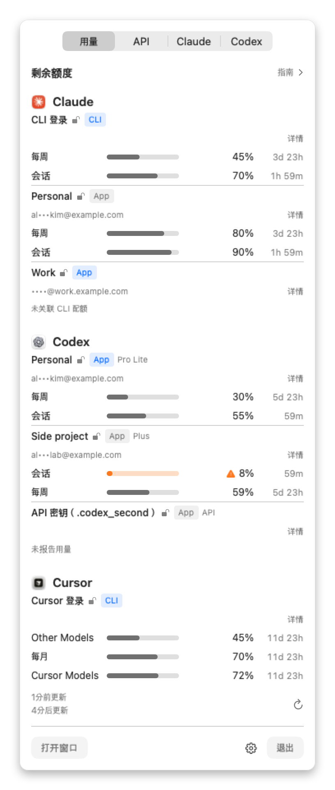
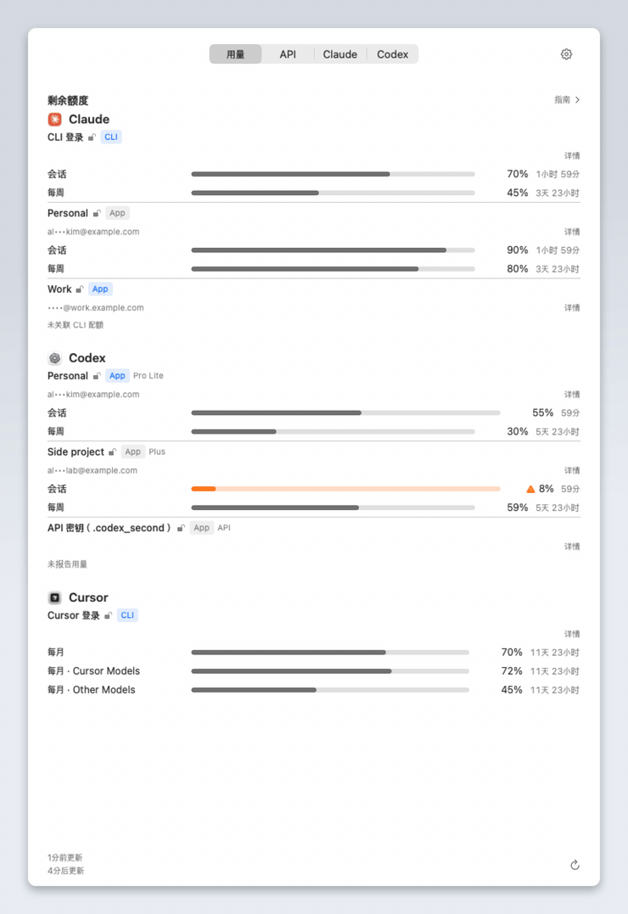
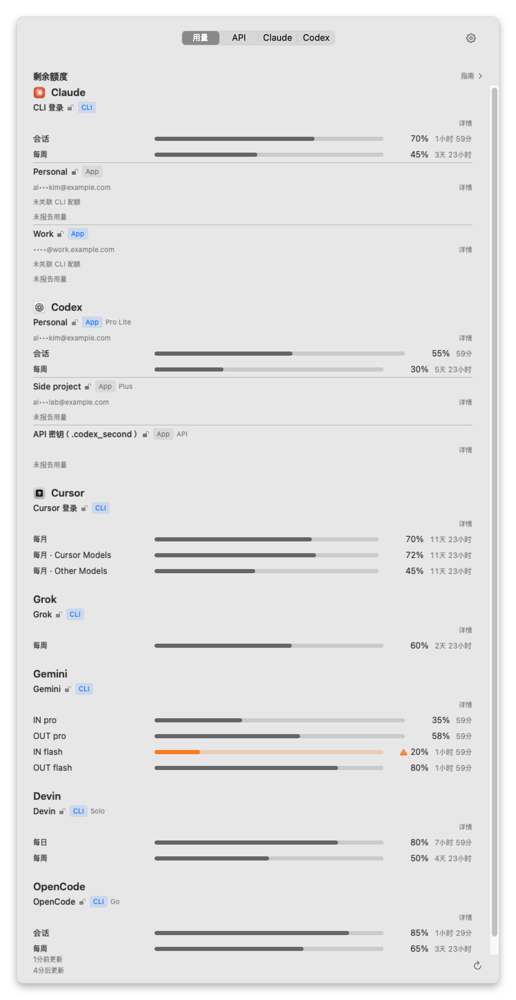
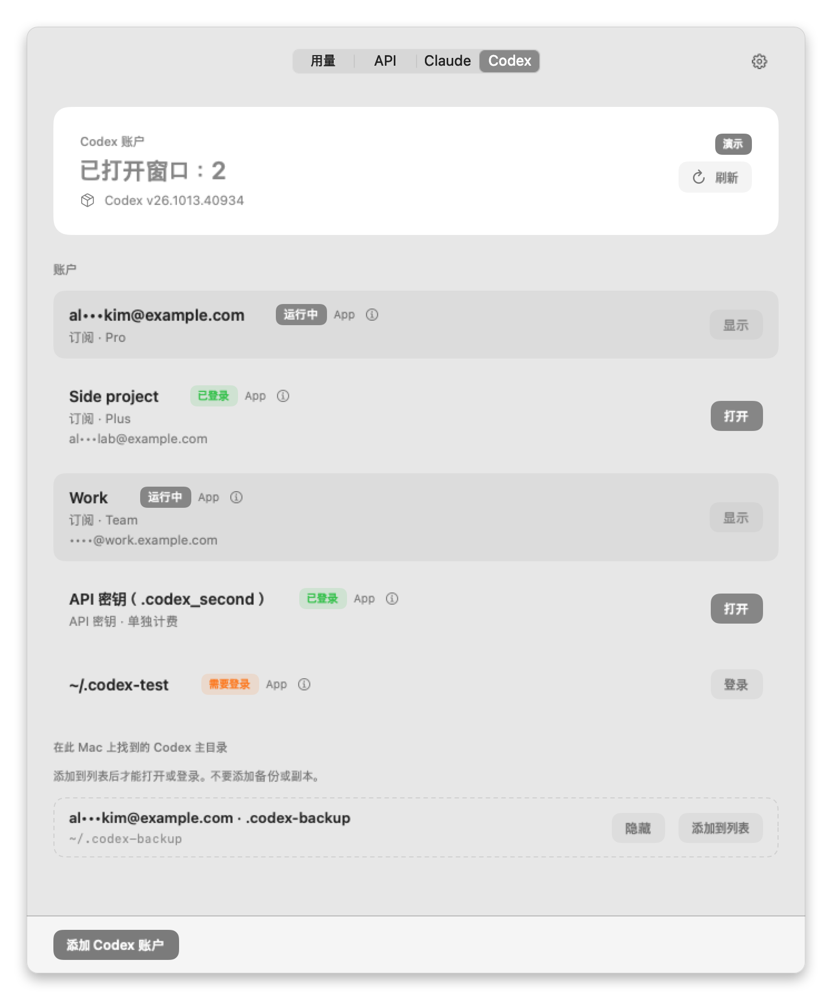
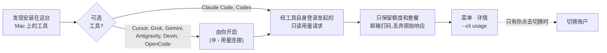

<div align="center">


# UsageSwitch

**随时看清 AI 用量还剩多少。切换账户由你决定。**

为在 Claude、Codex、Cursor 等 AI 编程工具间工作——常常同时使用多个账户——的人打造的 macOS 菜单栏原生应用。

[](https://github.com/deximple/usageswitch/releases/latest)


[](https://github.com/deximple/usageswitch/actions/workflows/ci.yml)
[](LICENSE)

[English](README.md) · [한국어](README.ko.md) · [日本語](README.ja.md) · **简体中文** · [Español](README.es.md)

<a href="https://github.com/deximple/usageswitch/releases/latest"></a>

<br><br>

<picture>
  <source media="(prefers-color-scheme: dark)" srcset="docs/screenshots/zh-Hans/menu-dark.png">
  
</picture>

<sub>本文所有截图与动画均使用应用内置演示数据，不含任何真实账户。</sub>

</div>

---

**目录** —
[功能](#功能) ·
[实际效果](#实际效果) ·
[安装](#安装) ·
[开始使用](#开始使用) ·
[读懂列表](#读懂用量列表) ·
[状态信息](#当某行显示提示信息时) ·
[支持的工具](#支持的工具) ·
[指南](#指南) ·
[切换账户](#切换账户) ·
[API 标签页](#api-标签页) ·
[设置](#设置) ·
[隐私](#隐私与安全) ·
[命令行](#命令行) ·
[常见问题](#常见问题) ·
[限制](#限制) ·
[卸载](#卸载) ·
[构建](#从源码构建)

## 功能

| | |
|---|---|
| 📊 **所有额度一目了然** | 每个账户的会话、每日、每周、每月额度，以**剩余**比例和重置时间显示。 |
| 🧭 **只显示你真在用的** | 列表只展示这台 Mac 上已安装的工具和已注册的账户。没有的工具不出现，也不会读取它的任何信息；关闭或隐藏的工具也会从列表中移除。Claude 和 Codex 的本地用量日志始终会被读取，用于指南和 API 标签页——这部分无法关闭。 |
| 💡 **只给建议，不做自动驾驶** | **指南**依据始终读取的本地日志，根据剩余量建议合适的账户、模型和强度，说明理由，并提醒哪项额度可能在重置前耗尽。它绝不自行切换、启动或登录。 |
| 🔁 **一键切换** | 在已保存的账户间更换 Claude Desktop 登录（带校验和自动回滚）；Codex 账户可在独立窗口并行使用。 |
| 🔒 **隐私优先设计** | 无分析、无遥测。只在你手动检查时检查更新，或在你允许后每天检查一次。邮箱始终打码。七个可选工具在你逐个开启前保持关闭。 |

## 实际效果

<p align="center">
  
</p>

1. **看** — 点击菜单栏图标。每个账户显示各项额度的剩余量和重置时间。
2. **得建议** — 打开**指南**，看哪个账户对你即将做的工作还有余量。
3. **切换** — 在 **Claude** 标签页点击**切换**。UsageSwitch 会重启 Claude Desktop 并以该账户登录、验证，出错时自动回滚。

每一步都由你决定。额度不足永远不会触发切换、启动或登录。

## 安装

**要求：** macOS 15 Sequoia 或更高版本，Apple silicon 或 Intel。

1. 从[最新版本](https://github.com/deximple/usageswitch/releases/latest)下载 `UsageSwitch-<version>.dmg`。
2. 打开并把 **UsageSwitch** 拖入**应用程序**。
3. 打开 UsageSwitch。它常驻菜单栏，没有 Dock 图标；从 Finder 打开时也会显示窗口。

发布版本经 Developer ID 签名并经 Apple 公证，因此 macOS 只在首次显示常规的“从互联网下载”提示。
每个版本附带 `SHA256SUMS.txt`，可用于校验下载。
更新请用 **⚙︎ › 检查更新…**。在启用了更新源的版本中，它会就地检查，安装前总会先征求你的同意；是否在后台每天再检查一次，由 Sparkle 的一次性提示决定。没有更新源的版本则打开发布页面。

## 开始使用

### 1. 看看“用量”标签页

**用量**标签页是你看到的第一个界面。Claude Code 和 Codex 的读数会自动开始，因为它们来自这些工具自己的命令行程序。
如果列表为空，说明该工具还没登录——见[状态信息](#当某行显示提示信息时)。

### 2. 开启你用的工具（可选）

Cursor、Grok、Gemini、Antigravity、Devin、OpenCode Go、GitHub Copilot **默认关闭**。对你使用的每一个：

- 点击该行上的**连接用量**，或打开 **⚙︎ › 用量连接**；
- 阅读对话框——它会明确说明读取什么、请求发往哪里；
- 点击**启用**。

在 **⚙︎ › 用量连接** 中关闭某个连接即停止读取，并从列表中移除该工具的行；重新打开即可恢复。不使用的工具也可以用该行的**隐藏**以同样方式移除。

### 3. 给已保存的 Claude 账户配上它自己的数字（可选）

Claude Desktop 登录不提供配额，所以已保存的 Claude 账户会显示**未关联 CLI 配额**，直到你把它关联到一个用同一账户登录的 Claude Code 配置：

```bash
# 为“Work”账户创建独立的 Claude Code 配置并登录
CLAUDE_CONFIG_DIR="$HOME/.claude-work" claude
```

然后在 UsageSwitch 中打开该账户的**详情** → **通过 CLI 配置目录连接用量…** → 选择文件夹（按 <kbd>⌘</kbd><kbd>⇧</kbd><kbd>.</kbd> 显示隐藏文件夹）→ **启用**。
只有当每次读取前后都确认该配置的账户/组织 ID 与 CLI 报告的组织、配置目录和邮箱与已保存账户一致时，UsageSwitch 才会显示数字。

### 4. 为切换保存账户

- **Claude** 标签页：在 Claude Desktop 已登录时点击**保存当前登录**。点击**登录其他账户**，登录后再保存。对每个账户重复。
- **Codex** 标签页：点击**添加 Codex 账户**，在浏览器中登录。在这台 Mac 上发现的现有 Codex 文件夹会列在**在此 Mac 上找到的 Codex 主目录**下；点击**添加到列表**选用。

## 读懂用量列表

每个账户是一个小卡片：先是谁，然后每个额度一行。

| 你看到 | 含义 |
|---|---|
| **Personal** | 账户显示名。在**详情** → **编辑名称**中修改。 |
|   | 读数来源：命令行登录（CLI）或桌面应用（App）。**蓝色**表示当前正在使用的登录（当前 CLI 登录或已打开的应用）。 |
| 打开的锁，强调色 | 已验证登录。 |
| 打开的锁，灰色 | 已保存登录。 |
| 闭合的锁 | 需要登录。没有锁表示 UsageSwitch 无法判断，因此不下结论。 |
| `Pro Lite`, `Plus`, `Team`… | 服务商报告的套餐。 |
| `API` · *API 密钥 · 单独计费* | API 密钥配置。按量计费，没有订阅额度，因此不计为剩余配额。 |
| `al•••kim@example.com` | 打码邮箱。开启 **⚙︎ › 始终显示电子邮件**可显示完整邮箱。 |
| `每周 ▬▬▬▭▭ 45%  3天 23小时` | 一项额度：名称、进度条、**剩余**百分比和重置时间。 |
| `Cursor Models`, `Gemini Models`… | 只适用于部分模型的额度，按服务商的命名显示。在菜单中，有多项额度的模型组（Antigravity）会单独显示一行标题，其下各行只显示 *每周*、*会话*… |
| *按此速度 5小时 后耗尽* | 按当前速度，该额度会在重置前用完。 |
| *重置券 2 张 · 首张 18天 5小时 后到期* | OpenAI 发给这个 Codex 账户的免费额度重置：有几张，以及第一张何时到期。UsageSwitch 只读取，不使用；要用请在 Codex 中自行操作。 |
| **另有 2 项上限** | 紧凑菜单中每个账户最多显示三项额度，其余在**详情**中。 |
| **详情** | 打开一个窗口，显示所有额度、重置时间、读数来源和工具版本。 |

**进度条颜色：** 有余量的条用该工具的标志色填充（Claude 为陶土橙，Gemini 和 Antigravity 为蓝色，其余为黑色，深色模式下为白色）；琥珀色加警告图标=超过你的警告线（默认已用 80%）；红色图标加空条=耗尽；变淡的灰色条=等待刷新的旧读数，或暂时无法读取的已保存 Claude 账号/Codex 登录的最近一次成功读数（附读取时间）；已过重置时间的窗口不显示数字。

**底部信息：** *1 分钟前更新 · 4 分钟后更新*。UsageSwitch 每 5 分钟刷新一次，也在额度重置后立即刷新，并可点击 ↻ 手动刷新。

**选择菜单栏显示的额度：** 在 **⚙︎ › 菜单栏用量** 中选一项额度，或右键点击额度并选择**置顶**。菜单栏随后显示该额度（例如 *每周剩余 25%*），而不是最紧张的那一项。在**菜单栏用量**中的选择优先于置顶；选回**自动（剩余最少的上限）**后，先用置顶的额度，没有则用最紧张的额度。

<p align="center">
  
</p>

## 当某行显示提示信息时

没有数字的行总会说明原因。以下是各条提示的含义和处理方法。

| 提示信息 | 原因 | 处理 |
|---|---|---|
| **需要连接用量** | 该可选工具尚未开启。 | 点击**连接用量**，或用 **⚙︎ › 用量连接**。不使用的话，点击**隐藏**。 |
| **未找到登录信息 · 请先登录 *X*** | 工具已安装但在这台 Mac 上未登录。 | 登录该工具一次。 |
| **此账号的 CLI 配置文件未登录 — 在"详情"中查看方法** | 已保存 Claude 账号关联的 CLI 配置文件已退出登录，因此以变淡的方式保留上次读数。 | 在**详情**中复制命令，在终端运行并用同一账号登录。 |
| **登录已过期 · 请在终端运行一次 *`command`*** | 已保存的登录已过期。 | 运行显示的命令：`claude auth login`、`codex login`、`cursor-agent login`、`grok login`、`gemini`、`agy`、`devin auth login`、`opencode auth login`。 |
| **登录被拒绝 · 请在终端运行一次 *`command`*** | 服务商拒绝了已保存的登录——它已被撤销、被其他应用的登录替换，或属于此工具不支持的账户。 | 运行显示的命令，并用你想查看的账户登录。 |
| **未关联 CLI 配额** | 已保存的 Claude Desktop 账户没有关联的 Claude Code 配置。 | 在**详情**中[关联配置](#3-给已保存的-claude-账户配上它自己的数字可选)。 |
| **未报告用量** | 工具应答了但没有返回用量数字：API 密钥配置（无订阅额度）、已登出的 Codex 主目录，或没有订阅额度的账户。 | 无需处理。花费估算见 [API 标签页](#api-标签页)（仅限 Codex API 密钥账户）。 |
| **此账户不适用 *X* 用量** | 服务商表示该账户的套餐没有可显示的配额。 | 无需处理。 |
| **Google 已停止为个人账号提供 Gemini CLI 配额（已迁移到 Antigravity）** | Google 已把个人账户迁移到 Antigravity。 | 开启 **Antigravity**；其 *Gemini Models* 额度显示的正是同一配额。 |
| **读取用量被拒绝** | 工具的命令行程序在没有返回用量报告的情况下停止了。 | 下次刷新时重试。若持续出现，请在终端中运行一次该工具，确认它已登录且工作正常。 |
| **返回的是其他账户的用量，因此不显示** | 读取期间登录发生了变化。UsageSwitch 绝不显示别的账户的数字。 | 等待下次刷新。 |
| **无法读取用量 — 此 *X* 版本可能需要更新 UsageSwitch** | 工具的响应格式变了。 | 检查是否有新版 UsageSwitch，或[提交问题](https://github.com/deximple/usageswitch/issues)。 |
| **读取用量超时** · **无法连接服务** · **已达速率限制 — 请稍后再试** | 暂时性的网络或服务问题。 | 下次刷新时自动重试。 |
| **找不到命令行工具** | 该工具的命令行程序未安装或不在 `PATH` 上。 | 安装它，或检查 `PATH`。 |
| **存在管理配置 — 无法读取用量** | 你的组织管理着这台 Mac 上的 Claude Code 设置。 | 属预期行为。UsageSwitch 不在此读取用量。 |
| **已过重置时间 — 需要刷新** | 自上次读取后额度已重置。 | 点击 ↻ 或稍等片刻。 |

## 支持的工具

| 工具 | 显示内容 | 数字来源 | 开启方式 |
|---|---|---|---|
| **Claude Code** | 会话（5 小时）、每周和按模型的每周额度 | `claude` CLI 的 `/usage` | 自动 |
| **已保存的 Claude Desktop 账户** | 同 Claude Code | 你关联的 Claude Code 配置（`claude auth status`，然后 `/usage`） | 每个账户在**详情**中开启 |
| **Codex** | 会话和每周额度，按 ChatGPT 账户，以及账户持有的额度重置券 | `codex app-server` | 自动 |
| **Cursor** | 月度总额，外加 *Cursor Models* 和 *Other Models* | Cursor 用量 API，使用 `cursor-agent` 登录 | ⚙︎ › 用量连接 |
| **Grok** | 每周额度 | Grok CLI 的用量端点 | ⚙︎ › 用量连接 |
| **Gemini** | 按模型的输入/输出额度 | Gemini Code Assist 配额，使用 Gemini CLI 登录 | ⚙︎ › 用量连接 |
| **Antigravity** | 模型组额度（例如 *Gemini Models*） | `agy` 的 `/usage` 界面，以及每次刷新时调用的只读配额 API（无法读取界面时显示该数值） | ⚙︎ › 用量连接 |
| **Devin** | Devin CLI 报告的配额 | Devin CLI 的用户状态 | ⚙︎ › 用量连接 |
| **OpenCode Go** | 滚动 5 小时、每周和每月额度 | OpenCode 的 Go 用量端点 | ⚙︎ › 用量连接 |

当工具的命令行程序位于 `PATH`（或 `~/.local/bin`、常见的 npm、bun、Volta 目录、`/opt/homebrew/bin`、`/usr/local/bin`）中，或其应用位于 `/Applications` 或 `~/Applications` 时，该工具就会被列出。发现工具永远不会去运行它。

<details>
<summary><b>每个可选连接具体读取和发送的内容</b></summary>

<br>

每个可选连接都读取该工具自己的本地登录信息，只在内存中保存，并只向固定的允许列表发送只读 HTTPS 请求——每个工具一个主机，Gemini 和 Antigravity 为两个（其配额端点加上用于令牌刷新的 `oauth2.googleapis.com`）。重定向一律拒绝，响应上限 1 MiB。不记录、不保存任何东西。

| 工具 | 读取的本地登录 | 连接的主机 | 说明 |
|---|---|---|---|
| Cursor | Cursor 的钥匙串项，然后 `~/.cursor/auth.json` | `api2.cursor.sh` | 每次刷新一次请求。过期令牌不发送请求。浏览器 `cursor-agent login` 约维持 60 天；API 密钥登录约 1 小时。不读取 Grok Bot 和按需付费。 |
| Grok | Grok CLI 的登录文件 | `cli-chat-proxy.grok.com` | 实验性。 |
| Gemini | Gemini CLI 的钥匙串项，然后 `~/.gemini/oauth_creds.json` | `cloudcode-pa.googleapis.com`, `oauth2.googleapis.com` | 若访问令牌过期，UsageSwitch 用已保存的刷新令牌和已安装 Gemini CLI 自带的登录客户端获取仅保存于内存的临时令牌。不回写任何内容。每次刷新最多三次请求。 |
| Antigravity | 在隐藏终端中从你的主目录运行的 `agy` 本体（最多每 9 分钟一次）；agy 的钥匙串项（钥匙串没有时读取 `~/.gemini/jetski-standalone-oauth-token`）在每次刷新时读取 | `oauth2.googleapis.com`, `cloudcode-pa.googleapis.com` | `agy` 以其正常设置启动，包括你配置的任何 MCP 服务器。UsageSwitch 从不回答 agy 的提示。macOS 可能会弹出一次钥匙串访问授权。 |
| Devin | Devin CLI 的凭据和版本 | `server.codeium.com` | 需要受支持的 Devin CLI 版本。 |
| OpenCode Go | OpenCode `auth.json` 中的 `opencode-go` 条目 | `opencode.ai` | 仅 Go 套餐，不含其他 OpenCode 用量。 |

这些都是私有端点，不是稳定的公开 API。服务商的更新可能在 UsageSwitch 更新前导致读取失败——届时该行会说明情况，而不是显示错误数字。
读写文件的完整清单见 [PRIVACY.md](PRIVACY.md)（英文）。

</details>

## 指南

点击列表上方的**指南**打开。旁边的小点表示建议已就绪（可用 **⚙︎ › 显示指南指示点** 关闭）。

- **模式** — 限制建议可以选用的模型强度和投入量：

  | 模式 | 最多建议 |
  |---|---|
  | *节省* | 中端模型、中等投入 |
  | *平衡* | 前沿模型中等投入，或中端模型高投入 |
  | *专注* | 前沿模型、高投入 |
  | *紧急* | 前沿模型、最高投入——会先询问，并在下一次 5 小时 Claude 重置（或 5 小时后）回到 *平衡* |

- **任务** — 从*简单编码*到*最大化推理*滑动，说明你将要做的工作。
- **建议** — 一行指出当前剩余量下合适的服务商和账户、模型和投入（*建议: …*；只有一个账户可比较时为 *可用: …*）。当没有合适的模型建议时，指南显示可比订阅账户中余量最多的一个。API 密钥配置永远不会被建议。
- **建议依据** — 展开后可看到与建议比较过的最多 4 个账户（卡住的额度、剩余比例、重置时间），以及**未纳入**的账户：已到警告线、可能在重置前耗尽，或在等待新的读数。
- **往后看** — 按各项额度的速度（两次读数对得上时用最近的速度，否则用至今的平均速度），按先后列出最多 3 个可能在重置前耗尽的账户。额度周期过去 15% 之前不做预测。即将重置的额度会把不用就会清零的部分算进去，所以每周重置前 3 小时还剩 60% 的账户，会排在还有 6 天、剩 70% 的账户之前。对建议的账户会加一行，例如 *平均使用的话，每天约 15% 可撑到重置*。
- **更轻的组合** — 当某个账户可能耗尽、且它的日志显示最近一天主要用了什么时，指南会给出同一厂商更轻的模型或投入（*更轻的组合：…*）。这只指出方向，不承诺节省多少。
- **没有账户有余量时** — 显示 *目前没有账户有余量。* 以及最先恢复的额度。无法排名但仍有余量的工具（Cursor、Devin、Copilot、Antigravity）以 *未参与排名但有余量* 列出，最多 2 个。
- **重置券** — 额度已用完的 Codex 账户若持有重置券会被指出（*可自行使用*），2 天内到期的重置券也会被指出。

预测是根据已显示的读数做出的估计。指南只提建议：它不会切换、登录或使用重置券。要不要执行由你自己切换。

<details>
<summary><b>指南读取和保存的内容</b></summary>

<br>

- **读取：** 你的用量读数，以及本地 Claude Code 和 Codex 会话日志中的模型、投入、时间戳和 token 数字段。绝不读取对话内容。
- **模型数据：** 随应用内置的固定模型目录。运行时不下载任何内容。
- **保存：** 以加盐账户哈希为键的小型本地学习文件——不含姓名、邮箱或内容。原始文件 14 天后归档，180 天后删除。
- **删除：** **⚙︎ › 清除学习数据**立即删除。你的模式和任务设置保留。

</details>

## 切换账户

### Claude Desktop（Claude 标签页）

先把每个账户的 Claude Desktop 登录各保存一次，然后在任一账户上点击**切换**。一次切换会：

1. 如有正在运行的 Claude Code 会话，先询问（会话历史保留）；
2. 暂停任何会在切换中重启 Claude 的进程，然后正常退出 Claude——绝不强制退出；
3. 交换本地登录，启动 Claude，并从其日志确认账户；
4. 任一步骤失败则回滚到原账户。

首次切换会为原登录做一次性备份。服务器端不会发生任何登出。
**登录其他账户**只清除这台 Mac 上的登录，且只发生在当前登录已保存之后。

### Codex（Codex 标签页）

每个 Codex 账户有独立的 Codex 文件夹并在独立窗口中打开，因此多个账户可以并行运行。
登录始终走 Codex 自己的 `codex login`（浏览器），登录文件绝不在文件夹间复制。
**移除**会在本机登出该账户并把文件夹移到废纸篓。**从列表中移除**只是隐藏在此 Mac 上找到的 Codex 主目录。标准的 `~/.codex` 不能被移除。

<p align="center">
  
</p>

## API 标签页

面向使用 API 密钥而非订阅的账户：

- **预算** — 为 Anthropic、OpenAI、Google、xAI 设置预付余额或月度配额（含重置日）。
- **估算** — 过去 7 天的花费、日均费率和预算大约还能撑几天。仅根据 API 密钥账户的本地 CLI 日志估算，绝不向服务商查询。
- **API 密钥保险库** — 在应用中添加、显示或删除密钥时会要求 Touch ID 或密码。密钥存放在登录钥匙串，遵循钥匙串自身的访问规则。密钥绝不会发往任何地方。

## 设置

一切都在 **⚙︎** 菜单中。

| 设置 | 作用 |
|---|---|
| 语言 | English、한국어、日本語、简体中文、Español。默认跟随系统。 |
| 外观 | 跟随系统、浅色或深色。 |
| 登录时打开 | 登录时启动 UsageSwitch。 |
| 在菜单栏中显示账户名称 | 在图标旁显示当前 Claude 账户名（邮箱仍然打码）。 |
| 始终显示电子邮件 | 显示完整邮箱而非打码。 |
| 在菜单栏显示用量 | 在图标旁显示一项额度，例如 *每周剩余 25%*。默认开启。 |
| 菜单栏用量 | 选择显示哪一项。**自动（剩余最少的上限）**先用置顶的额度，否则用未耗尽的额度中剩余最少的一项；也可以从列表中选定一项。 |
| 用量提醒 · 用量警告阈值 | 某项额度已用超过 70%、80%（默认）或 90% 时发送 macOS 通知。 |
| 显示指南指示点 | 建议就绪时**指南**旁的小点。 |
| 用量连接 | 开关每个可选工具；关闭的工具会从用量列表中移除。只列出在此 Mac 上找到的工具。 |
| 清除学习数据 | 删除指南的本地学习文件。 |
| 在访达中显示数据文件夹 | 打开 `~/Library/Application Support/com.jaysong.usageswitch/`。 |
| 检查更新… | 启用更新功能时检查更新源；否则在浏览器中打开发布页面。 |

## 隐私与安全



**UsageSwitch 绝不会：**

- 因为额度低而切换账户、打开应用或登录；
- 发送模型请求或执行任务——读取用量不产生任何费用；
- 在服务器端登出，或解密 Claude 的 Cookie;
- 保存或记录为读取用量而取得的令牌，或把它们发到该工具主机以外的任何地方；
- 发送分析、遥测或崩溃报告，或在后台自行更新。

**它保存的内容** — 全部位于 `~/Library/Application Support/com.jaysong.usageswitch/`，仅你可读：
已保存的 Claude Desktop 登录（仍按 Claude 原样加密保存）、你添加的 Codex 文件夹、设置、邮箱打码的最近用量读数，以及指南的学习文件。

所有读取、写入的文件和连接的主机的完整清单见 **[PRIVACY.md](PRIVACY.md)**（英文）。如需私下报告安全问题，见 [SECURITY.md](SECURITY.md)。

## 命令行

应用二进制同时也是一个 JSON 命令行工具。

```bash
APP=/Applications/UsageSwitch.app/Contents/MacOS/UsageSwitch

"$APP" --cli usage            # 最近的用量读数(JSON)
"$APP" --cli status           # 已保存的 Claude 账户及 Claude 状态
"$APP" --cli codex status     # Codex 账户
"$APP" --cli switch Work      # 把 Claude Desktop 切换到名为 "Work" 的账户
"$APP" --cli                  # 列出所有命令
```

**2.2.0 变更：** `remove` 和 `codex remove` 需要 `--yes` 确认——不带该参数会以 `needs_confirmation`（退出码 3）结束，且不做任何更改。

`--cli usage` 输出应用最近读取并保存的内容。它不接触任何工具或网络，所以先打开 UsageSwitch 一次。邮箱始终打码。

<details>
<summary><b>输出示例，以及用 <code>jq</code> 生成一行摘要</b></summary>

<br>

```json
{
  "ok" : true,
  "result" : {
    "accounts" : [
      {
        "accountRef" : "codex#1",
        "authentication" : "subscription",
        "id" : "codex#1",
        "label" : "al•••kim@example.com",
        "plan" : "prolite",
        "provider" : "codex",
        "readAt" : "2026-11-09T05:10:00Z",
        "state" : "ok",
        "toolVersion" : "0.166.0",
        "windows" : [
          {
            "durationMinutes" : 10080,
            "kind" : "weekly",
            "leftPercent" : 69,
            "resetsAt" : "2026-11-13T14:00:00Z",
            "usedPercent" : 31
          }
        ]
      },
      {
        "accountRef" : "current",
        "authentication" : "unknown",
        "id" : "gemini:current",
        "label" : "Gemini",
        "problem" : "notEligible",
        "provider" : "gemini",
        "readAt" : "2026-11-09T05:10:00Z",
        "state" : "unavailable",
        "windows" : []
      }
    ],
    "generatedAt" : "2026-11-09T05:10:00Z"
  }
}
```

`state` 为 `ok`、`notReporting`、`unavailable` 或 `failed`;`problem` 说明原因。账户 ID 是不透明的，顺序随列表变化。

```bash
"$APP" --cli usage | jq -r '.result.accounts[]
  | "\(.provider)\t\(.label)\t\([.windows[] | "\(.scope // .kind) \(.leftPercent | floor)% left"] | join(", "))"'
```

会改变状态的命令（`switch`、`capture`、`enroll`、`remove`、`codex add` 等）把进度打印到 stderr，失败时返回非零退出码。当 Claude Code 会话正在运行时，`switch` 会要求 `--yes`。
`usageswitch://switch?id=<account-id>` 链接在你在应用中确认后，执行与按钮相同的切换。

</details>

## 常见问题

<details>
<summary><b>额度低了它会自动帮我切换吗？</b></summary>

不会。读数和建议只用于显示。只有你的点击（或你运行的命令）才会触发切换、启动或登录。

</details>

<details>
<summary><b>读取用量要花钱吗？会用掉我的配额吗？</b></summary>

不会。UsageSwitch 不发送模型请求。它只通过只读命令和端点向各工具询问用量。

</details>

<details>
<summary><b>我用的工具不在列表里。</b></summary>

只有当 UsageSwitch 在 `PATH`（或常见的 npm、bun、Volta 目录）中找到工具的命令行程序，或其应用位于 `/Applications` / `~/Applications` 时才会列出。Cursor、Grok、Gemini、Antigravity、Devin、OpenCode 还需要 **⚙︎ › 用量连接**。

</details>

<details>
<summary><b>为什么已保存的 Claude 账户显示“未关联 CLI 配额”？</b></summary>

Claude Desktop 登录不公开用量。请关联一个用同一账户登录的 Claude Code 配置——见[第 3 步](#3-给已保存的-claude-账户配上它自己的数字可选)。UsageSwitch 绝不根据邮箱猜测关联关系。

</details>

<details>
<summary><b>Cursor 一直提示登录过期。</b></summary>

UsageSwitch 使用 `cursor-agent` 保存的登录，自身不续期。浏览器 `cursor-agent login` 约维持 60 天，API 密钥登录约 1 小时。运行 `cursor-agent login` 并选择浏览器登录。

</details>

<details>
<summary><b>Gemini 显示提示信息而不是数字。</b></summary>

Google 已停止为个人账号提供 Gemini CLI 配额并将其迁到 Antigravity。开启 **Antigravity**：其 *Gemini Models* 额度就是同一配额。

</details>

<details>
<summary><b>共享屏幕时使用安全吗？</b></summary>

邮箱默认在所有位置打码，包括菜单栏。即使开启**始终显示电子邮件**，保存的用量文件和 `--cli usage` 输出也始终打码。其他 CLI 输出（`--cli status`、`--cli codex status`、`--cli switch`、`--cli capture`）会原样打印账户的完整邮箱。

</details>

<details>
<summary><b>UsageSwitch 是 Anthropic、OpenAI 或其他服务商做的吗？</b></summary>

不是。它是一个独立的开源项目，与它们均无隶属或背书关系。

</details>

## 限制

- Claude Desktop 的切换依赖 Claude 的内部文件。若 Claude 更新改变了这些文件，切换会安全失败并回滚，直到 UsageSwitch 更新。
- 已保存的 Claude 登录可能过期或被撤销。届时该行会要求你**需重新登录**。
- 把登录保存在钥匙串中的 Codex 文件夹（`cli_auth_credentials_store = "keyring"`）可能显示为未登录。
- 可选连接使用可能随时变化的私有端点。
- UsageSwitch 显示各服务商报告的额度，不显示服务商余额或账单；API 标签页只有本地估算。

## 卸载

1. 可选：先在 **API** 标签页删除你的 API 密钥——卸载后它们仍留在钥匙串中。
2. 可选：要登出你添加的 Codex 账户，先在 **Codex** 标签页中移除它们。
3. 关闭 **⚙︎ › 登录时打开**，退出 UsageSwitch，移到废纸篓。
4. 可选：删除 `~/Library/Application Support/com.jaysong.usageswitch/`。里面保存着你的登录、设置和在 UsageSwitch 中添加的 Codex 文件夹，保留还需要的内容。

## 从源码构建

需要 macOS 15 或更高版本上的 Xcode 26 或更高版本（macOS 26 SDK）。

```bash
swift build                    # 调试构建
./scripts/test.sh              # 测试和覆盖率报告
python3 scripts/check-l10n.py  # 检查五种语言都包含全部字符串
./scripts/bundle.sh            # 通用版 build/UsageSwitch.app(有 Developer ID 则签名,否则 ad-hoc)
./scripts/vendor-drift.sh      # 检查已安装的厂商 CLI 输出是否仍是应用读取的格式(docs/vendor-drift.md)
```

要在没有任何账户的情况下试用界面，用演示数据运行该应用包——它不会碰你的真实数据：

```bash
build/UsageSwitch.app/Contents/MacOS/UsageSwitch --ui-fixture usage-seven
```

`./scripts/readme-screenshots.sh` 会用同一套演示数据，以五种语言重新生成本 README 的所有图片。

发布版通过 `scripts/notarize.sh` 公证，需要已有的 `NOTARY_PROFILE` 钥匙串配置文件。发布版不能使用 ad-hoc 回退。
欢迎提出问题和拉取请求。变更记录见 [CHANGELOG.md](CHANGELOG.md)，设计笔记见 [DESIGN.md](DESIGN.md)。

## 致谢

独立开源项目——与 Anthropic、OpenAI、Anysphere（Cursor）、xAI、Google、Cognition（Devin）、SST（OpenCode）均无隶属或背书关系。产品名称归各自所有者。
相关社区项目：[CodexBar](https://github.com/steipete/CodexBar)、[claudepot-app](https://github.com/xiaolai/claudepot-app)、[claude-desktop-accounts](https://github.com/5eanxlee/claude-desktop-accounts)、[Swivel](https://github.com/jspanji/Swivel)、[claude-graft](https://github.com/aaditya-v-more/claude-graft)。

## 许可证

[MIT](LICENSE) © 2026 Jay Song
